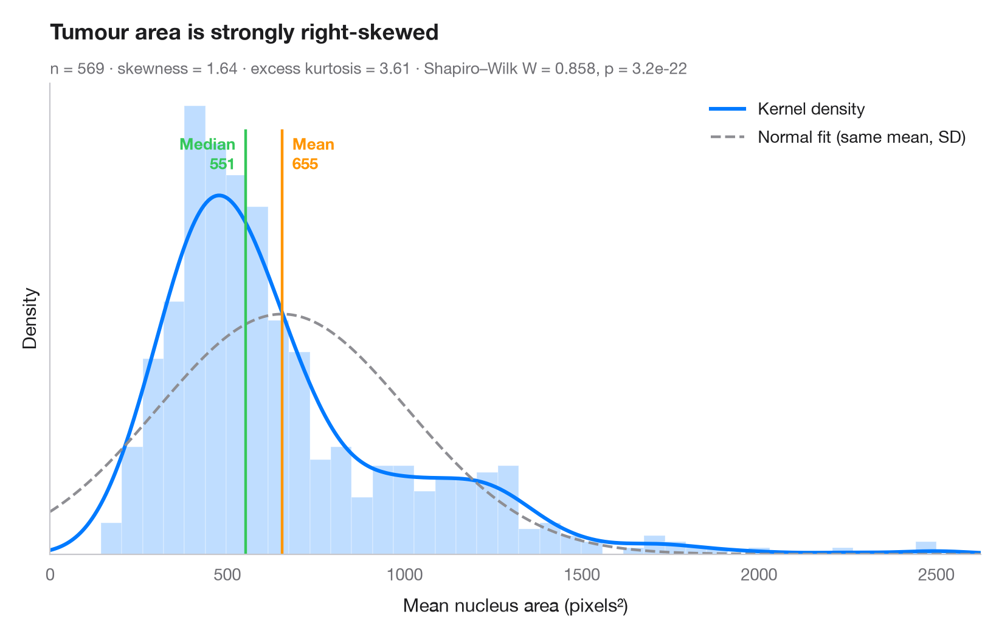
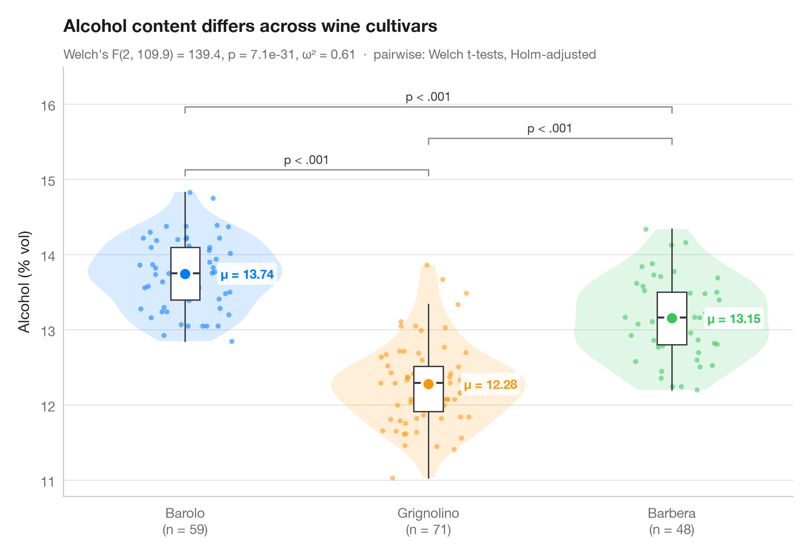
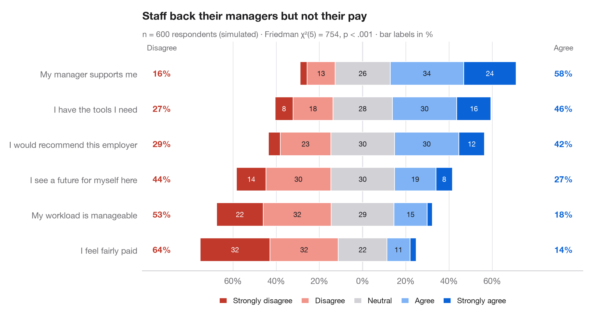
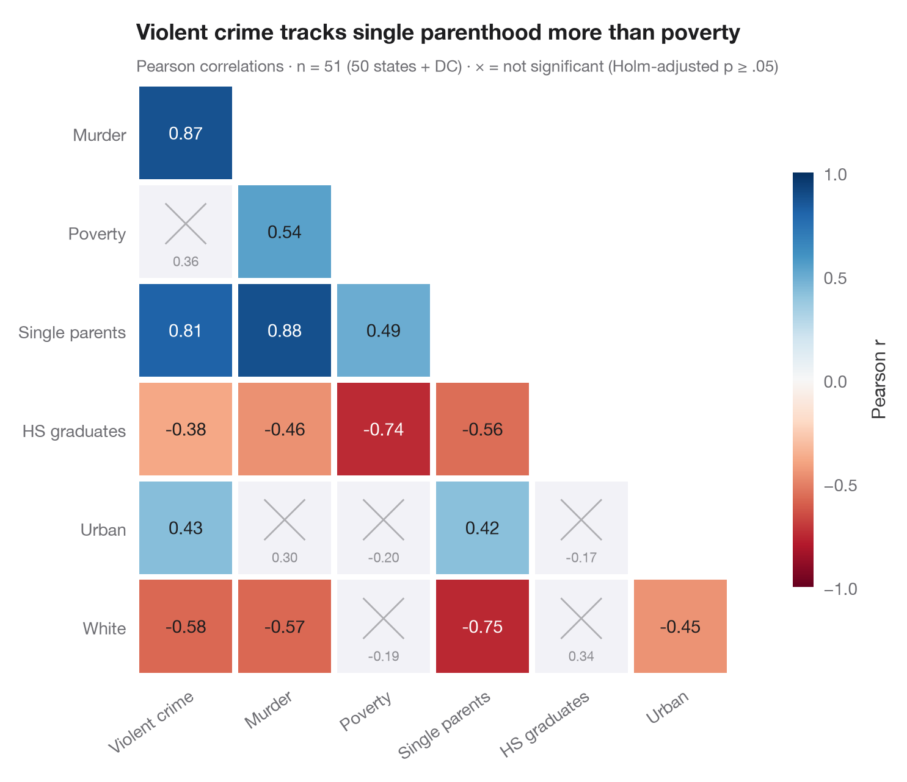
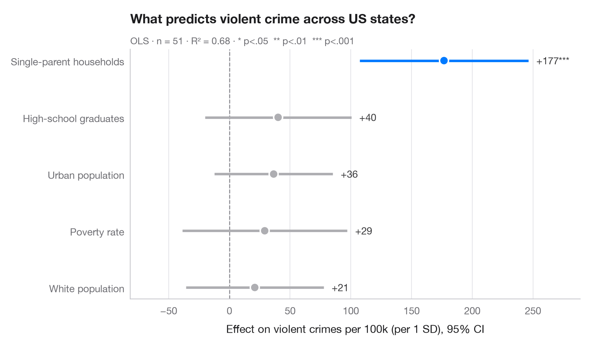
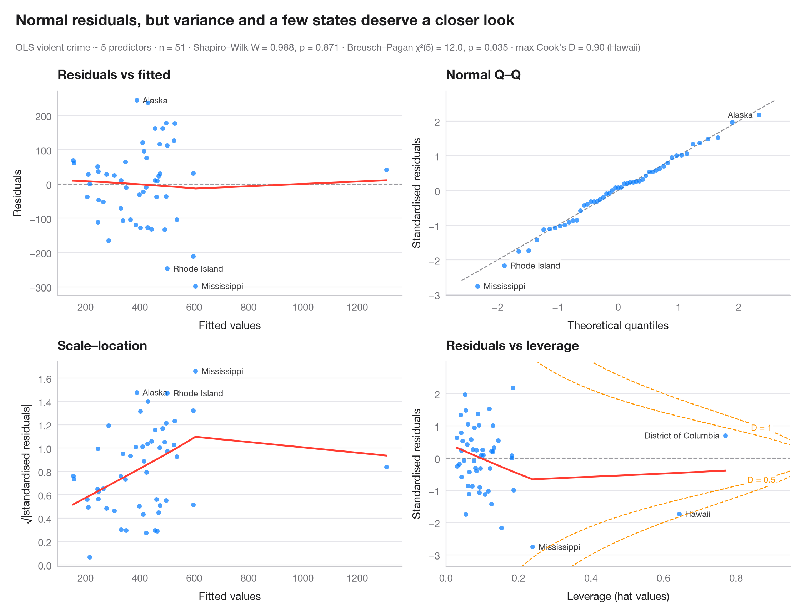
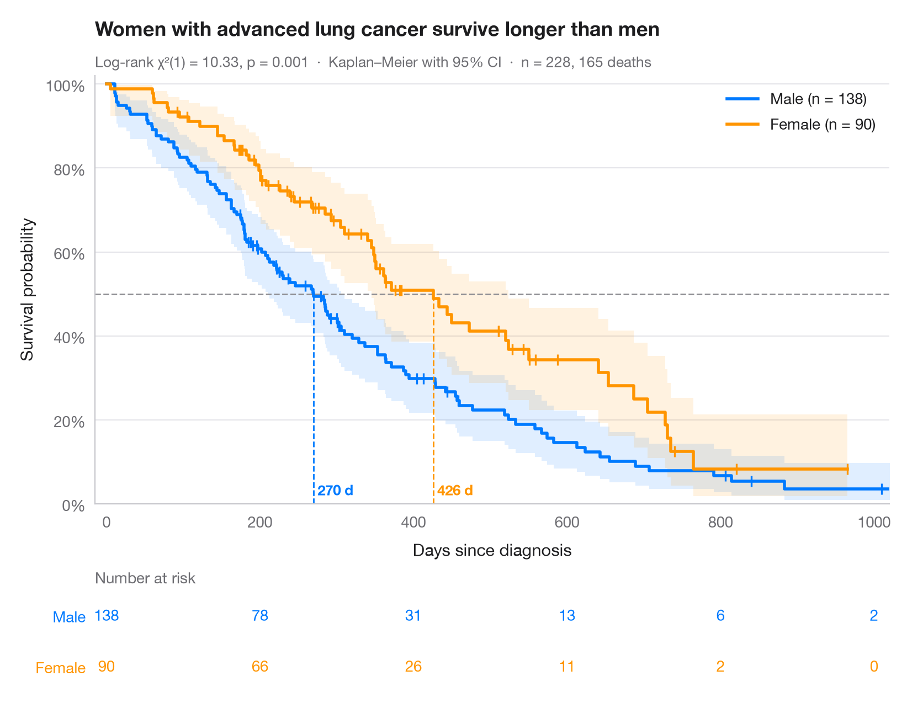
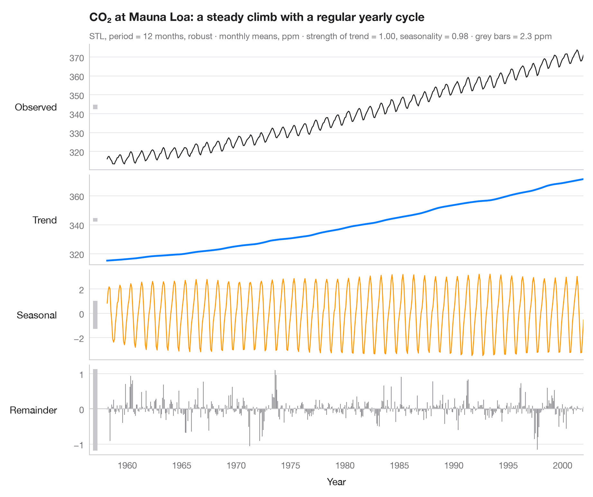
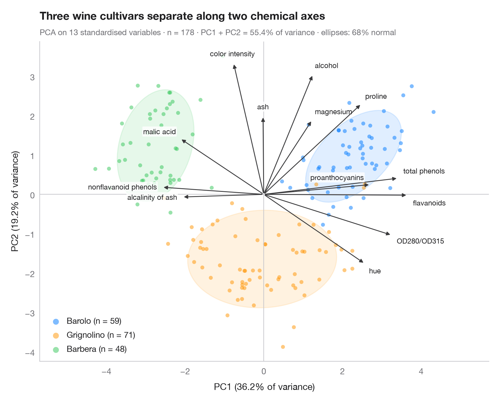
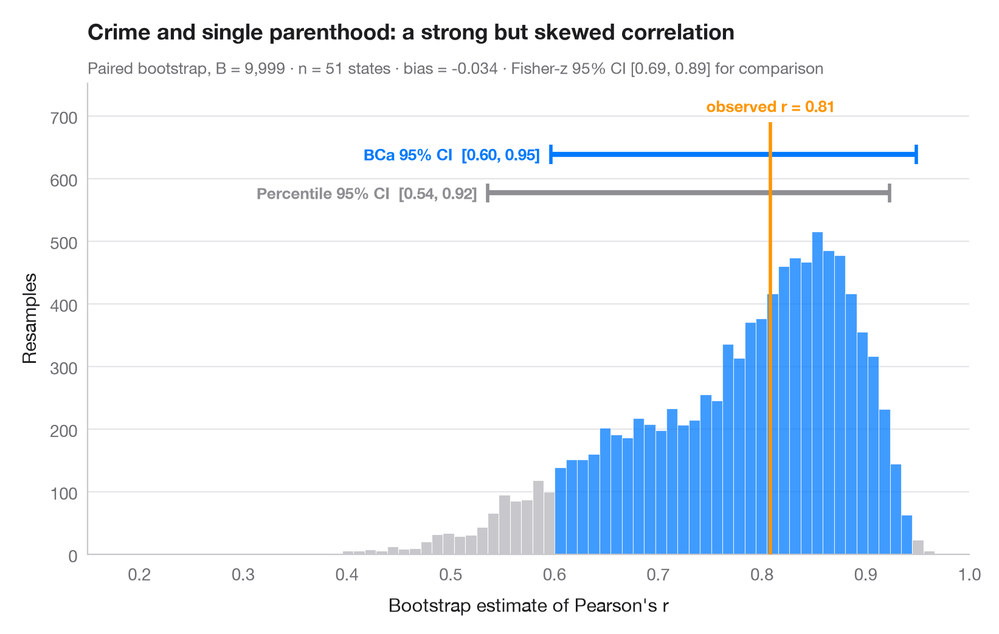

<p align="center">
  
</p>

<h1 align="center">Statlas</h1>

<p align="center"><b>The Python gallery of statistical graphics.</b><br>
48 charts · 10 families · copy‑paste Python code · inspired by the R Graph Gallery, <code>ggstats</code> and <code>ggstatsplot</code>.</p>

<p align="center">
  <a href="https://warint.github.io/statlas/"><b>Browse the gallery →</b></a>
</p>

---

Statlas is a curated atlas of **statistical** charts for Python: coefficient plots, odds‑ratio forests, Likert scales, Kaplan–Meier curves with risk tables, regression diagnostics, Bland–Altman, meta‑analysis forests and more. Each chart is a single, self‑contained script built on **NumPy, pandas, Matplotlib, seaborn, SciPy, statsmodels, scikit‑learn and lifelines** — no downloads, no hidden helpers.

## The repository *is* the gallery

```
gallery/
  <NN-family>/
    _category.yaml        family title + summary
    <NN-chart>/
      plot.py             the code (metadata in the docstring)
      plot.png            the rendered figure
      README.md           browsable on GitHub
```

Browse the folders right here on GitHub, or visit the [website](https://warint.github.io/statlas/).

## Families

| | |
|:--|:--|
| [](gallery/01-distributions/) | **[Distributions](gallery/01-distributions/)** — See the shape of your data: histograms, densities, ridgelines, ECDFs and Q–Q plots.<br><sub>[Histogram with density](gallery/01-distributions/01-histogram-density/) · [Raincloud plot](gallery/01-distributions/02-raincloud/) · [Ridgeline plot](gallery/01-distributions/03-ridgeline/) · [ECDF comparison](gallery/01-distributions/04-ecdf-comparison/) · [Q–Q plot with confidence band](gallery/01-distributions/05-qq-plot/)</sub> |
| [](gallery/02-group-comparisons/) | **[Group comparisons](gallery/02-group-comparisons/)** — Compare groups with the test, effect size and p-values on the chart — the ggstatsplot way.<br><sub>[Between-groups comparison](gallery/02-group-comparisons/01-between-groups-violin/) · [Within-subjects comparison](gallery/02-group-comparisons/02-within-subjects/) · [Estimation plot](gallery/02-group-comparisons/03-estimation-plot/) · [Interaction plot](gallery/02-group-comparisons/04-means-with-ci/) · [Tukey HSD intervals](gallery/02-group-comparisons/05-tukey-hsd/)</sub> |
| [](gallery/03-proportions-surveys/) | **[Proportions & surveys](gallery/03-proportions-surveys/)** — Proportions, cross-tabs and Likert scales, in the spirit of ggstats::gglikert and stat_prop.<br><sub>[Diverging Likert chart](gallery/03-proportions-surveys/01-likert-diverging/) · [Stacked proportions by group](gallery/03-proportions-surveys/02-stacked-proportions/) · [Mosaic plot with Pearson residuals](gallery/03-proportions-surveys/03-mosaic-plot/) · [Proportions with confidence intervals](gallery/03-proportions-surveys/04-proportions-with-ci/) · [Cross-table with standardized residuals](gallery/03-proportions-surveys/05-crosstab-residuals/)</sub> |
| [](gallery/04-correlation/) | **[Correlation & association](gallery/04-correlation/)** — Correlation matrices, scatterplots with statistics and pairwise relationships.<br><sub>[Correlation matrix](gallery/04-correlation/01-correlation-matrix/) · [Scatterplot with statistics](gallery/04-correlation/02-scatter-with-stats/) · [Pairs plot with correlations](gallery/04-correlation/03-pairs-plot/) · [Correlogram with clustering](gallery/04-correlation/04-correlogram-bubble/)</sub> |
| [](gallery/05-regression-models/) | **[Regression models](gallery/05-regression-models/)** — Coefficient plots, odds ratios, model comparison and marginal effects — ggcoef_model for Python.<br><sub>[Coefficient plot](gallery/05-regression-models/01-coefficient-plot/) · [Odds-ratio forest plot](gallery/05-regression-models/02-odds-ratio-forest/) · [Comparing nested models](gallery/05-regression-models/03-compare-models/) · [Predicted probabilities](gallery/05-regression-models/04-predicted-probabilities/) · [Interaction effects](gallery/05-regression-models/05-interaction-effects/) · [Quantile regression process](gallery/05-regression-models/06-quantile-regression/)</sub> |
| [](gallery/06-model-diagnostics/) | **[Model diagnostics](gallery/06-model-diagnostics/)** — Residuals, leverage, calibration and ROC curves: check before you trust a model.<br><sub>[Residual diagnostics](gallery/06-model-diagnostics/01-residual-diagnostics/) · [Influence plot](gallery/06-model-diagnostics/02-influence-plot/) · [ROC curves](gallery/06-model-diagnostics/03-roc-curve/) · [Calibration plot](gallery/06-model-diagnostics/04-calibration-plot/) · [Added-variable plots](gallery/06-model-diagnostics/05-partial-regression/)</sub> |
| [](gallery/07-survival/) | **[Survival analysis](gallery/07-survival/)** — Kaplan–Meier curves with risk tables, cumulative hazards and Cox model hazard ratios.<br><sub>[Kaplan–Meier curves](gallery/07-survival/01-kaplan-meier/) · [Cox hazard ratios](gallery/07-survival/02-cox-hazard-ratios/) · [Cumulative hazard](gallery/07-survival/03-cumulative-hazard/) · [Adjusted survival curves](gallery/07-survival/04-adjusted-survival/)</sub> |
| [](gallery/08-time-series/) | **[Time series](gallery/08-time-series/)** — Decomposition, autocorrelation, forecasts with prediction intervals and change over time.<br><sub>[STL decomposition](gallery/08-time-series/01-stl-decomposition/) · [ACF and PACF](gallery/08-time-series/02-acf-pacf/) · [SARIMA forecast](gallery/08-time-series/03-arima-forecast/) · [Seasonal subseries plot](gallery/08-time-series/04-seasonal-subseries/)</sub> |
| [](gallery/09-multivariate/) | **[Multivariate & clustering](gallery/09-multivariate/)** — PCA biplots, scree plots, clustering and heatmaps for high-dimensional data.<br><sub>[PCA biplot](gallery/09-multivariate/01-pca-biplot/) · [Scree plot](gallery/09-multivariate/02-scree-plot/) · [Silhouette plot for k-means](gallery/09-multivariate/03-silhouette-clusters/) · [Clustered heatmap](gallery/09-multivariate/04-clustered-heatmap/)</sub> |
| [](gallery/10-inference-uncertainty/) | **[Inference & uncertainty](gallery/10-inference-uncertainty/)** — Bootstrap, confidence intervals, power, agreement and meta-analysis forest plots.<br><sub>[Bootstrap distribution](gallery/10-inference-uncertainty/01-bootstrap-distribution/) · [What a 95% confidence interval means](gallery/10-inference-uncertainty/02-confidence-intervals/) · [Power curve](gallery/10-inference-uncertainty/03-power-curve/) · [Bland–Altman plot](gallery/10-inference-uncertainty/04-bland-altman/) · [Meta-analysis forest plot](gallery/10-inference-uncertainty/05-meta-analysis-forest/) · [Funnel plot](gallery/10-inference-uncertainty/06-funnel-plot/)</sub> |

## Use a chart

```bash
pip install -r requirements.txt
python gallery/05-regression-models/01-coefficient-plot/plot.py
```

For the exact look of the gallery, drop [`statlas.mplstyle`](statlas.mplstyle) next to your script and add `plt.style.use("statlas.mplstyle")`.

## Build the site

```bash
python -m venv .venv && source .venv/bin/activate
pip install -r requirements.txt
python build.py            # renders new/changed charts, READMEs and docs/
```

The website in `docs/` is served by GitHub Pages.

## Contributing

New charts are welcome — see [CONTRIBUTING.md](CONTRIBUTING.md).

## License

MIT
