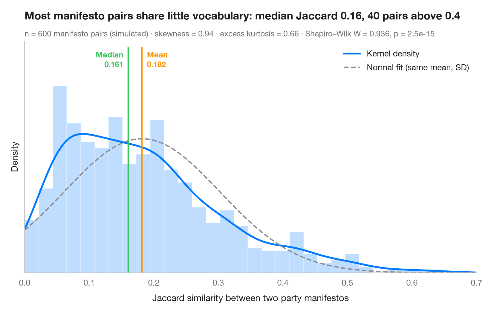

# Histogram with density

> Histogram, kernel density and fitted normal curve, with shape statistics.



The first look at any continuous variable. Bars show the empirical
distribution on a density scale, the solid curve is a kernel density estimate
(KDE) and the dashed curve is the normal distribution with the same mean and
standard deviation. When the two curves disagree, the data are not normal —
here a similarity index bounded between 0 and 1 piles up near zero, and its
long right tail pulls the **mean** above the **median**.

The setting is Sanger & Warin (2019, *Data in Brief*), a dataset of Jaccard
similarity indices between European party manifestos. The numbers here are
**simulated** for illustration (a Beta distribution, n = 600 manifesto pairs)
and are not the paper's data or results. `scipy.stats.gaussian_kde` draws
the density, `scipy.stats.skew` / `kurtosis` describe the shape and
`scipy.stats.shapiro` tests normality.

**R equivalent:** `ggplot2::geom_histogram() + geom_density()`  
**Libraries:** Matplotlib, NumPy, SciPy

**Data:** Simulated data with a fixed random seed, created for this example. — No real respondents, documents or measurements: the numbers only illustrate how the chart and its statistics work.

**Data:** Sanger, W., & Warin, T. (2019). Dataset of Jaccard similarity indices from 1,597 European political manifestos across 27 countries (1945–2017). Data in Brief, 24, 103907. https://doi.org/10.1016/j.dib.2019.103907 — The example is set in the context of this paper; unless its description says otherwise, the numbers are simulated and are not the paper's data or results.


```python
import matplotlib.pyplot as plt
import numpy as np
from scipy import stats

# Simulated data, set in the context of Sanger & Warin (2019) [sanger2019]

# Data: Jaccard similarity (0 = no shared words, 1 = identical) of 600 manifesto pairs
rng = np.random.default_rng(2019)
x = rng.beta(1.6, 7.5, size=600)
mean, median, sd = x.mean(), np.median(x), x.std(ddof=1)

# Shape statistics and normality test
skew, kurt = stats.skew(x), stats.kurtosis(x)  # kurtosis: excess, 0 for a normal
W, p = stats.shapiro(x)

fig, ax = plt.subplots(figsize=(8, 5))
ax.hist(x, bins=30, density=True, color="#007AFF", alpha=0.25, edgecolor="white")

# Kernel density estimate and the normal curve with the same mean / SD
grid = np.linspace(0, 0.7, 400)
ax.plot(grid, stats.gaussian_kde(x)(grid), color="#007AFF", lw=2.2, label="Kernel density")
ax.plot(grid, stats.norm.pdf(grid, mean, sd), color="#8E8E93", lw=1.6, ls="--",
        label="Normal fit (same mean, SD)")

# Mean and median markers
ymax = ax.get_ylim()[1] * 1.18  # headroom above the bars for the labels
ax.set_ylim(0, ymax)
for value, name, color, ha, dx in [(mean, "Mean", "#FF9500", "left", 6),
                                   (median, "Median", "#34C759", "right", -6)]:
    ax.axvline(value, color=color, lw=1.6, ymax=0.97)
    ax.annotate(f"{name}\n{value:.3f}", (value, ymax * 0.97), xytext=(dx, -2),
                textcoords="offset points", ha=ha, va="top", fontsize=9.5,
                fontweight="semibold", color=color)

ax.set_xlim(0, grid[-1])
ax.set_yticks([])
ax.set_ylabel("Density")
ax.set_xlabel("Jaccard similarity between two party manifestos")
ax.legend(loc="upper right")
ax.set_title(f"Most manifesto pairs share little vocabulary: median Jaccard {median:.2f}, "
             f"{(x > 0.4).sum()} pairs above 0.4", pad=26)
ax.text(0, 1.02, f"n = {len(x)} manifesto pairs (simulated) · skewness = {skew:.2f} · "
        f"excess kurtosis = {kurt:.2f} · Shapiro–Wilk W = {W:.3f}, p = {p:.1e}",
        transform=ax.transAxes, fontsize=9.5, color="#6E6E73")
plt.show()
```

---

**PyStatlas** by [Thierry Warin](https://www.warin.ca) · [View on the website →](https://warint.github.io/pystatlas/distributions/histogram-density/) · [← Distributions](../README.md)

**Cite:** Warin, T. (2026). Histogram with density. In PyStatlas: A Python Gallery of Statistical Graphics for the Social Sciences. https://warint.github.io/pystatlas/distributions/histogram-density/
