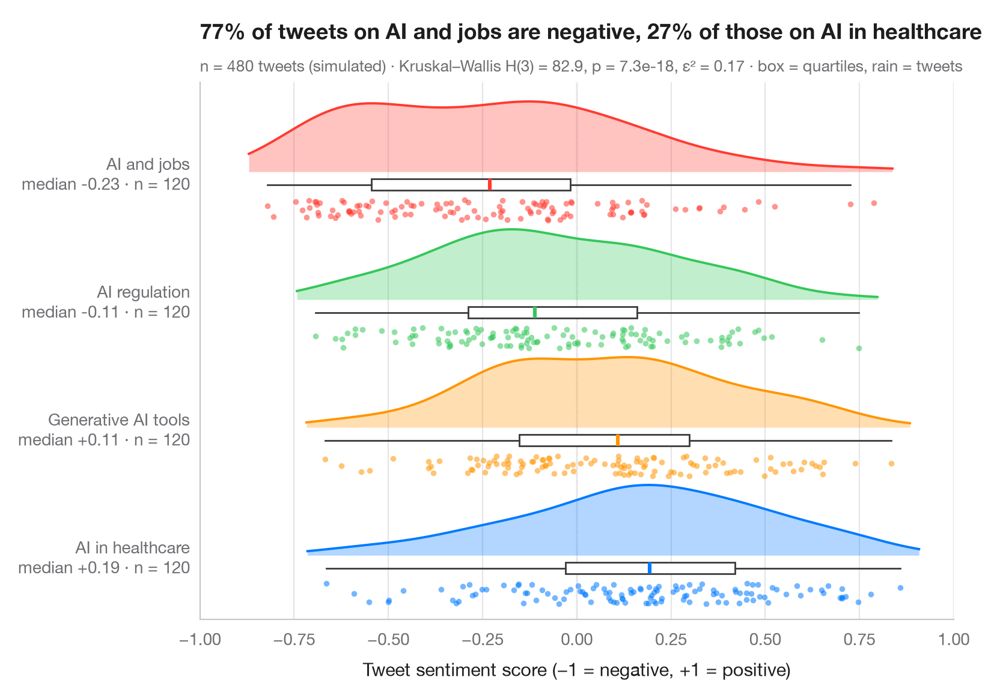

# Raincloud plot

> Half violin, box plot and raw points per group, drawn horizontally.



A raincloud plot stacks three views of the same data: a half violin (the
"cloud") shows the density, a slim box plot gives the median and quartiles,
and the jittered points underneath (the "rain") show every single
observation. Nothing is hidden, so skewness, outliers and small samples are
all visible.

The setting is de Marcellis-Warin, Kouloukoui & Warin (2025, *Data in
Brief*), a large dataset of AI-related tweets. The numbers here are
**simulated** for illustration — a sentiment score between −1 (negative)
and +1 (positive) for n = 480 tweets on four AI topics — and are not the
paper's data or results. The densities come from `scipy.stats.gaussian_kde`,
and the subtitle reports a Kruskal–Wallis test (`scipy.stats.kruskal`) — a
rank test, suited to bounded, skewed scores — with ε² as effect size.

**R equivalent:** `ggdist::stat_halfeye() / ggrain::geom_rain()`  
**Libraries:** Matplotlib, NumPy, SciPy

**Data:** Simulated data with a fixed random seed, created for this example. — No real respondents, documents or measurements: the numbers only illustrate how the chart and its statistics work.

**Data:** de Marcellis-Warin, N., Kouloukoui, D., & Warin, T. (2025). A large-scale dataset of AI-related tweets: Structure and descriptive statistics. Data in Brief, 62, 111960. https://doi.org/10.1016/j.dib.2025.111960 — The example is set in the context of this paper; unless its description says otherwise, the numbers are simulated and are not the paper's data or results.


```python
import matplotlib.pyplot as plt
import numpy as np
from scipy import stats

# Simulated data, set in the context of de Marcellis-Warin, Kouloukoui & Warin (2025) [dmw2025aitweets]

# Data: sentiment score (−1 to +1) of 120 tweets per AI topic (Beta draws rescaled)
rng = np.random.default_rng(2025)
groups = {"AI in healthcare": (5.0, 3.5), "Generative AI tools": (4.0, 3.5),
          "AI regulation": (3.5, 4.0), "AI and jobs": (2.6, 4.5)}
data = [2 * rng.beta(a, b, 120) - 1 for a, b in groups.values()]
palette = ["#007AFF", "#FF9500", "#34C759", "#FF3B30"]

# Kruskal–Wallis test + epsilon squared
H, p = stats.kruskal(*data)
n = sum(len(d) for d in data)
eps2 = H / (n - 1)

fig, ax = plt.subplots(figsize=(8, 5.6))
for i, (d, c) in enumerate(zip(data, palette)):
    # Cloud: half violin above the baseline, scaled to a fixed height
    grid = np.linspace(d.min() - 0.05, d.max() + 0.05, 300)  # trim the cloud near the data
    dens = stats.gaussian_kde(d)(grid)
    ax.fill_between(grid, i, i + 0.55 * dens / dens.max(), color=c, alpha=0.3, lw=0)
    ax.plot(grid, i + 0.55 * dens / dens.max(), color=c, lw=1.4)
    # Box: median and quartiles just under the cloud
    ax.boxplot(d, positions=[i - 0.1], widths=0.09, orientation="horizontal", showfliers=False,
               patch_artist=True, boxprops=dict(facecolor="white", edgecolor="#3A3A3C", lw=1),
               medianprops=dict(color=c, lw=2.2), whiskerprops=dict(color="#3A3A3C"),
               capprops=dict(visible=False))
    # Rain: jittered raw points below the box
    ax.scatter(d, i - 0.3 + rng.uniform(-0.08, 0.08, len(d)),
               s=12, color=c, alpha=0.55, lw=0)

ax.set_yticks(range(len(groups)), [f"{g}\nmedian {np.median(d):+.2f} · n = {len(d)}"
                                   for g, d in zip(groups, data)])
ax.set_ylim(-0.5, len(groups) - 0.3)
ax.set_xlim(-1, 1)
ax.axvline(0, color="#8E8E93", lw=0.8, ls="--", zorder=0)
ax.grid(axis="x"); ax.grid(axis="y", visible=False)
ax.set_xlabel("Tweet sentiment score (−1 = negative, +1 = positive)")
share = [np.mean(d < 0) for d in data]
ax.set_title(f"{share[3]:.0%} of tweets on AI and jobs are negative, "
             f"{share[0]:.0%} of those on AI in healthcare", pad=26)
ax.text(0, 1.02, f"n = {n} tweets (simulated) · Kruskal–Wallis H(3) = {H:.1f}, p = {p:.1e}, "
        f"ε² = {eps2:.2f} · box = quartiles, rain = tweets", transform=ax.transAxes,
        fontsize=9.5, color="#6E6E73")
plt.show()
```

---

**PyStatlas** by [Thierry Warin](https://www.warin.ca) · [View on the website →](https://warint.github.io/pystatlas/distributions/raincloud/) · [← Distributions](../README.md)

**Cite:** Warin, T. (2026). Raincloud plot. In PyStatlas: A Python Gallery of Statistical Graphics for the Social Sciences (Version 1.1.0) [Computer software]. https://warint.github.io/pystatlas/distributions/raincloud/
