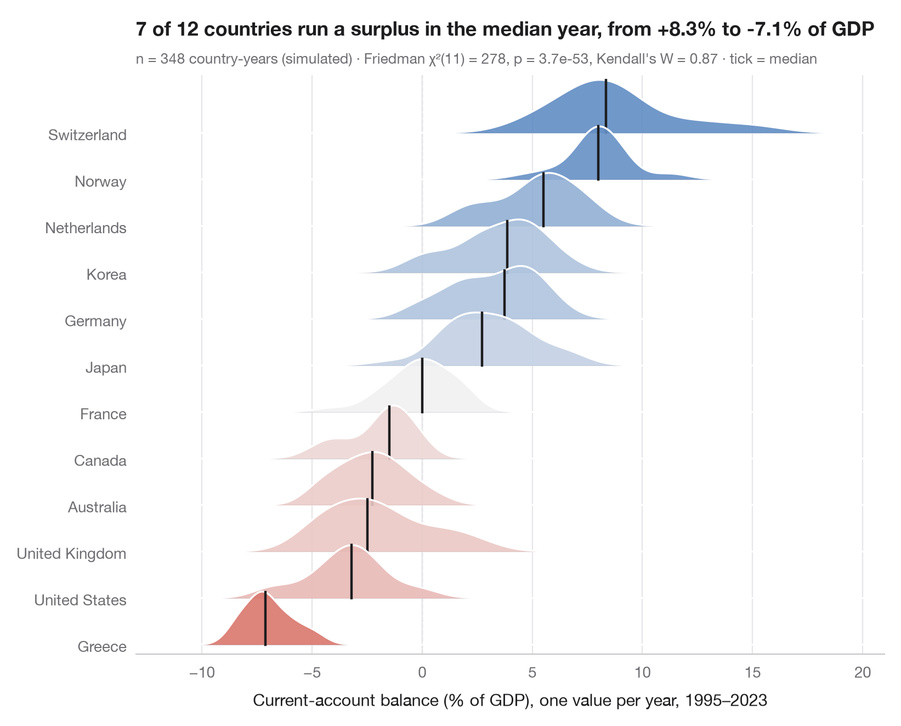

# Ridgeline plot

> Overlapping density curves to compare one distribution across many groups.



A ridgeline (or "joy") plot stacks one density curve per group, letting them
overlap slightly so that many distributions fit in one compact figure.
Here each ridge is one OECD country and shows how its current-account
balance was spread over the years; ridges are sorted by their median, the
dark tick marks it and the colour encodes it (red = deficit, blue = surplus),
so persistent surplus and deficit countries, and the width of each
country's swings, read at a glance.

The setting is Stojkov, Warin & Kjosevski (2026, *Acta Oeconomica*), on the
current accounts of OECD countries. The numbers here are **simulated** for
illustration (12 countries × 29 years, 1995–2023, n = 348 country-years,
each country a mean plus AR(1) noise) and are not the paper's data or
results. Densities come from `scipy.stats.gaussian_kde`; because every year
gives one value per country, the subtitle reports a Friedman test
(`scipy.stats.friedmanchisquare`, years as blocks) with Kendall's W as
effect size.

**R equivalent:** `ggridges::geom_density_ridges()`  
**Libraries:** Matplotlib, NumPy, pandas, seaborn, SciPy

**Data:** Simulated data with a fixed random seed, created for this example. — No real respondents, documents or measurements: the numbers only illustrate how the chart and its statistics work.

**Data:** Stojkov, A., Warin, T., & Kjosevski, J. (2026). Beyond the balance: An intertemporal perspective on the current accounts of OECD countries. Acta Oeconomica, 76(3), 402–429. https://doi.org/10.1556/032.2026.00539 — The example is set in the context of this paper; unless its description says otherwise, the numbers are simulated and are not the paper's data or results.


```python
import matplotlib.pyplot as plt
import numpy as np
import pandas as pd
import seaborn as sns
from scipy import stats

# Simulated data, set in the context of Stojkov, Warin & Kjosevski (2026) [stojkov2026ca]

# Data: current-account balance (% of GDP), one column per country, one row per year
rng = np.random.default_rng(2026)
means = {"Norway": 8, "Switzerland": 7, "Netherlands": 5.5, "Germany": 4, "Korea": 3,
         "Japan": 2.5, "France": -0.5, "Canada": -1.5, "United Kingdom": -3,
         "United States": -3, "Australia": -3.5, "Greece": -6}
years, ca = np.arange(1995, 2024), {}
for country, mu in means.items():
    e = np.zeros(len(years))
    for t in range(1, len(years)):            # AR(1) swings around the country mean
        e[t] = 0.6 * e[t - 1] + rng.normal(0, 1.1 + 0.08 * abs(mu))
    ca[country] = mu + e
ca = pd.DataFrame(ca, index=years)

# Friedman test (years are blocks) + Kendall's W
chi2, p = stats.friedmanchisquare(*[ca[c] for c in ca])
W = chi2 / (len(ca) * (ca.shape[1] - 1))

medians = ca.median().sort_values(ascending=False)    # largest surplus on top
grid = np.linspace(-13, 21, 400)
cmap = sns.diverging_palette(15, 250, as_cmap=True)  # red = deficit, blue = surplus
norm = plt.matplotlib.colors.TwoSlopeNorm(0, -10, 10)

fig, ax = plt.subplots(figsize=(8, 6.4))
spacing, height = 1.0, 1.9  # vertical gap between ridges, peak height of a ridge
for i, c in enumerate(medians.index):
    base = (len(medians) - 1 - i) * spacing
    kde = stats.gaussian_kde(ca[c])
    dens = kde(grid)
    curve = base + height * dens / dens.max() * 0.6
    ax.fill_between(grid, base, curve, color=cmap(norm(medians[c])), alpha=0.9, lw=0,
                    zorder=2 * i + 1)
    ax.plot(grid, curve, color="white", lw=1.2, zorder=2 * i + 2)
    ax.axhline(base, color="#C7C7CC", lw=0.6, zorder=2 * i)
    # Dark tick at the median
    y_med = base + height * kde(medians[c])[0] / dens.max() * 0.6
    ax.plot([medians[c]] * 2, [base, y_med], color="#1D1D1F", lw=1.6, zorder=2 * i + 2)

ax.axvline(0, color="#8E8E93", lw=0.8, ls="--", zorder=0)
ax.set_yticks([(len(medians) - 1 - i) * spacing for i in range(len(medians))], medians.index)
ax.set_ylim(-0.2, (len(medians) - 1) * spacing + height * 0.6 + 0.1)
ax.set_xlim(grid[0], grid[-1])
ax.grid(axis="x"); ax.grid(axis="y", visible=False)
ax.spines["left"].set_visible(False)
ax.set_xlabel(f"Current-account balance (% of GDP), one value per year, {years[0]}–{years[-1]}")
ax.set_title(f"{(medians > 0).sum()} of {len(medians)} countries run a surplus in the median "
             f"year, from {medians.iloc[0]:+.1f}% to {medians.iloc[-1]:+.1f}% of GDP", pad=26)
ax.text(0, 1.02, f"n = {ca.size} country-years (simulated) · "
        f"Friedman χ²({ca.shape[1] - 1}) = {chi2:.0f}, p = {p:.1e}, Kendall's W = {W:.2f}"
        " · tick = median", transform=ax.transAxes, fontsize=9.5, color="#6E6E73")
plt.show()
```

---

**PyStatlas** by [Thierry Warin](https://www.warin.ca) · [View on the website →](https://warint.github.io/pystatlas/distributions/ridgeline/) · [← Distributions](../README.md)

**Cite:** Warin, T. (2026). Ridgeline plot. In PyStatlas: A Python Gallery of Statistical Graphics for the Social Sciences. https://warint.github.io/pystatlas/distributions/ridgeline/
