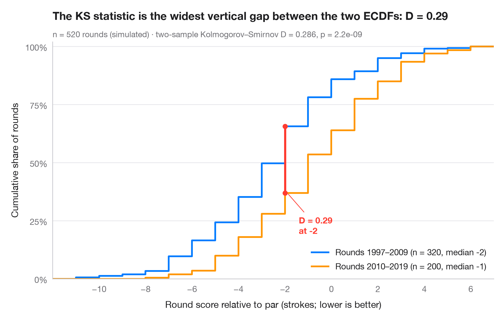

# ECDF comparison

> Empirical cumulative distributions of two groups, with the Kolmogorov–Smirnov gap.



An empirical cumulative distribution function (ECDF) plots, for every value
on the x-axis, the share of observations at or below it. Unlike a histogram
it needs no bins, and every quantile can be read off directly. When two
ECDFs are drawn together, the largest vertical distance between them is
exactly the two-sample **Kolmogorov–Smirnov** statistic D, drawn here as a
red segment.

Data are the 442 patients of the diabetes study bundled with
**scikit-learn** (`load_diabetes(scaled=False)`): body-mass index by sex.
`scipy.stats.ecdf` builds the curves and `scipy.stats.ks_2samp` returns D, its
location and the p-value.

**R equivalent:** `ggplot2::stat_ecdf()`  
**Libraries:** Matplotlib, NumPy, SciPy, scikit-learn

```python
import matplotlib.pyplot as plt
import numpy as np
from scipy import stats
from sklearn.datasets import load_diabetes

# Data: body-mass index of diabetes patients, split by sex (coded 1 / 2)
df = load_diabetes(as_frame=True, scaled=False).frame
groups = {"Sex 1": df.loc[df.sex == 1, "bmi"].to_numpy(),
          "Sex 2": df.loc[df.sex == 2, "bmi"].to_numpy()}
palette = ["#007AFF", "#FF9500"]

# Two-sample Kolmogorov–Smirnov test: D is the largest vertical gap
ks = stats.ks_2samp(*groups.values())
x_gap = ks.statistic_location
F = [stats.ecdf(d).cdf for d in groups.values()]
y_gap = [f.evaluate(x_gap) for f in F]

lo, hi = df.bmi.min() - 0.5, df.bmi.max() + 0.5  # common x-range for both curves
fig, ax = plt.subplots(figsize=(8, 5))
for (name, d), f, c in zip(groups.items(), F, palette):
    ax.step(np.r_[lo, f.quantiles, hi], np.r_[0, f.probabilities, 1], where="post",
            color=c, lw=2, label=f"{name} (n = {len(d)}, median {np.median(d):.1f})")

# Mark the KS distance
ax.plot([x_gap, x_gap], y_gap, color="#FF3B30", lw=2.5, solid_capstyle="round", zorder=5)
ax.scatter([x_gap, x_gap], y_gap, color="#FF3B30", s=30, zorder=6)
ax.annotate(f"D = {ks.statistic:.2f}\nat BMI {x_gap:.1f}", (x_gap + 0.2, min(y_gap)),
            xytext=(x_gap + 2, min(y_gap)), ha="left", va="center", fontsize=10,
            fontweight="semibold", color="#FF3B30",
            arrowprops=dict(arrowstyle="-", color="#FF3B30", lw=0.8, shrinkB=2))

ax.set_xlim(lo, hi)
ax.set_ylim(0, 1.02)
ax.set_yticks(np.linspace(0, 1, 5), [f"{v:.0%}" for v in np.linspace(0, 1, 5)])
ax.set_xlabel("Body-mass index (kg/m²)")
ax.set_ylabel("Cumulative share of patients")
ax.legend(loc="lower right")
ax.set_title("Sex 2 has fewer low-BMI patients than sex 1", pad=26)
ax.text(0, 1.02, f"Two-sample Kolmogorov–Smirnov D = {ks.statistic:.3f}, p = {ks.pvalue:.3f}"
        f" · n = {len(df)}", transform=ax.transAxes, fontsize=9.5, color="#6E6E73")
plt.show()
```

---

**Statlas** by [Thierry Warin](https://www.warin.ca) · [View on the website →](https://warint.github.io/statlas/distributions/ecdf-comparison/) · [← Distributions](../README.md)

**Cite:** Warin, T. (2026). ECDF comparison. In Statlas: The Python Gallery of Statistical Graphics. https://warint.github.io/statlas/distributions/ecdf-comparison/
