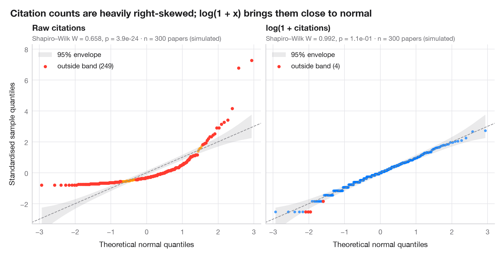

# Q–Q plot with confidence band

> Normal quantile–quantile plots with a 95% envelope, for a raw and a logged variable.



A quantile–quantile plot puts the sorted, standardised data against the
quantiles a normal distribution would produce. Normal data fall on the
diagonal; a curved, banana-shaped pattern means skewness. The shaded band is
a 95% pointwise envelope built from the Beta distribution of normal order
statistics, so points outside it are more extreme than chance allows.

The setting is Warin (2021, *JMIR Medical Informatics*), a metadata-based
analysis of global research on coronaviruses. The numbers here are
**simulated** for illustration — citation counts of n = 300 coronavirus
papers, drawn as Poisson counts around a log-normal mean — and are not the
paper's data or results. The left panel shows raw citations, the right
panel log(1 + citations), computed with `numpy.log1p`. Quantiles come from
`scipy.stats.norm.ppf`, the envelope from `scipy.stats.beta.ppf`, and each
panel reports a Shapiro–Wilk test.

**R equivalent:** `qqplotr::stat_qq_band()`  
**Libraries:** Matplotlib, NumPy, SciPy

**Data:** Simulated data with a fixed random seed, created for this example. — No real respondents, documents or measurements: the numbers only illustrate how the chart and its statistics work.

**Data:** Warin, T. (2021). Global research on coronaviruses: Metadata-based analysis for public health policies. JMIR Medical Informatics, 9(11), e31510. https://doi.org/10.2196/31510 — The example is set in the context of this paper; unless its description says otherwise, the numbers are simulated and are not the paper's data or results.


```python
import matplotlib.pyplot as plt
import numpy as np
from scipy import stats

# Simulated data, set in the context of Warin (2021) [warin2021corona]

# Data: citations per paper, raw and log(1 + x)
rng = np.random.default_rng(2021)
citations = rng.poisson(rng.lognormal(2.5, 1.0, 300))
samples = {"Raw citations": citations, "log(1 + citations)": np.log1p(citations)}
palette = ["#FF9500", "#007AFF"]

fig, axes = plt.subplots(1, 2, figsize=(10, 5), sharex=True, sharey=True)
for ax, (name, x), c in zip(axes, samples.items(), palette):
    n = len(x)
    z = np.sort((x - x.mean()) / x.std(ddof=1))      # standardised sample quantiles
    pp = (np.arange(1, n + 1) - 0.5) / n              # plotting positions
    theo = stats.norm.ppf(pp)                         # theoretical normal quantiles

    # 95% pointwise envelope: order statistic i of a uniform sample is Beta(i, n-i+1)
    i = np.arange(1, n + 1)
    lo = stats.norm.ppf(stats.beta.ppf(0.025, i, n - i + 1))
    hi = stats.norm.ppf(stats.beta.ppf(0.975, i, n - i + 1))
    outside = (z < lo) | (z > hi)

    ax.fill_between(theo, lo, hi, color="#8E8E93", alpha=0.18, lw=0, label="95% envelope")
    ax.plot([-3.5, 3.5], [-3.5, 3.5], color="#8E8E93", lw=1, ls="--")
    ax.scatter(theo[~outside], z[~outside], s=16, color=c, alpha=0.7, lw=0)
    ax.scatter(theo[outside], z[outside], s=22, color="#FF3B30", lw=0,
               label=f"outside band ({outside.sum()})")

    W, p = stats.shapiro(x)
    ax.set_title(name, pad=20, fontsize=12)
    ax.text(0, 1.02, f"Shapiro–Wilk W = {W:.3f}, p = {p:.1e} · n = {n} papers (simulated)",
            transform=ax.transAxes, fontsize=9.5, color="#6E6E73")
    ax.legend(loc="upper left")
    ax.grid(axis="x")
    ax.set_xlabel("Theoretical normal quantiles")

axes[0].set_ylabel("Standardised sample quantiles")
axes[0].set_xlim(-3.2, 3.2)
axes[0].set_ylim(-3.3, 8.3)  # room for the most-cited papers
fig.suptitle("Citation counts are heavily right-skewed; log(1 + x) brings them close to normal",
             x=0.01, ha="left", fontsize=14)
plt.show()
```

---

**PyStatlas** by [Thierry Warin](https://www.warin.ca) · [View on the website →](https://warint.github.io/pystatlas/distributions/qq-plot/) · [← Distributions](../README.md)

**Cite:** Warin, T. (2026). Q–Q plot with confidence band. In PyStatlas: A Python Gallery of Statistical Graphics for the Social Sciences (Version 1.1.0) [Computer software]. https://warint.github.io/pystatlas/distributions/qq-plot/
