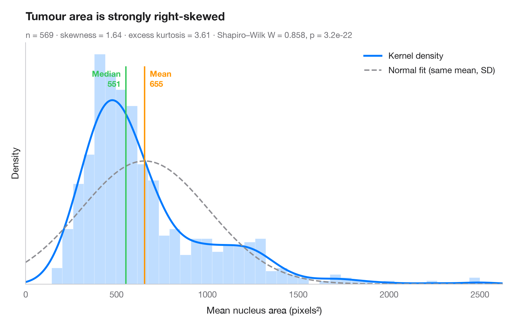
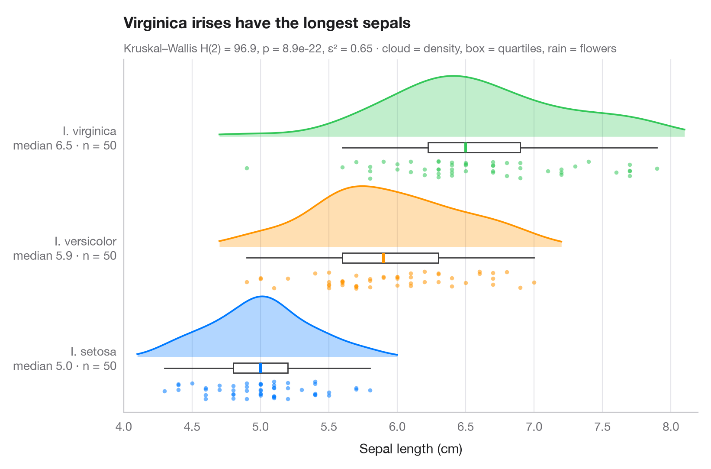
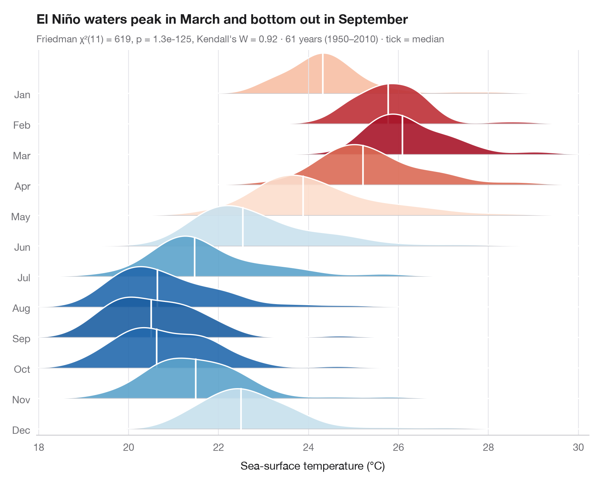
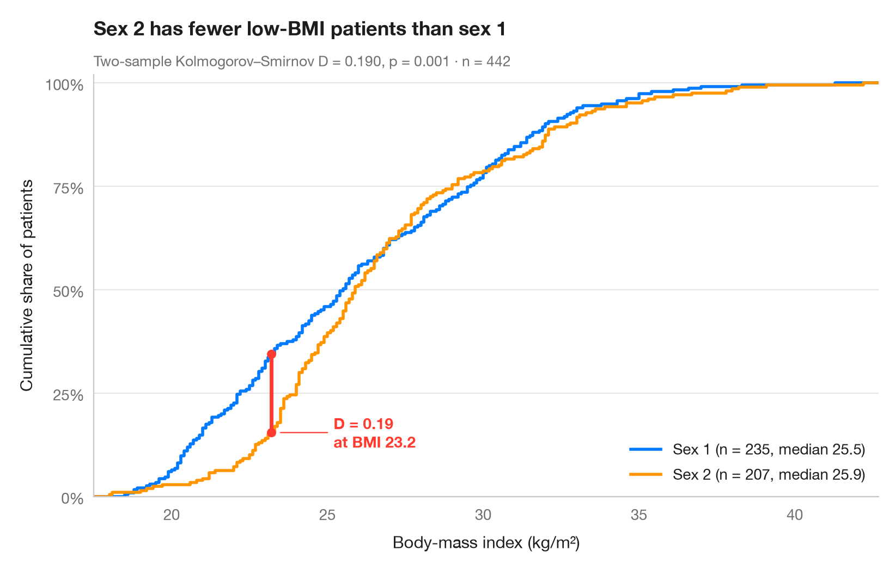
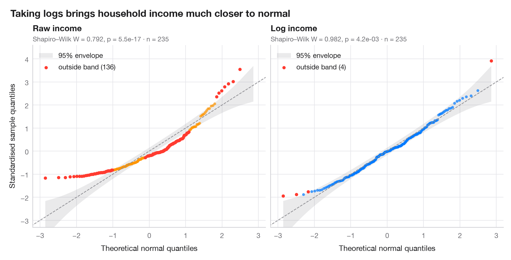

# Distributions

See the shape of your data: histograms, densities, ridgelines, ECDFs and Q–Q plots.

| Chart | Description |
|:--|:--|
|  | **[Histogram with density](01-histogram-density/)** Histogram, kernel density and fitted normal curve, with shape statistics. `ggplot2::geom_histogram() + geom_density()` |
|  | **[Raincloud plot](02-raincloud/)** Half violin, box plot and raw points per group, drawn horizontally. `ggdist::stat_halfeye() / ggrain::geom_rain()` |
|  | **[Ridgeline plot](03-ridgeline/)** Overlapping density curves to compare one distribution across many groups. `ggridges::geom_density_ridges()` |
|  | **[ECDF comparison](04-ecdf-comparison/)** Empirical cumulative distributions of two groups, with the Kolmogorov–Smirnov gap. `ggplot2::stat_ecdf()` |
|  | **[Q–Q plot with confidence band](05-qq-plot/)** Normal quantile–quantile plots with a 95% envelope, for a raw and a logged variable. `qqplotr::stat_qq_band()` |

[← All families](../../README.md) · [Browse on the website](https://warint.github.io/statlas/distributions/)
