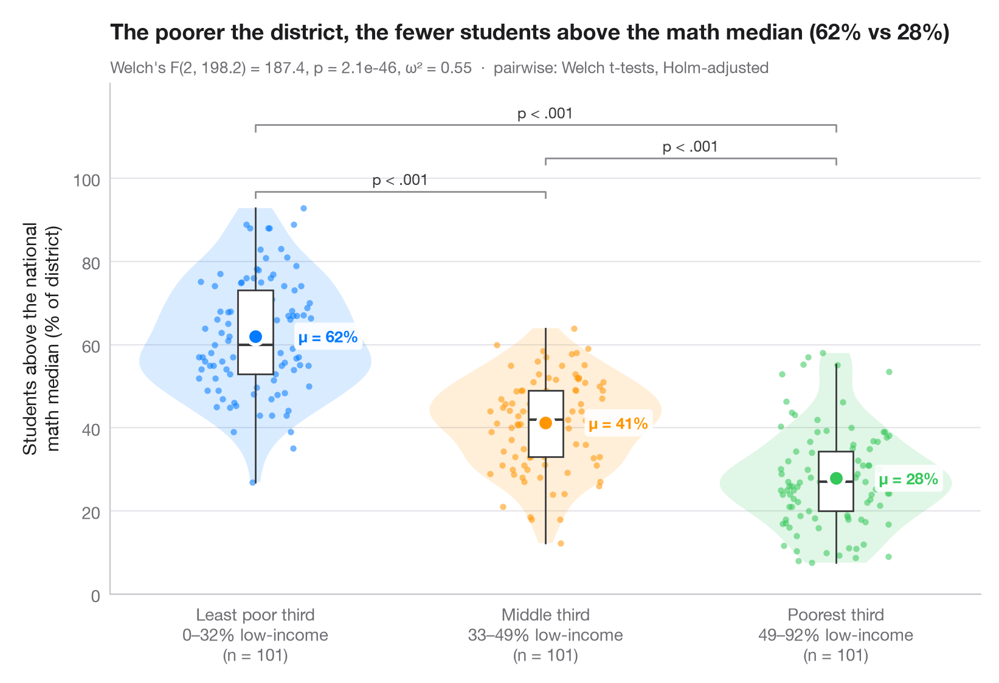

# Between-groups comparison

> Violin + box + points with Welch's ANOVA, effect size and pairwise tests.



The Python counterpart of `ggbetweenstats()`: every observation is shown,
wrapped in a violin (distribution) and a slim box (quartiles), with the group
mean highlighted. The subtitle reports Welch's one-way ANOVA — robust to
unequal variances — together with ω² as effect size, and brackets show the
Holm-corrected pairwise Welch t-tests.

Data are the classic wine recognition measurements bundled with
**scikit-learn**: alcohol content for three cultivars.

**R equivalent:** `ggstatsplot::ggbetweenstats()`  
**Libraries:** Matplotlib, NumPy, pandas, SciPy, scikit-learn, statsmodels

```python
from itertools import combinations

import matplotlib.pyplot as plt
import numpy as np
import pandas as pd
from scipy import stats
from sklearn.datasets import load_wine
from statsmodels.stats.multitest import multipletests
from statsmodels.stats.oneway import anova_oneway

wine = load_wine(as_frame=True)
df = wine.frame.assign(cultivar=wine.target.map({0: "Barolo", 1: "Grignolino", 2: "Barbera"}))
groups = ["Barolo", "Grignolino", "Barbera"]
data = [df.loc[df.cultivar == g, "alcohol"].to_numpy() for g in groups]
palette = ["#007AFF", "#FF9500", "#34C759"]

# Welch's ANOVA + omega squared
res = anova_oneway(data, use_var="unequal")
k, n = len(data), sum(len(d) for d in data)
omega2 = (res.statistic - 1) * (k - 1) / ((res.statistic - 1) * (k - 1) + n)

# Pairwise Welch t-tests, Holm-corrected
pairs = list(combinations(range(k), 2))
raw_p = [stats.ttest_ind(data[i], data[j], equal_var=False).pvalue for i, j in pairs]
adj_p = multipletests(raw_p, method="holm")[1]

fig, ax = plt.subplots(figsize=(8, 5.4))
rng = np.random.default_rng(1)
for i, (d, c) in enumerate(zip(data, palette)):
    v = ax.violinplot(d, positions=[i], widths=0.8, showextrema=False)
    for body in v["bodies"]:
        body.set(facecolor=c, alpha=0.15, edgecolor="none")
    ax.boxplot(d, positions=[i], widths=0.12, showfliers=False, patch_artist=True,
               boxprops=dict(facecolor="white", edgecolor="#3A3A3C", lw=1),
               medianprops=dict(color="#3A3A3C", lw=1.5),
               whiskerprops=dict(color="#3A3A3C"), capprops=dict(visible=False))
    ax.scatter(i + rng.uniform(-0.22, 0.22, len(d)) * 0.9, d, s=14, color=c, alpha=0.55, lw=0)
    ax.scatter(i, d.mean(), s=90, color=c, edgecolor="white", lw=2, zorder=5)
    ax.annotate(f"μ = {d.mean():.2f}", (i + 0.09, d.mean()), xytext=(10, 0), textcoords="offset points",
                va="center", bbox=dict(boxstyle="round,pad=0.25", fc="white", ec="none", alpha=0.9), fontsize=9.5, fontweight="semibold", color=c)

# Significance brackets
top, step = max(map(np.max, data)), 0.42
for h, ((i, j), p) in enumerate(sorted(zip(pairs, adj_p), key=lambda t: t[0][1] - t[0][0])):
    y = top + 0.3 + h * step
    ax.plot([i, i, j, j], [y - 0.08, y, y, y - 0.08], color="#8E8E93", lw=1)
    label = "p < .001" if p < 0.001 else f"p = {p:.3f}"
    ax.text((i + j) / 2, y + 0.04, label, ha="center", va="bottom", fontsize=9, color="#3A3A3C")

ax.set_xticks(range(k), [f"{g}\n(n = {len(d)})" for g, d in zip(groups, data)])
ax.set_ylabel("Alcohol (% vol)")
ax.set_ylim(top=top + 0.3 + len(pairs) * step + 0.1)
ax.set_title("Alcohol content differs across wine cultivars", pad=26)
ax.text(0, 1.02, f"Welch's F({res.df_num:.0f}, {res.df_denom:.1f}) = {res.statistic:.1f}, "
        f"p = {res.pvalue:.1e}, ω² = {omega2:.2f}  ·  pairwise: Welch t-tests, Holm-adjusted",
        transform=ax.transAxes, fontsize=9.5, color="#6E6E73")
plt.show()
```

---

**PyStatlas** by [Thierry Warin](https://www.warin.ca) · [View on the website →](https://warint.github.io/pystatlas/group-comparisons/between-groups-violin/) · [← Group comparisons](../README.md)

**Cite:** Warin, T. (2026). Between-groups comparison. In PyStatlas: The Python Gallery of Statistical Graphics. https://warint.github.io/pystatlas/group-comparisons/between-groups-violin/
