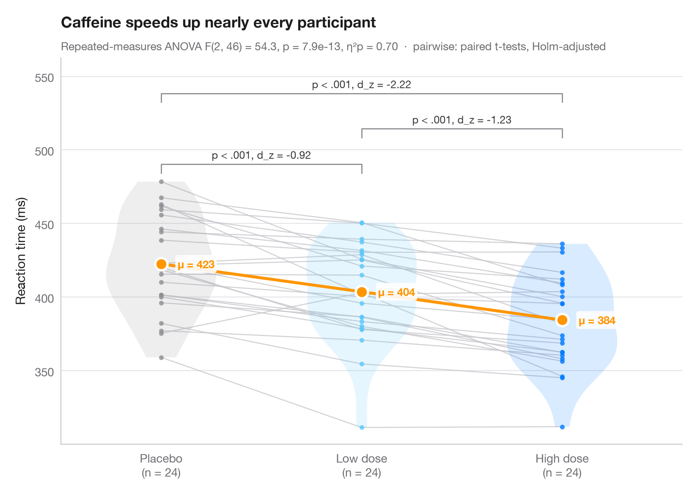

# Within-subjects comparison

> Repeated measures with one line per subject, means, rm-ANOVA and paired tests.



When the same subjects are measured under every condition, the interesting
variation is *within* each person. Thin grey lines join each subject's
measurements, so you can see whether almost everybody moves in the same
direction; violins show the distribution per condition and the large dots
(joined by a coloured line) are the condition means.

Data are simulated: 24 participants whose reaction time is recorded after a
placebo, a low and a high dose of caffeine, with a random subject effect.
The subtitle reports a one-way repeated-measures ANOVA
(`statsmodels.stats.anova.AnovaRM`) with partial η², and the brackets show
Holm-corrected paired t-tests (`scipy.stats.ttest_rel`) with Cohen's d_z.

**R equivalent:** `ggstatsplot::ggwithinstats()`  
**Libraries:** Matplotlib, NumPy, pandas, SciPy, statsmodels

```python
from itertools import combinations

import matplotlib.pyplot as plt
import numpy as np
import pandas as pd
from scipy import stats
from statsmodels.stats.anova import AnovaRM
from statsmodels.stats.multitest import multipletests

# Simulated data: 24 subjects x 3 conditions, reaction time in ms
rng = np.random.default_rng(42)
conditions = ["Placebo", "Low dose", "High dose"]
n = 24
subject = rng.normal(0, 35, n)                      # stable person-level speed
wide = pd.DataFrame({c: 420 + subject + shift + rng.normal(0, 18, n)
                     for c, shift in zip(conditions, [0, -14, -32])})
long = wide.rename_axis("id").reset_index().melt("id", var_name="condition", value_name="rt")

# Repeated-measures ANOVA + partial eta squared
aov = AnovaRM(long, "rt", "id", within=["condition"]).fit().anova_table.iloc[0]
eta_p = aov["F Value"] * aov["Num DF"] / (aov["F Value"] * aov["Num DF"] + aov["Den DF"])

# Pairwise paired t-tests (Holm) with Cohen's d_z
pairs = list(combinations(range(3), 2))
tests = [stats.ttest_rel(wide.iloc[:, j], wide.iloc[:, i]) for i, j in pairs]
adj_p = multipletests([t.pvalue for t in tests], method="holm")[1]
dz = [(wide.iloc[:, j] - wide.iloc[:, i]).mean() / (wide.iloc[:, j] - wide.iloc[:, i]).std()
      for i, j in pairs]

fig, ax = plt.subplots(figsize=(8, 5.6))
palette = ["#8E8E93", "#5AC8FA", "#007AFF"]
x = np.arange(3)
for _, row in wide.iterrows():                      # one line per subject
    ax.plot(x, row.values, color="#C7C7CC", lw=0.9, alpha=0.8, zorder=1)
for i, c in enumerate(palette):
    v = ax.violinplot(wide.iloc[:, i], positions=[i], widths=0.55, showextrema=False)
    v["bodies"][0].set(facecolor=c, alpha=0.15, edgecolor="none")
    ax.scatter(np.full(n, i), wide.iloc[:, i], s=16, color=c, alpha=0.8, lw=0, zorder=2)
means = wide.mean()
ax.plot(x, means, color="#FF9500", lw=2.5, zorder=3)
ax.scatter(x, means, s=110, color="#FF9500", edgecolor="white", lw=2, zorder=4)
for i, m in enumerate(means):
    ax.annotate(f"μ = {m:.0f}", (i, m), xytext=(14, 0), textcoords="offset points", va="center",
                fontsize=9.5, fontweight="semibold", color="#FF9500",
                bbox=dict(boxstyle="round,pad=0.2", fc="white", ec="none", alpha=0.9), zorder=5)

# Significance brackets
top, step = wide.values.max() + 12, 24
for h, ((i, j), p, d) in enumerate(sorted(zip(pairs, adj_p, dz), key=lambda t: t[0][1] - t[0][0])):
    y = top + h * step
    ax.plot([i, i, j, j], [y - 6, y, y, y - 6], color="#8E8E93", lw=1)
    label = "p < .001" if p < 0.001 else f"p = {p:.3f}"
    ax.text((i + j) / 2, y + 2, f"{label}, d_z = {d:.2f}", ha="center", va="bottom",
            fontsize=9, color="#3A3A3C")

ax.set_xticks(x, [f"{c}\n(n = {n})" for c in conditions])
ax.set_xlim(-0.5, 2.6)
ax.set_ylim(top=top + 3 * step)
ax.set_ylabel("Reaction time (ms)")
ax.set_title("Caffeine speeds up nearly every participant", pad=26)
ax.text(0, 1.02, f"Repeated-measures ANOVA F({aov['Num DF']:.0f}, {aov['Den DF']:.0f}) = "
        f"{aov['F Value']:.1f}, p = {aov['Pr > F']:.1e}, η²p = {eta_p:.2f}  ·  "
        "pairwise: paired t-tests, Holm-adjusted", transform=ax.transAxes,
        fontsize=9.5, color="#6E6E73")
plt.show()
```

---

**PyStatlas** by [Thierry Warin](https://www.warin.ca) · [View on the website →](https://warint.github.io/pystatlas/group-comparisons/within-subjects/) · [← Group comparisons](../README.md)

**Cite:** Warin, T. (2026). Within-subjects comparison. In PyStatlas: The Python Gallery of Statistical Graphics. https://warint.github.io/pystatlas/group-comparisons/within-subjects/
