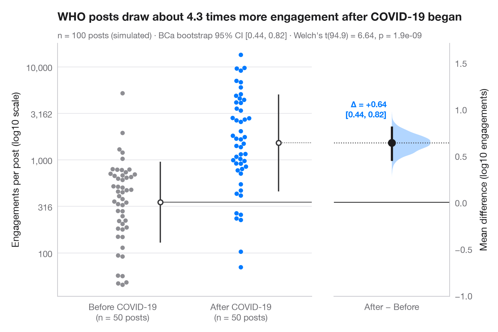

# Estimation plot

> Raw data of two groups plus the mean difference and its bootstrap 95% CI.



The Gardner–Altman estimation plot puts the effect size, not the p-value, at
the centre. The left axis shows every observation of both groups; the right,
floating axis is anchored so that its zero sits at the reference-group mean.
On it, the bootstrap distribution of the mean difference is drawn as a half
violin, with the point estimate and its 95% confidence interval as a dot and
a bar. Engagement counts are very skewed, so the comparison is made on a
log10 scale: a difference of 0.3 means about twice as many engagements.

The setting is Warin, Melchior & de Marcellis-Warin (2025, *Journal of
Medical Internet Research*), on public engagement with the WHO on X before
and after COVID-19. The numbers here are **simulated** for illustration —
engagements (likes, reposts and replies) per WHO post for n = 100 posts,
50 before and 50 after the pandemic began — and are not the paper's data or
results. The 95% CI is a bias-corrected and accelerated (BCa) bootstrap from
`scipy.stats.bootstrap`, the subtitle adds Welch's t-test
(`scipy.stats.ttest_ind`), the vertical line beside each swarm is the group
mean ± 1 SD, and the swarm comes from `seaborn.swarmplot`.

**R equivalent:** `dabestr::dabest() + plot()`  
**Libraries:** Matplotlib, NumPy, pandas, seaborn, SciPy

**Data:** Simulated data with a fixed random seed, created for this example. — No real respondents, documents or measurements: the numbers only illustrate how the chart and its statistics work.

**Data:** Warin, T., Melchior, C., & de Marcellis-Warin, N. (2025). Social media metrics and popular legitimacy: Content analysis of pre- and post-COVID-19 public engagement with the WHO on X. Journal of Medical Internet Research, 27, e69959. https://doi.org/10.2196/69959 — The example is set in the context of this paper; unless its description says otherwise, the numbers are simulated and are not the paper's data or results.


```python
import matplotlib.pyplot as plt
import numpy as np
import pandas as pd
import seaborn as sns
from scipy import stats

# Simulated data, set in the context of Warin, Melchior & de Marcellis-Warin (2025) [warin2025who]

# Data: log10 of engagements per WHO post, before and after the start of COVID-19
rng = np.random.default_rng(2025)
pre, post = rng.normal(2.6, 0.38, 50), rng.normal(3.15, 0.45, 50)
df = pd.DataFrame({"group": ["Pre-COVID"] * 50 + ["Post-COVID"] * 50,
                   "log_eng": np.r_[pre, post]})

# Mean difference with a BCa bootstrap 95% CI, and the bootstrap distribution
diff = lambda a, b, axis=-1: np.mean(b, axis=axis) - np.mean(a, axis=axis)
boot = stats.bootstrap((pre, post), diff, n_resamples=5000, method="BCa",
                       random_state=np.random.default_rng(1))
lo, hi = boot.confidence_interval
delta = post.mean() - pre.mean()
t = stats.ttest_ind(post, pre, equal_var=False)

# Manual layout (the long subtitle would otherwise squeeze the panels apart)
fig, (ax, ax2) = plt.subplots(1, 2, figsize=(8, 5.2), width_ratios=[2.2, 1], layout="none")
fig.subplots_adjust(wspace=0.12)
palette = ["#8E8E93", "#007AFF"]
sns.swarmplot(data=df, x="group", y="log_eng", hue="group", palette=palette, size=5,
              order=["Pre-COVID", "Post-COVID"], hue_order=["Pre-COVID", "Post-COVID"],
              legend=False, ax=ax)
for i, d in enumerate([pre, post]):            # mean ± SD as a gapped line beside the swarm
    m, s = d.mean(), d.std(ddof=1)
    ax.vlines(i + 0.32, m - s, m + s, color="#3A3A3C", lw=1.5)
    ax.scatter(i + 0.32, m, s=30, color="white", edgecolor="#3A3A3C", lw=1.5, zorder=3)
ax.set_xlabel("")
ax.set_ylabel("Engagements per post (log10 scale)")
ax.set_yticks([2, 2.5, 3, 3.5, 4], ["100", "316", "1,000", "3,162", "10,000"])
ax.set_xticks([0, 1], [f"Before COVID-19\n(n = {len(pre)} posts)",
                      f"After COVID-19\n(n = {len(post)} posts)"])

# Floating difference axis: zero aligned with the pre-COVID mean
ax.set_xlim(-0.55, 1.6)
ymin, ymax = ax.get_ylim()
ax2.set_ylim(ymin - pre.mean(), ymax - pre.mean())
ax2.axhline(0, color="#3A3A3C", lw=1)
ax2.axhline(delta, color="#3A3A3C", lw=1, ls=":")
ax.plot([0.32, 1.6], [pre.mean()] * 2, color="#3A3A3C", lw=0.8)
ax.plot([1.32, 1.6], [post.mean()] * 2, color="#3A3A3C", lw=0.8, ls=":")
v = ax2.violinplot(boot.bootstrap_distribution, positions=[0], widths=0.8,
                   showextrema=False, side="high")
v["bodies"][0].set(facecolor="#007AFF", alpha=0.3, edgecolor="none")
ax2.vlines(0, lo, hi, color="#1D1D1F", lw=2.5)
ax2.scatter(0, delta, s=70, color="#1D1D1F", zorder=3)
ax2.annotate(f"Δ = {delta:+.2f}\n[{lo:.2f}, {hi:.2f}]", (0, hi), xytext=(-6, 8),
             textcoords="offset points", ha="right", va="bottom", fontsize=9.5,
             fontweight="semibold", color="#007AFF")
ax2.set_xlim(-0.6, 0.6)
ax2.set_xticks([0], ["After − Before"])
ax2.yaxis.tick_right(); ax2.yaxis.set_label_position("right")
ax2.spines[["left"]].set_visible(False); ax2.spines["right"].set_visible(True)
ax2.set_ylabel("Mean difference (log10 engagements)")
ax2.grid(False)

ax.set_title(f"Post minus pre: a mean difference of {delta:+.2f} on the log10 scale, with its bootstrap CI",
             pad=26)
ax.text(0, 1.02, f"n = {len(df)} posts (simulated) · BCa bootstrap 95% CI [{lo:.2f}, {hi:.2f}] · "
        f"Welch's t({t.df:.1f}) = {t.statistic:.2f}, p = {t.pvalue:.1e}",
        transform=ax.transAxes, fontsize=9.5, color="#6E6E73")
plt.show()
```

---

**PyStatlas** by [Thierry Warin](https://www.warin.ca) · [View on the website →](https://warint.github.io/pystatlas/group-comparisons/estimation-plot/) · [← Group comparisons](../README.md)

**Cite:** Warin, T. (2026). Estimation plot. In PyStatlas: A Python Gallery of Statistical Graphics for the Social Sciences (Version 1.1.0) [Computer software]. https://warint.github.io/pystatlas/group-comparisons/estimation-plot/
