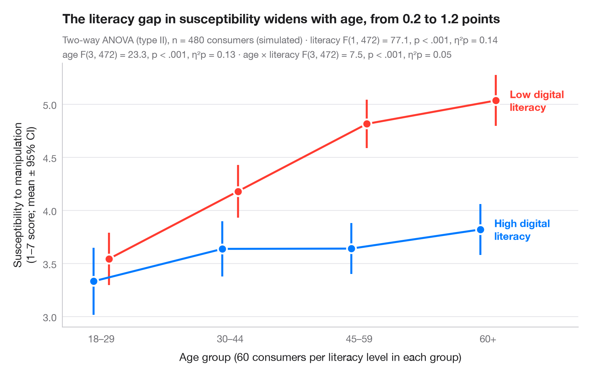

# Interaction plot

> Group means with 95% confidence intervals for two factors, with a two-way ANOVA.



An interaction plot shows the mean outcome for every combination of two
factors: one factor on the x-axis, the other as coloured, slightly dodged
lines. Each mean carries its 95% confidence interval. Parallel lines mean
the two factors act independently; lines that converge, diverge or cross
signal an interaction.

The setting is de Marcellis-Warin, Marty, Thelisson & Warin (2022, *AI and
Ethics*), on artificial intelligence and consumer manipulation. The numbers
here are **simulated** for illustration — a 1–7 susceptibility-to-manipulation
score for n = 480 consumers, by age group and by low or high digital
literacy (60 per cell) — and are not the paper's data or results. The
two-way ANOVA (type II sums of squares) comes from
`statsmodels.formula.api.ols` and `statsmodels.stats.anova.anova_lm`, with
partial η² for each term; the intervals use the t distribution.

**R equivalent:** `ggpubr::ggline(add = "mean_ci") / ggstats`  
**Libraries:** Matplotlib, NumPy, pandas, statsmodels, SciPy

**Data:** Simulated data with a fixed random seed, created for this example. — No real respondents, documents or measurements: the numbers only illustrate how the chart and its statistics work.

**Data:** de Marcellis-Warin, N., Marty, F., Thelisson, E., & Warin, T. (2022). Artificial intelligence and consumer manipulations: From consumer's counter algorithms to firm's self-regulation tools. AI and Ethics, 2(2), 259–268. https://doi.org/10.1007/s43681-022-00149-5 — The example is set in the context of this paper; unless its description says otherwise, the numbers are simulated and are not the paper's data or results.


```python
import matplotlib.pyplot as plt
import numpy as np
import pandas as pd
import statsmodels.formula.api as smf
from scipy import stats
from statsmodels.stats.anova import anova_lm

# Simulated data, set in the context of de Marcellis-Warin et al. (2022) [dmw2022manip]

# Data: susceptibility score (1–7) by age group and digital literacy, 60 consumers per cell
rng = np.random.default_rng(2022)
classes = ["18–29", "30–44", "45–59", "60+"]
df = pd.DataFrame([(a, lit) for a in range(4) for lit in ["High", "Low"] for _ in range(60)],
                  columns=["age", "literacy"])
low = (df.literacy == "Low").to_numpy()
df["score"] = np.clip(3.4 + 0.15 * df.age + low * (0.3 + 0.35 * df.age)
                      + rng.normal(0, 1.0, len(df)), 1, 7)
df["age_group"] = pd.Categorical(np.array(classes)[df.age], classes)

# Two-way ANOVA with interaction (type II) + partial eta squared
aov = anova_lm(smf.ols("score ~ C(age_group) * C(literacy)", data=df).fit(), typ=2)
ss_res = aov.loc["Residual", "sum_sq"]
aov["eta_p"] = aov.sum_sq / (aov.sum_sq + ss_res)
df_res = int(aov.loc["Residual", "df"])

# Means and t-based 95% CIs per cell
cells = df.groupby(["literacy", "age_group"], observed=True).score.agg(["mean", "sem", "count"])
cells["half"] = cells["sem"] * stats.t.ppf(0.975, cells["count"] - 1)

fig, ax = plt.subplots(figsize=(8, 5))
x = np.arange(len(classes))
for (lit, c, dx) in [("High", "#007AFF", -0.06), ("Low", "#FF3B30", 0.06)]:
    m = cells.loc[lit].reindex(classes)
    ax.errorbar(x + dx, m["mean"], yerr=m["half"], color=c, lw=2, capsize=0,
                elinewidth=2, marker="o", ms=9, mec="white", mew=1.8)
    ax.annotate(f"{lit} digital\nliteracy", (x[-1] + dx, m["mean"].iloc[-1]), xytext=(14, 0),
                textcoords="offset points", va="center", fontsize=10.5,
                fontweight="semibold", color=c)

ax.set_xticks(x, classes)
ax.set_xlim(-0.3, len(classes) - 0.3)
ax.set_xlabel("Age group (60 consumers per literacy level in each group)")
ax.set_ylabel("Susceptibility to manipulation\n(1–7 score; mean ± 95% CI)")

# One "F(df1, df2) = …, p …, η²p = …" string per ANOVA term
stat = {}
for term, label in [("C(age_group)", "age"), ("C(literacy)", "literacy"),
                    ("C(age_group):C(literacy)", "age × literacy")]:
    r = aov.loc[term]
    pval = "< .001" if r["PR(>F)"] < .001 else f"= {r['PR(>F)']:.2f}"
    stat[label] = f"{label} F({r.df:.0f}, {df_res}) = {r.F:.1f}, p {pval}, η²p = {r.eta_p:.2f}"

gap = cells.loc["Low", "mean"] - cells.loc["High", "mean"]
ax.set_title(f"The literacy gap in susceptibility widens with age, "
             f"from {gap.iloc[0]:.1f} to {gap.iloc[-1]:.1f} points", pad=40)
ax.text(0, 1.075, f"Two-way ANOVA (type II), n = {len(df)} consumers (simulated) · {stat['literacy']}",
        transform=ax.transAxes, fontsize=9.5, color="#6E6E73")
ax.text(0, 1.02, f"{stat['age']} · {stat['age × literacy']}", transform=ax.transAxes,
        fontsize=9.5, color="#6E6E73")
plt.show()
```

---

**PyStatlas** by [Thierry Warin](https://www.warin.ca) · [View on the website →](https://warint.github.io/pystatlas/group-comparisons/means-with-ci/) · [← Group comparisons](../README.md)

**Cite:** Warin, T. (2026). Interaction plot. In PyStatlas: A Python Gallery of Statistical Graphics for the Social Sciences. https://warint.github.io/pystatlas/group-comparisons/means-with-ci/
