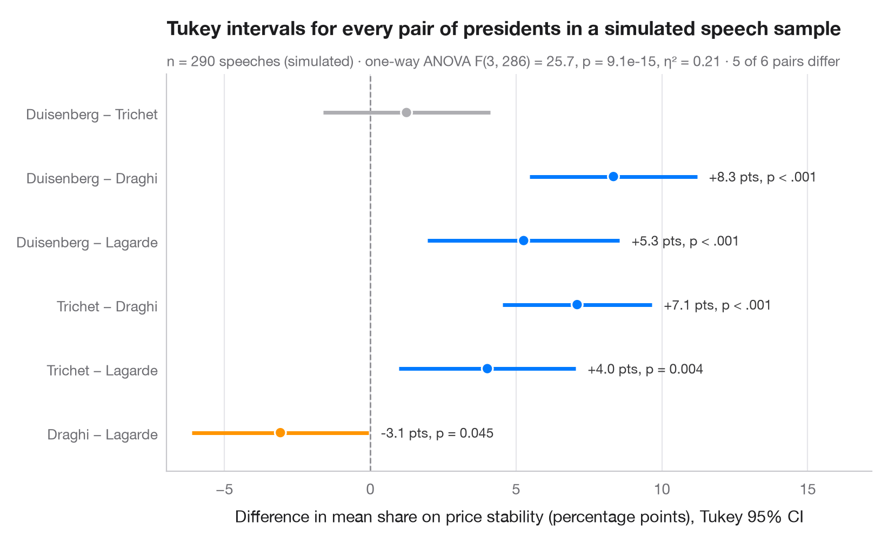

# Tukey HSD intervals

> Simultaneous 95% confidence intervals for every pairwise difference in means.



After an ANOVA says "the groups differ", Tukey's honestly significant
difference (HSD) says *which* pairs differ. Each row is one pairwise
difference in means with a confidence interval that is widened so that all
intervals hold **simultaneously** at 95%. Intervals that do not cross zero are
coloured: blue when the first group is older, orange when it is younger.

Data are 944 respondents of the 1996 American National Election Study
bundled with **statsmodels** (`sm.datasets.anes96`): age by party
identification, from strong Democrat to strong Republican. The intervals come
from `statsmodels.stats.multicomp.pairwise_tukeyhsd`, the omnibus test from
`scipy.stats.f_oneway`.

**R equivalent:** `TukeyHSD() + plot()`  
**Libraries:** Matplotlib, NumPy, pandas, statsmodels, SciPy

```python
import matplotlib.pyplot as plt
import numpy as np
import pandas as pd
import statsmodels.api as sm
from scipy import stats
from statsmodels.stats.multicomp import pairwise_tukeyhsd

# Data: age by party identification (0 = strong Democrat ... 6 = strong Republican)
anes = sm.datasets.anes96.load_pandas().data
names = ["Strong Dem", "Weak Dem", "Lean Dem", "Independent",
         "Lean Rep", "Weak Rep", "Strong Rep"]
anes["party"] = pd.Categorical(anes.PID.astype(int).map(dict(enumerate(names))), names)

# One-way ANOVA, then Tukey HSD on all 21 pairs
F, p = stats.f_oneway(*[g.age for _, g in anes.groupby("party", observed=True)])
k, n = len(names), len(anes)
eta2 = F * (k - 1) / (F * (k - 1) + n - k)
tukey = pairwise_tukeyhsd(anes.age, anes.party.cat.codes)
res = pd.DataFrame(tukey._results_table.data[1:], columns=tukey._results_table.data[0])
# statsmodels reports group2 − group1; flip to read "group1 − group2"
res = res.assign(diff=-res.meandiff, low=-res.upper, high=-res.lower,
                 label=[f"{names[a]} − {names[b]}" for a, b in zip(res.group1, res.group2)])
res = res.iloc[::-1].reset_index(drop=True)  # first pair on top

colors = np.where(~res.reject, "#AEAEB2", np.where(res["diff"] > 0, "#007AFF", "#FF9500"))
fig, ax = plt.subplots(figsize=(8, 7))
y = np.arange(len(res))
ax.axvline(0, color="#8E8E93", lw=1, ls="--", zorder=1)
ax.hlines(y, res.low, res.high, color=colors, lw=2.5, zorder=2)
ax.scatter(res["diff"], y, s=55, color=colors, edgecolor="white", lw=1.2, zorder=3)
for yi, row in res[res.reject].iterrows():
    ax.annotate(f"{row['diff']:+.1f} y, p = {row['p-adj']:.3f}", (row.high, yi), xytext=(8, 0),
                textcoords="offset points", va="center", fontsize=9, color="#3A3A3C")

ax.set_yticks(y, res.label, fontsize=9.5)
ax.set_ylim(-0.7, len(res) - 0.3)
ax.grid(axis="x"); ax.grid(axis="y", visible=False)
ax.set_xlabel("Difference in mean age (years), Tukey 95% family-wise CI")
ax.set_title("Strong Democrats are older than weak and leaning Democrats", pad=26)
ax.text(0, 1.015, f"One-way ANOVA F({k - 1}, {n - k}) = {F:.2f}, p = {p:.3f}, η² = {eta2:.3f}"
        f" · {res.reject.sum()} of {len(res)} pairs significant (Tukey HSD)",
        transform=ax.transAxes, fontsize=9.5, color="#6E6E73")
plt.show()
```

---

**Statlas** by [Thierry Warin](https://www.warin.ca) · [View on the website →](https://warint.github.io/pystatlas/group-comparisons/tukey-hsd/) · [← Group comparisons](../README.md)

**Cite:** Warin, T. (2026). Tukey HSD intervals. In Statlas: The Python Gallery of Statistical Graphics. https://warint.github.io/pystatlas/group-comparisons/tukey-hsd/
