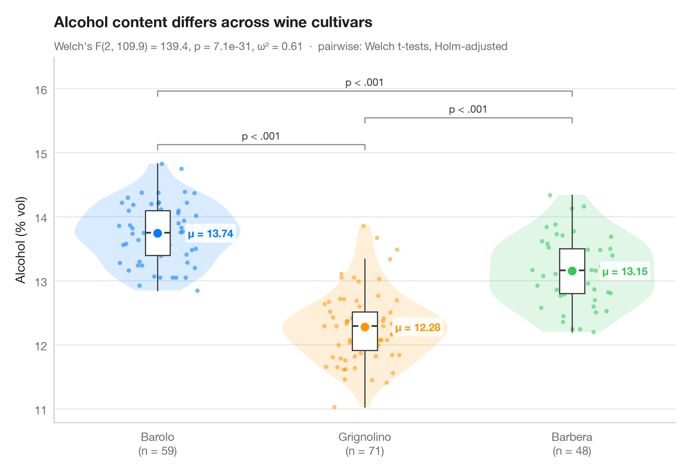
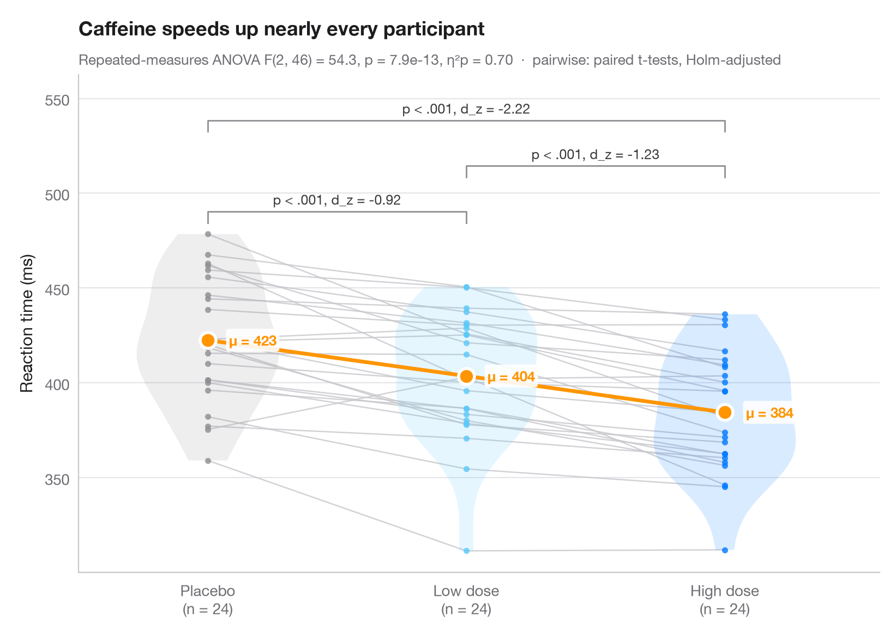
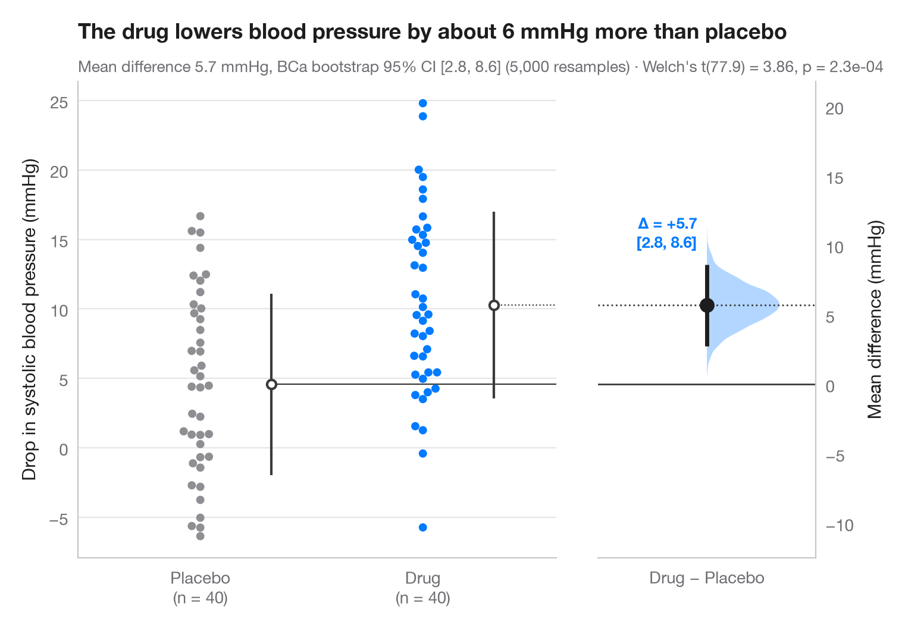
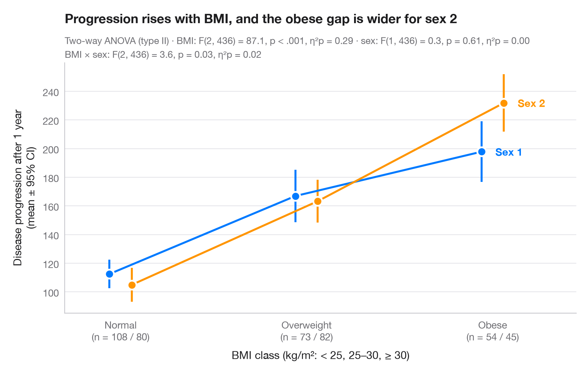
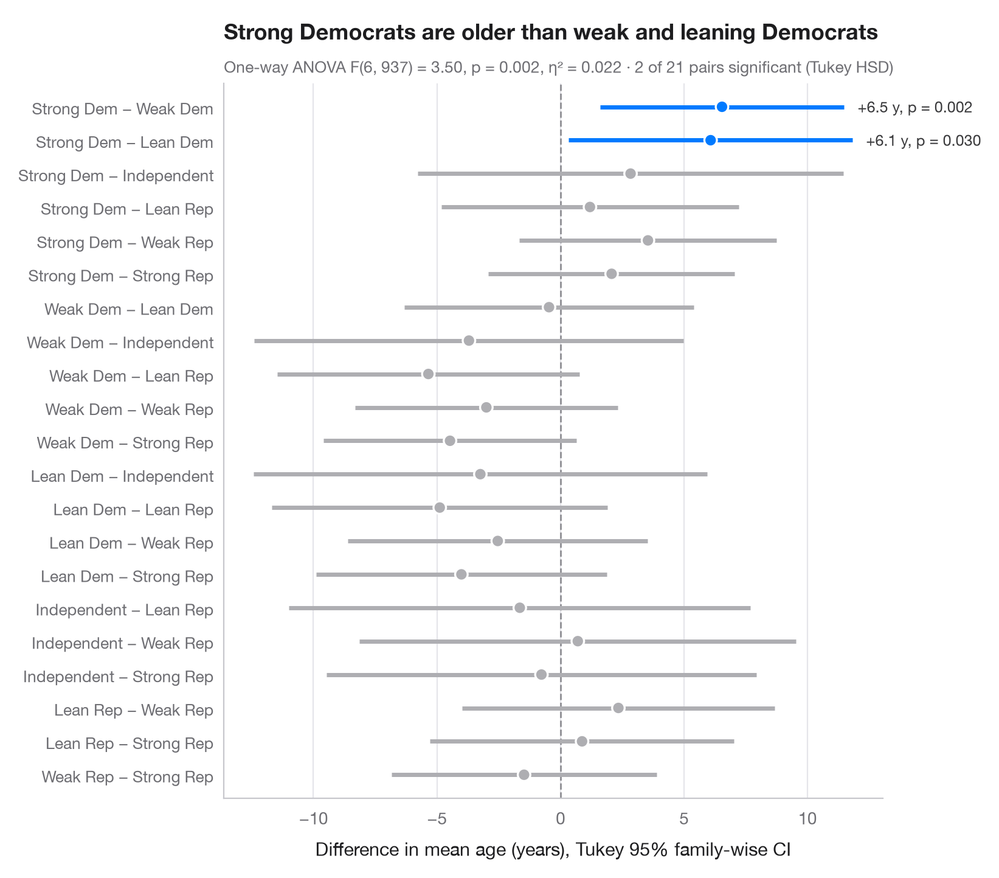

# Group comparisons

Compare groups with the test, effect size and p-values on the chart — the ggstatsplot way.

| Chart | Description |
|:--|:--|
|  | **[Between-groups comparison](01-between-groups-violin/)** Violin + box + points with Welch's ANOVA, effect size and pairwise tests. `ggstatsplot::ggbetweenstats()` |
|  | **[Within-subjects comparison](02-within-subjects/)** Repeated measures with one line per subject, means, rm-ANOVA and paired tests. `ggstatsplot::ggwithinstats()` |
|  | **[Estimation plot](03-estimation-plot/)** Raw data of two groups plus the mean difference and its bootstrap 95% CI. `dabestr::dabest() + plot()` |
|  | **[Interaction plot](04-means-with-ci/)** Group means with 95% confidence intervals for two factors, with a two-way ANOVA. `ggpubr::ggline(add = "mean_ci") / ggstats` |
|  | **[Tukey HSD intervals](05-tukey-hsd/)** Simultaneous 95% confidence intervals for every pairwise difference in means. `TukeyHSD() + plot()` |

[← All families](../../README.md) · [Browse on the website](https://warint.github.io/statlas/group-comparisons/)
