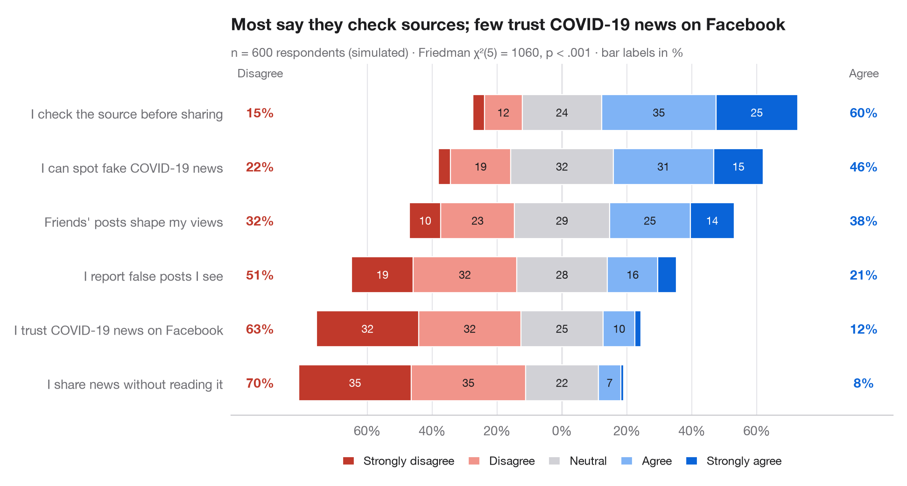

# Diverging Likert chart

> Five-point Likert items as diverging stacked bars centred on the neutral answer.



The Python counterpart of `gglikert()`. Each row is one survey item; the bar is
split into the five answer levels and shifted so that the **neutral** answer sits
astride zero: disagreement grows to the left, agreement to the right. Items are
sorted by total agreement, and the side columns give the total share who
disagree (left) and agree (right), so rows can be compared without reading segments.

Data are a seeded simulation of 600 employees answering six workplace statements.
Percentages come from `pd.crosstab(normalize="index")`; the subtitle reports a
**Friedman test** (`scipy.stats.friedmanchisquare`) asking whether the items
receive the same distribution of answers from the same respondents.

**R equivalent:** `ggstats::gglikert()`  
**Libraries:** Matplotlib, NumPy, pandas, SciPy

**Data:** Simulated data with a fixed random seed, created for this example. — No real respondents, documents or measurements: the numbers only illustrate how the chart and its statistics work.


```python
import matplotlib.pyplot as plt
import numpy as np
import pandas as pd
from scipy import stats

# Simulated survey: 600 respondents, 6 items, answers 1-5 driven by a shared latent mood
rng = np.random.default_rng(42)
items = {"My workload is manageable": -0.6, "I have the tools I need": 0.4,
         "My manager supports me": 0.8, "I feel fairly paid": -1.0,
         "I would recommend this employer": 0.2, "I see a future for myself here": -0.2}
mood = rng.normal(0, 0.8, 600)
answers = pd.DataFrame({item: np.digitize(shift + mood + rng.normal(0, 1, 600),
                                          [-1.6, -0.5, 0.5, 1.6]) + 1
                        for item, shift in items.items()})

levels = ["Strongly disagree", "Disagree", "Neutral", "Agree", "Strongly agree"]
colors = ["#C0392B", "#F1948A", "#D1D1D6", "#7FB3F5", "#0A64D8"]
pct = answers.melt().pipe(lambda d: pd.crosstab(d.variable, d.value, normalize="index") * 100)
pct["agree"], pct["disagree"] = pct[4] + pct[5], pct[1] + pct[2]
pct = pct.sort_values("agree")

# Friedman test: do the six items get the same answers from the same people?
fr = stats.friedmanchisquare(*[answers[c] for c in answers])

fig, ax = plt.subplots(figsize=(9.5, 5))
y = np.arange(len(pct))
left = -(pct[1] + pct[2] + pct[3] / 2)              # start so that neutral is centred on 0
for lev, (name, c) in enumerate(zip(levels, colors), start=1):
    ax.barh(y, pct[lev], left=left, color=c, height=0.66, label=name, edgecolor="white", lw=0.8)
    for yi, (l, w) in enumerate(zip(left, pct[lev])):
        if w >= 6:
            ax.text(l + w / 2, yi, f"{w:.0f}", ha="center", va="center", fontsize=8.5,
                    color="white" if lev in (1, 5) else "#1D1D1F")
    left = left + pct[lev]

# Totals on both sides
for yi, (d, a) in enumerate(zip(pct["disagree"], pct["agree"])):
    ax.text(-93, yi, f"{d:.0f}%", ha="center", va="center", fontsize=10, color="#C0392B", fontweight="semibold")
    ax.text(93, yi, f"{a:.0f}%", ha="center", va="center", fontsize=10, color="#0A64D8", fontweight="semibold")
ax.text(-93, len(pct) - 0.35, "Disagree", ha="center", fontsize=9, color="#6E6E73")
ax.text(93, len(pct) - 0.35, "Agree", ha="center", fontsize=9, color="#6E6E73")

ax.axvline(0, color="#3A3A3C", lw=0.8, zorder=0)
ax.spines["left"].set_visible(False)
ax.set_yticks(y, pct.index)
ax.set_xlim(-102, 102)
ax.set_ylim(-0.6, len(pct) - 0.1)
ax.set_xticks(range(-60, 61, 20), [f"{abs(t)}%" for t in range(-60, 61, 20)])
ax.grid(axis="x"); ax.grid(axis="y", visible=False)
ax.legend(ncols=5, loc="upper center", bbox_to_anchor=(0.5, -0.08), fontsize=9,
          handlelength=1, columnspacing=1.2)
ax.set_title("Staff back their managers but not their pay", pad=26)
ax.text(0, 1.02, f"n = {len(answers)} respondents (simulated) · Friedman χ²({answers.shape[1] - 1}) = "
        f"{fr.statistic:.0f}, p < .001 · bar labels in %", transform=ax.transAxes,
        fontsize=9.5, color="#6E6E73")
plt.show()
```

---

**PyStatlas** by [Thierry Warin](https://www.warin.ca) · [View on the website →](https://warint.github.io/pystatlas/proportions-surveys/likert-diverging/) · [← Proportions & surveys](../README.md)

**Cite:** Warin, T. (2026). Diverging Likert chart. In PyStatlas: A Python Gallery of Statistical Graphics for the Social Sciences. https://warint.github.io/pystatlas/proportions-surveys/likert-diverging/
