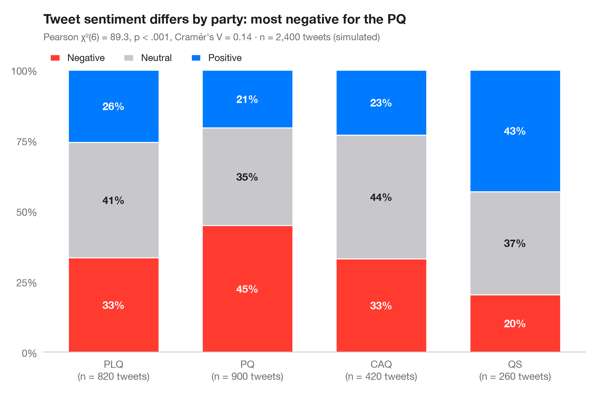

# Stacked proportions by group

> 100% stacked bars with percentage labels, n per bar, chi-squared test and Cramér's V.



The Python counterpart of `ggbarstats()`. Each bar is one group rescaled to
100%, so the segments show the **conditional distribution** of the outcome within
the group; the labels are row percentages and the number under each bar is the
group size. The subtitle reports Pearson's χ² test of independence and
**Cramér's V**, the effect size that rescales χ² to the 0–1 range.

The setting is Sanger & Warin (2018, *Canadian Journal of Communication*) on the
2014 Québec election on Twitter. The data are **simulated** for illustration and
are *not* the paper's data or results: 2,400 tweets mentioning one of four parties
(PLQ, PQ, CAQ, QS), each labelled negative, neutral or positive. The test comes
from `scipy.stats.chi2_contingency` and V from `scipy.stats.contingency.association`.

**R equivalent:** `ggstatsplot::ggbarstats()`  
**Libraries:** Matplotlib, NumPy, pandas, SciPy

**Data:** Simulated data with a fixed random seed, created for this example. — No real respondents, documents or measurements: the numbers only illustrate how the chart and its statistics work.

**Data:** Sanger, W., & Warin, T. (2018). The public's perception of political parties during the 2014 Québec election on Twitter. Canadian Journal of Communication, 43(2), 245–263. https://doi.org/10.22230/cjc.2018v43n2a3251 — The example is set in the context of this paper; unless its description says otherwise, the numbers are simulated and are not the paper's data or results.


```python
import matplotlib.pyplot as plt
import numpy as np
import pandas as pd
from scipy import stats
from scipy.stats.contingency import association
# Simulated data, set in the context of Sanger & Warin (2018) [sanger2018quebec]

# Simulated tweets: party mentioned and sentiment, with party-specific sentiment shares
rng = np.random.default_rng(2014)
probs = {"PLQ": [0.38, 0.37, 0.25], "PQ": [0.47, 0.33, 0.20],
         "CAQ": [0.33, 0.42, 0.25], "QS": [0.24, 0.40, 0.36]}
sizes = {"PLQ": 820, "PQ": 900, "CAQ": 420, "QS": 260}
df = pd.DataFrame([(p, s) for p, n in sizes.items()
                   for s in rng.choice(["Negative", "Neutral", "Positive"], n, p=probs[p])],
                  columns=["party", "sentiment"])

table = pd.crosstab(pd.Categorical(df.party, list(sizes)), df.sentiment)
pct = table.div(table.sum(axis=1), axis=0) * 100

# Pearson chi-squared test of independence + Cramér's V
chi2, p, dof, _ = stats.chi2_contingency(table, correction=False)
v = association(table.to_numpy(), method="cramer")

fig, ax = plt.subplots(figsize=(8, 5.2))
colors = ["#FF3B30", "#C7C7CC", "#007AFF"]
x = np.arange(len(pct))
bottom = np.zeros(len(pct))
for sent, c in zip(pct.columns, colors):
    ax.bar(x, pct[sent], bottom=bottom, color=c, width=0.68, label=sent, edgecolor="white", lw=1)
    for xi, (b, h) in enumerate(zip(bottom, pct[sent])):
        ax.text(xi, b + h / 2, f"{h:.0f}%", ha="center", va="center", fontsize=10.5,
                fontweight="semibold", color="#1D1D1F" if c == "#C7C7CC" else "white")
    bottom += pct[sent].to_numpy()

ax.set_xticks(x, [f"{g}\n(n = {n:,} tweets)" for g, n in zip(pct.index, table.sum(axis=1))])
ax.set_yticks(range(0, 101, 25), [f"{t}%" for t in range(0, 101, 25)])
ax.set_ylim(0, 100)
ax.grid(False)
ax.spines["left"].set_visible(False)
ax.legend(ncols=3, loc="lower left", bbox_to_anchor=(0, 1.0), fontsize=9.5,
          handlelength=1, borderaxespad=0.3)
ax.set_title("Tweet sentiment differs by party: most negative for the PQ", pad=46)
p_txt = "p < .001" if p < 0.001 else f"p = {p:.3f}"
ax.text(0, 1.105, f"Pearson χ²({dof}) = {chi2:.1f}, {p_txt}, Cramér's V = {v:.2f} · "
        f"n = {table.to_numpy().sum():,} tweets (simulated)", transform=ax.transAxes,
        fontsize=9.5, color="#6E6E73")
plt.show()
```

---

**PyStatlas** by [Thierry Warin](https://www.warin.ca) · [View on the website →](https://warint.github.io/pystatlas/proportions-surveys/stacked-proportions/) · [← Proportions & surveys](../README.md)

**Cite:** Warin, T. (2026). Stacked proportions by group. In PyStatlas: A Python Gallery of Statistical Graphics for the Social Sciences. https://warint.github.io/pystatlas/proportions-surveys/stacked-proportions/
