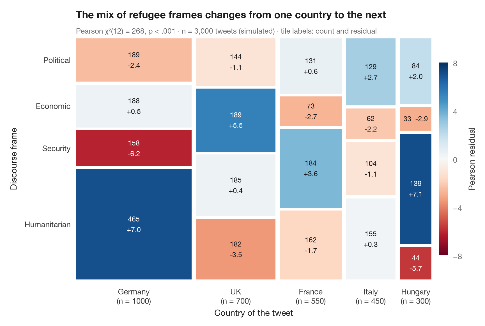

# Mosaic plot with Pearson residuals

> Tile areas proportional to cell counts, shaded by Pearson residuals from independence.



A mosaic plot draws a two-way table as a square cut into tiles. Column **widths**
are the marginal shares of the first variable, tile **heights** the conditional
shares of the second, so every tile's area is proportional to its count. As in
`vcd::mosaic(shade = TRUE)`, the colour is the **Pearson residual**
(observed − expected) / √expected: blue tiles hold more people than independence
predicts, red tiles fewer, and residuals beyond ±2 or ±4 flag the cells that drive χ².

Data are the 1974 *Redbook* survey of 6,366 married women bundled with
**statsmodels** (`sm.datasets.fair`): self-rated marriage quality against time
spent in extramarital affairs. The tiles are drawn by hand with `ax.bar`;
expected counts come from `scipy.stats.chi2_contingency`.

**R equivalent:** `vcd::mosaic(shade = TRUE)`  
**Libraries:** Matplotlib, NumPy, pandas, statsmodels, SciPy

```python
import matplotlib.pyplot as plt
import numpy as np
import pandas as pd
import statsmodels.api as sm
from matplotlib.colors import TwoSlopeNorm
from scipy import stats

# Data: marriage rating (1-5, 1-2 pooled) × time spent in affairs (none / ≤ 1 / > 1)
df = sm.datasets.fair.load_pandas().data
rating = pd.cut(df.rate_marriage, [0, 2, 3, 4, 5], labels=["Poor", "Fair", "Good", "Very good"])
affairs = pd.cut(df.affairs, [-1, 0, 1, np.inf], labels=["None", "Occasional", "Frequent"])
table = pd.crosstab(rating, affairs)
obs = table.to_numpy()

# Chi-squared test and Pearson residuals
chi2, p, dof, expected = stats.chi2_contingency(obs, correction=False)
resid = (obs - expected) / np.sqrt(expected)

fig, ax = plt.subplots(figsize=(8.5, 5.6))
cmap = plt.get_cmap("RdBu")                         # red = fewer than expected, blue = more
norm = TwoSlopeNorm(0, vmin=-12, vmax=12)
gap = 0.012
widths = obs.sum(axis=1) / obs.sum()
x0 = 0
for i, w in enumerate(widths):
    heights = obs[i] / obs[i].sum()
    y0 = 0
    for j, h in enumerate(heights):
        ax.bar(x0, h - gap, width=w - gap, bottom=y0, align="edge",
               color=cmap(norm(resid[i, j])), edgecolor="none")
        sep = "  " if h < 0.12 else "\n"              # thin tiles get a one-line label
        ax.text(x0 + (w - gap) / 2, y0 + (h - gap) / 2, f"{obs[i, j]}{sep}{resid[i, j].round(1) + 0:+.1f}", ha="center", va="center",
                fontsize=9, linespacing=1.3, color="white" if abs(resid[i, j]) > 7 else "#1D1D1F")
        y0 += h
    ax.text(x0 + (w - gap) / 2, -0.03, f"{table.index[i]}\n(n = {obs[i].sum()})", ha="center", va="top",
            fontsize=10, color="#3A3A3C")
    x0 += w

# Row labels on the left, placed at the heights of the first column
y0 = 0
for j, h in enumerate(obs[0] / obs[0].sum()):
    ax.text(-0.015, y0 + (h - gap) / 2, table.columns[j], ha="right", va="center", fontsize=10, color="#3A3A3C")
    y0 += h

sm_ = plt.cm.ScalarMappable(norm=norm, cmap=cmap)
cb = fig.colorbar(sm_, ax=ax, shrink=0.8, pad=0.02, ticks=[-12, -8, -4, 0, 4, 8, 12])
cb.set_label("Pearson residual", color="#3A3A3C")
cb.outline.set_visible(False)
ax.set_xlim(0, 1 - gap); ax.set_ylim(0, 1 - gap)
ax.axis("off")
ax.text(0.5, -0.15, "Self-rated marriage quality", transform=ax.transAxes, ha="center", fontsize=11)
ax.text(-0.19, 0.5, "Time spent in affairs", transform=ax.transAxes, rotation=90, va="center", fontsize=11)
ax.set_title("Unhappy marriages carry far more affairs than chance predicts", pad=26)
ax.text(0, 1.02, f"Pearson χ²({dof}) = {chi2:.0f}, p < .001 · n = {obs.sum():,} · "
        "tile labels: count and residual", transform=ax.transAxes, fontsize=9.5, color="#6E6E73")
plt.show()
```

---

**PyStatlas** by [Thierry Warin](https://www.warin.ca) · [View on the website →](https://warint.github.io/pystatlas/proportions-surveys/mosaic-plot/) · [← Proportions & surveys](../README.md)

**Cite:** Warin, T. (2026). Mosaic plot with Pearson residuals. In PyStatlas: The Python Gallery of Statistical Graphics. https://warint.github.io/pystatlas/proportions-surveys/mosaic-plot/
