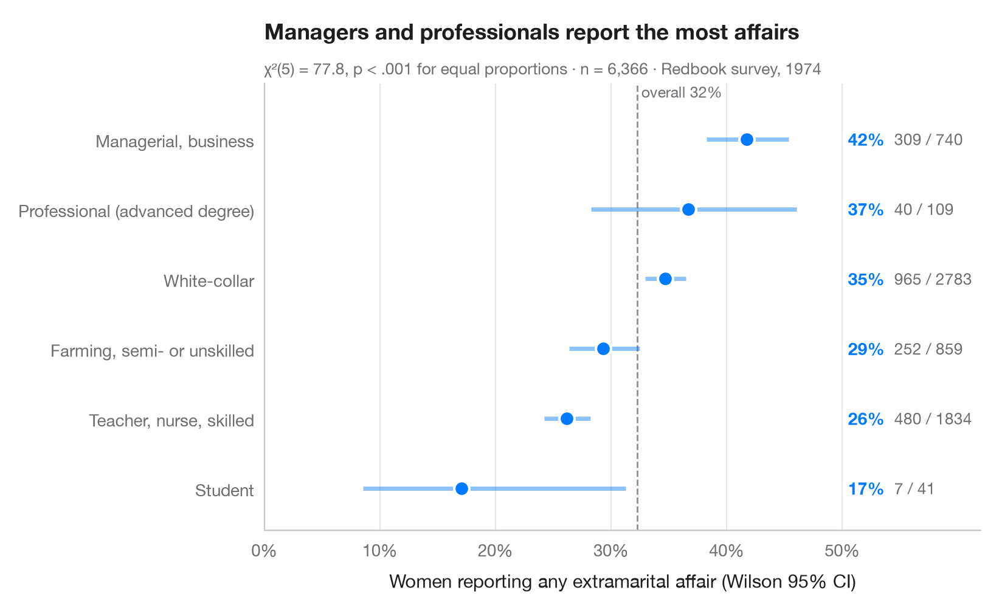

# Proportions with confidence intervals

> A sorted dot plot of group proportions with Wilson 95% confidence intervals.



When the question is "what share of each group…?", a dot per group with its
confidence interval beats a bar chart: the eye compares positions, and the
interval width shows at once which groups are small. The **Wilson score
interval** is used instead of the textbook Wald interval because it keeps its
95% coverage for small groups and proportions near 0 or 1. The dashed line is
the overall proportion.

Data are the 1974 *Redbook* survey of married women bundled with **statsmodels**
(`sm.datasets.fair`): the share who reported any extramarital affair, by the
respondent's occupation. Intervals come from
`statsmodels.stats.proportion.proportion_confint(method="wilson")` and the
subtitle tests equality of all proportions with `scipy.stats.chi2_contingency`.

**R equivalent:** `ggstats::stat_prop() + geom_errorbar()`  
**Libraries:** Matplotlib, NumPy, pandas, statsmodels, SciPy

**Data:** Fair, R. C. (1978). A theory of extramarital affairs. Journal of Political Economy, 86(1), 45–61. https://doi.org/10.1086/260646 — Data from the 1974 Redbook magazine survey; distributed with statsmodels (sm.datasets.fair) with the author's permission.


```python
import matplotlib.pyplot as plt
import numpy as np
import pandas as pd
import statsmodels.api as sm
from scipy import stats
from statsmodels.stats.proportion import proportion_confint

# Data: share of women reporting any affair, by occupation
df = sm.datasets.fair.load_pandas().data
jobs = {1: "Student", 2: "Farming, semi- or unskilled", 3: "White-collar",
        4: "Teacher, nurse, skilled", 5: "Managerial, business", 6: "Professional (advanced degree)"}
df["job"] = df.occupation.map(jobs)
df["affair"] = df.affairs > 0

# Proportion + Wilson 95% CI per group, sorted
g = df.groupby("job").affair.agg(k="sum", n="size")
g["p"] = g.k / g.n
g["low"], g["high"] = proportion_confint(g.k, g.n, alpha=0.05, method="wilson")
g = g.sort_values("p")

# Chi-squared test of homogeneity across the six groups
chi2, pval, dof, _ = stats.chi2_contingency(pd.crosstab(df.job, df.affair), correction=False)
overall = df.affair.mean()

fig, ax = plt.subplots(figsize=(8, 4.8))
y = np.arange(len(g))
ax.axvline(overall, color="#8E8E93", lw=1, ls="--", zorder=1)
ax.text(overall, len(g) - 0.45, f" overall {overall:.0%}", fontsize=9, color="#6E6E73", va="bottom")
ax.hlines(y, g.low, g.high, color="#007AFF", lw=2.5, alpha=0.45, zorder=2)
ax.scatter(g.p, y, s=80, color="#007AFF", edgecolor="white", lw=1.5, zorder=3)

for yi, (_, row) in zip(y, g.iterrows()):
    ax.text(0.505, yi, f"{row.p:.0%}", va="center", fontsize=10, fontweight="semibold", color="#007AFF")
    ax.text(0.545, yi, f"{row.k:.0f} / {row.n:.0f}", va="center", fontsize=9.5, color="#6E6E73")

ax.set_yticks(y, g.index)
ax.set_ylim(-0.6, len(g) - 0.2)
ax.set_xlim(0, 0.62)
ax.set_xticks(np.arange(0, 0.51, 0.1))
ax.xaxis.set_major_formatter(plt.matplotlib.ticker.PercentFormatter(1, decimals=0))
ax.grid(axis="x"); ax.grid(axis="y", visible=False)
ax.set_xlabel("Women reporting any extramarital affair (Wilson 95% CI)")
ax.set_title("Managers and professionals report the most affairs", pad=26)
ax.text(0, 1.02, f"χ²({dof}) = {chi2:.1f}, p < .001 for equal proportions · n = {len(df):,} · "
        "Redbook survey, 1974", transform=ax.transAxes, fontsize=9.5, color="#6E6E73")
plt.show()
```

---

**PyStatlas** by [Thierry Warin](https://www.warin.ca) · [View on the website →](https://warint.github.io/pystatlas/proportions-surveys/proportions-with-ci/) · [← Proportions & surveys](../README.md)

**Cite:** Warin, T. (2026). Proportions with confidence intervals. In PyStatlas: A Python Gallery of Statistical Graphics for the Social Sciences. https://warint.github.io/pystatlas/proportions-surveys/proportions-with-ci/
