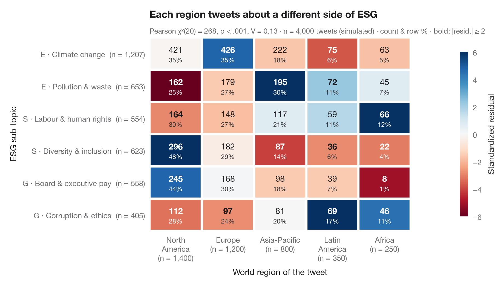

# Cross-table with standardized residuals

> A contingency table as a heatmap, coloured by standardized residuals from independence.



The Python counterpart of `ggstats::ggtable()`: the familiar cross-tab, but each
cell is coloured by its **standardized (adjusted) residual** — how many standard
errors the observed count sits above or below what independence would predict.
Under independence these residuals are roughly standard normal, so cells beyond
±2 (marked in bold) are the ones that make the χ² test significant. Each cell
prints the count and its row percentage; the margins give the totals.

Data are the 1974 *Redbook* survey bundled with **statsmodels**
(`sm.datasets.fair`): religiousness against self-rated marriage quality for 6,366
women. Expected counts come from `scipy.stats.chi2_contingency`; the residual is
(O − E) / √(E · (1 − row share) · (1 − column share)).

**R equivalent:** `ggstats::ggtable() / stat_cross()`  
**Libraries:** Matplotlib, NumPy, pandas, statsmodels, SciPy

**Data:** Fair, R. C. (1978). A theory of extramarital affairs. Journal of Political Economy, 86(1), 45–61. https://doi.org/10.1086/260646 — Data from the 1974 Redbook magazine survey; distributed with statsmodels (sm.datasets.fair) with the author's permission.


```python
import matplotlib.pyplot as plt
import numpy as np
import pandas as pd
import statsmodels.api as sm
from matplotlib.colors import TwoSlopeNorm
from scipy import stats

# Data: religiousness (rows) × marriage rating (columns)
df = sm.datasets.fair.load_pandas().data
rel = df.religious.map({1: "Not religious", 2: "Mildly", 3: "Fairly", 4: "Strongly"})
rate = df.rate_marriage.map({1: "Very poor", 2: "Poor", 3: "Fair", 4: "Good", 5: "Very good"})
table = pd.crosstab(pd.Categorical(rel, ["Not religious", "Mildly", "Fairly", "Strongly"]),
                    pd.Categorical(rate, ["Very poor", "Poor", "Fair", "Good", "Very good"]))
obs = table.to_numpy()
n = obs.sum()

# Chi-squared test and adjusted (standardized) residuals
chi2, p, dof, exp = stats.chi2_contingency(obs, correction=False)
row_share, col_share = obs.sum(1, keepdims=True) / n, obs.sum(0, keepdims=True) / n
std_resid = (obs - exp) / np.sqrt(exp * (1 - row_share) * (1 - col_share))
row_pct = obs / obs.sum(1, keepdims=True) * 100
v = np.sqrt(chi2 / (n * (min(obs.shape) - 1)))

fig, ax = plt.subplots(figsize=(9, 5))
norm = TwoSlopeNorm(0, vmin=-6, vmax=6)
im = ax.imshow(std_resid, cmap="RdBu_r", norm=norm, aspect="auto")
for i in range(obs.shape[0]):
    for j in range(obs.shape[1]):
        strong = abs(std_resid[i, j]) >= 2
        ax.text(j, i - 0.12, f"{obs[i, j]:,}", ha="center", va="center", fontsize=11,
                fontweight="bold" if strong else "normal",
                color="white" if abs(std_resid[i, j]) > 3 else "#1D1D1F")
        ax.text(j, i + 0.2, f"{row_pct[i, j]:.0f}%", ha="center", va="center", fontsize=8.5,
                color="white" if abs(std_resid[i, j]) > 3 else "#3A3A3C")

# White gutters between cells and totals in the margins
ax.set_xticks(np.arange(-0.5, obs.shape[1]), minor=True)
ax.set_yticks(np.arange(-0.5, obs.shape[0]), minor=True)
ax.grid(which="minor", color="white", lw=3)
ax.grid(which="major", visible=False)
ax.tick_params(which="minor", length=0)
ax.set_xticks(range(obs.shape[1]), [f"{c}\n(n = {t:,})" for c, t in zip(table.columns, obs.sum(0))])
ax.set_yticks(range(obs.shape[0]), [f"{r}  (n = {t:,})" for r, t in zip(table.index, obs.sum(1))])
for s in ax.spines.values():
    s.set_visible(False)
ax.set_xlabel("Self-rated marriage quality")
ax.set_ylabel("Religiousness")

cb = fig.colorbar(im, ax=ax, shrink=0.85, pad=0.02, ticks=[-6, -4, -2, 0, 2, 4, 6])
cb.set_label("Standardized residual", color="#3A3A3C")
cb.outline.set_visible(False)
ax.set_title("Strongly religious women report the happiest marriages", pad=26)
ax.text(0, 1.02, f"Pearson χ²({dof}) = {chi2:.1f}, p < .001, Cramér's V = {v:.2f} · n = {n:,} · "
        "count & row % · bold: |resid.| ≥ 2", transform=ax.transAxes,
        fontsize=9.5, color="#6E6E73")
plt.show()
```

---

**PyStatlas** by [Thierry Warin](https://www.warin.ca) · [View on the website →](https://warint.github.io/pystatlas/proportions-surveys/crosstab-residuals/) · [← Proportions & surveys](../README.md)

**Cite:** Warin, T. (2026). Cross-table with standardized residuals. In PyStatlas: A Python Gallery of Statistical Graphics for the Social Sciences. https://warint.github.io/pystatlas/proportions-surveys/crosstab-residuals/
