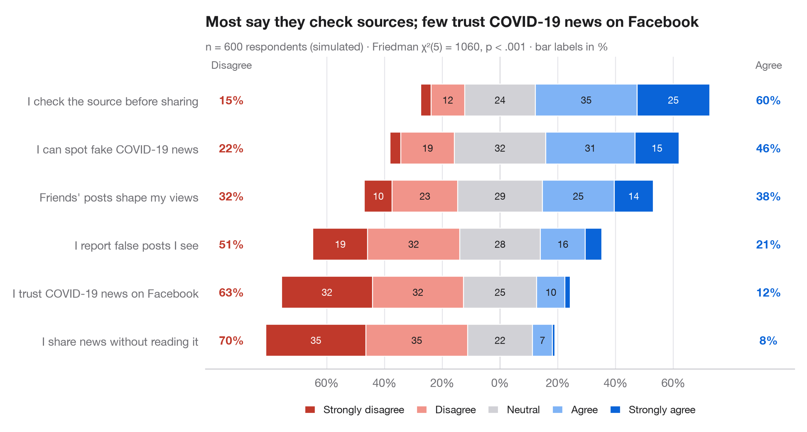
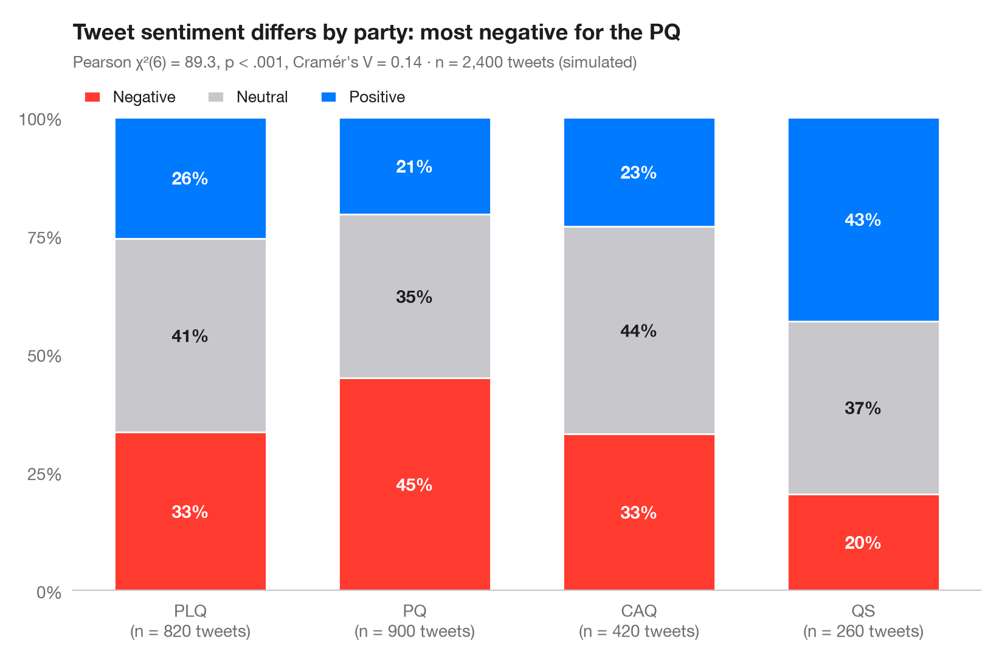
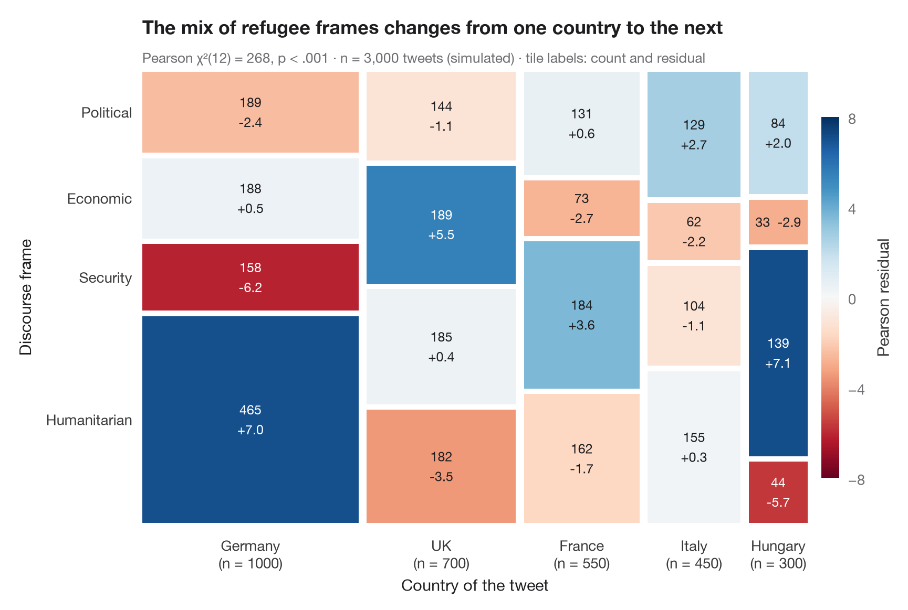
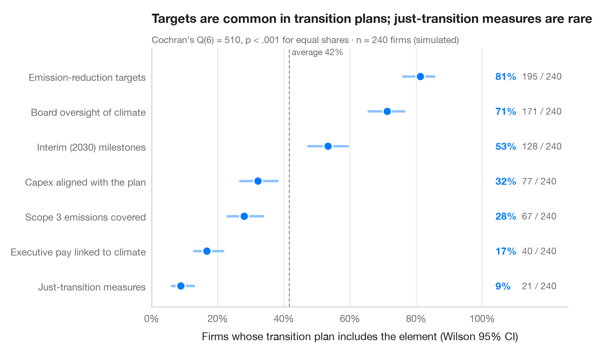
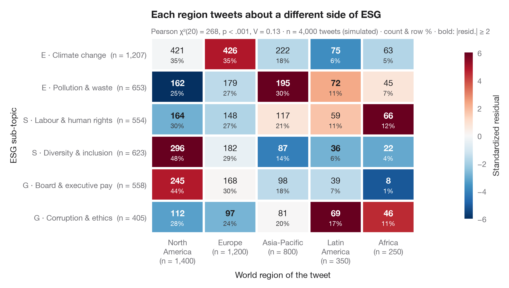

# Proportions & surveys

Proportions, cross-tabs and Likert scales, in the spirit of ggstats::gglikert and stat_prop.

| Chart | Description |
|:--|:--|
|  | **[Diverging Likert chart](01-likert-diverging/)** Five-point Likert items as diverging stacked bars centred on the neutral answer. `ggstats::gglikert()` |
|  | **[Stacked proportions by group](02-stacked-proportions/)** 100% stacked bars with percentage labels, n per bar, chi-squared test and Cramér's V. `ggstatsplot::ggbarstats()` |
|  | **[Mosaic plot with Pearson residuals](03-mosaic-plot/)** Tile areas proportional to cell counts, shaded by Pearson residuals from independence. `vcd::mosaic(shade = TRUE)` |
|  | **[Proportions with confidence intervals](04-proportions-with-ci/)** A sorted dot plot of proportions with Wilson 95% confidence intervals. `ggstats::stat_prop() + geom_errorbar()` |
|  | **[Cross-table with standardized residuals](05-crosstab-residuals/)** A contingency table as a heatmap, coloured by standardized residuals from independence. `ggstats::ggtable() / stat_cross()` |

[← All families](../../README.md) · [Browse on the website](https://warint.github.io/pystatlas/proportions-surveys/)
