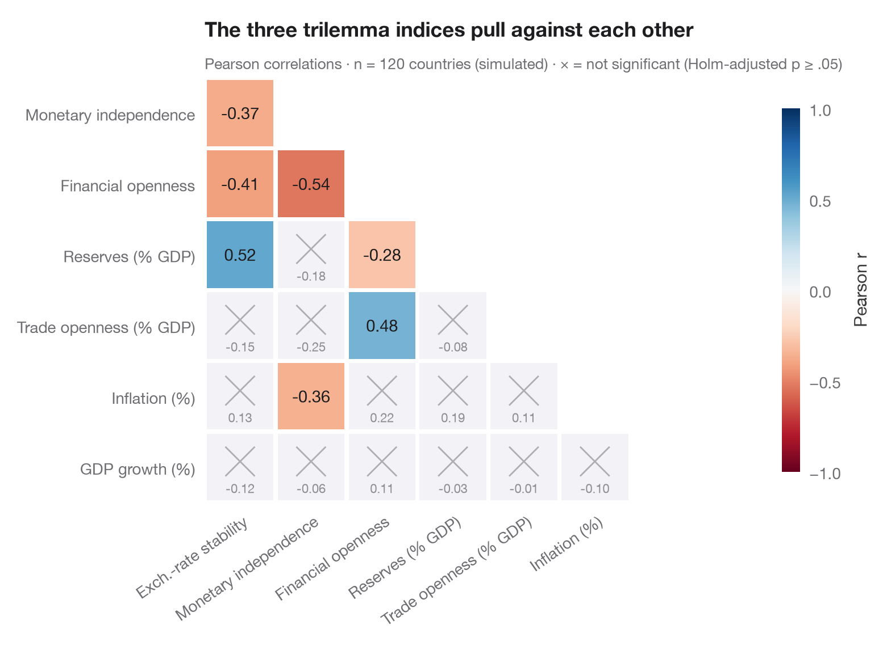

# Correlation matrix

> Lower-triangle Pearson correlation heatmap; non-significant cells (Holm) are crossed out.



The Python counterpart of `ggcorrmat()`. Only the lower triangle is drawn, since
a correlation matrix is symmetric; each tile shows Pearson's *r*, coloured on a
diverging scale from −1 (red) to +1 (blue). Because 21 correlations are tested
at once, the p-values are **Holm-adjusted**, and pairs that are not significant
at α = .05 after adjustment are greyed out and crossed, so the eye skips them.

The setting is Stojkov & Warin (2019, *Data in Brief*), a four-decade dataset on
the Mundellian trilemma. The data are **simulated** for illustration and are
*not* the dataset's values: 120 countries with the three trilemma indices
(exchange-rate stability, monetary independence, financial openness), built so
that they roughly sum to 2, plus four macro variables. Correlations and p-values
come from `scipy.stats.pearsonr`, the adjustment from
`statsmodels.stats.multitest.multipletests(method="holm")`.

**R equivalent:** `ggstatsplot::ggcorrmat()`  
**Libraries:** Matplotlib, NumPy, pandas, SciPy, statsmodels

**Data:** Simulated data with a fixed random seed, created for this example. — No real respondents, documents or measurements: the numbers only illustrate how the chart and its statistics work.

**Data:** Stojkov, A., & Warin, T. (2019). Navigating through the Mundellian trilemma: A dataset of four decades. Data in Brief, 27, 104677. https://doi.org/10.1016/j.dib.2019.104677 — The example is set in the context of this paper; unless its description says otherwise, the numbers are simulated and are not the paper's data or results.


```python
from itertools import combinations

import matplotlib.pyplot as plt
import numpy as np
import pandas as pd
from scipy import stats
from statsmodels.stats.multitest import multipletests

# Simulated data, set in the context of Stojkov & Warin (2019) [stojkov2019trilemma]

# Simulated cross-section: 120 countries; the trilemma indices share a budget of about 2
rng = np.random.default_rng(1999)
n = 120
share = rng.dirichlet([2, 2, 2], n)                    # how each country "gives up" the budget
ers, mi, ka = (np.clip(1 - share + rng.normal(0, 0.08, (n, 3)), 0, 1)).T
df = pd.DataFrame({"Exch.-rate stability": ers, "Monetary independence": mi,
                   "Financial openness": ka,
                   "Reserves (% GDP)": 8 + 25 * ers + rng.normal(0, 7, n),
                   "Trade openness (% GDP)": 50 + 60 * ka + rng.normal(0, 25, n),
                   "Inflation (%)": 6 - 4 * mi + rng.gamma(2, 1.5, n),
                   "GDP growth (%)": 3 + rng.normal(0, 2, n)})
k = df.shape[1]

# Pearson r and Holm-adjusted p-values for every pair
pairs = list(combinations(range(k), 2))
tests = [stats.pearsonr(df.iloc[:, i], df.iloc[:, j]) for i, j in pairs]
p_adj = multipletests([t.pvalue for t in tests], method="holm")[1]

fig, ax = plt.subplots(figsize=(7.6, 6.2))
cmap, norm = plt.get_cmap("RdBu"), plt.Normalize(-1, 1)
for (i, j), t, p in zip(pairs, tests, p_adj):
    row, col = j, i                                    # lower triangle: row > column
    sig = p < 0.05
    ax.add_patch(plt.Rectangle((col - 0.5 + 0.03, row - 0.5 + 0.03), 0.94, 0.94,
                               color=cmap(norm(t.statistic)) if sig else "#F2F2F7", lw=0))
    if sig:
        ax.text(col, row, f"{t.statistic:.2f}", ha="center", va="center", fontsize=10.5,
                color="white" if abs(t.statistic) > 0.6 else "#1D1D1F")
    else:
        ax.plot([col - 0.2, col + 0.2], [row - 0.28, row + 0.12], color="#AEAEB2", lw=1)
        ax.plot([col - 0.2, col + 0.2], [row + 0.12, row - 0.28], color="#AEAEB2", lw=1)
        ax.text(col, row + 0.3, f"{t.statistic:.2f}", ha="center", va="center", fontsize=8, color="#8E8E93")

ax.set_xlim(-0.5, k - 1.5)
ax.set_ylim(k - 0.5, 0.5)
ax.set_xticks(range(k - 1), df.columns[:-1], rotation=35, ha="right", rotation_mode="anchor")
ax.set_yticks(range(1, k), df.columns[1:])
ax.set_aspect("equal")
ax.grid(False)
for s in ax.spines.values():
    s.set_visible(False)

cb = fig.colorbar(plt.cm.ScalarMappable(norm=norm, cmap=cmap), ax=ax, shrink=0.7, pad=0.02,
                  ticks=[-1, -0.5, 0, 0.5, 1])
cb.set_label("Pearson r", color="#3A3A3C")
cb.outline.set_visible(False)
ax.set_title("The three trilemma indices pull against each other", pad=26)
ax.text(0, 1.02, f"Pearson correlations · n = {len(df)} countries (simulated) · "
        f"× = not significant (Holm-adjusted p ≥ .05)", transform=ax.transAxes,
        fontsize=9.5, color="#6E6E73")
plt.show()
```

---

**PyStatlas** by [Thierry Warin](https://www.warin.ca) · [View on the website →](https://warint.github.io/pystatlas/correlation/correlation-matrix/) · [← Correlation & association](../README.md)

**Cite:** Warin, T. (2026). Correlation matrix. In PyStatlas: A Python Gallery of Statistical Graphics for the Social Sciences. https://warint.github.io/pystatlas/correlation/correlation-matrix/
