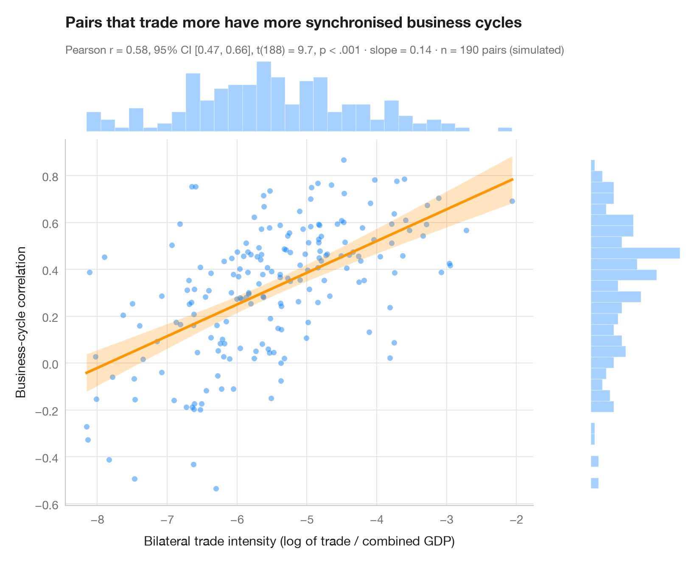

# Scatterplot with statistics

> Trade intensity vs business-cycle correlation for country pairs — scatter, OLS line with 95% band, marginal histograms and Pearson's r.



The Python counterpart of `ggscatterstats()`. The central panel shows every
observation with the least-squares line and its 95% confidence band (uncertainty
about the mean of *y* at each *x*, not about individual points). Marginal
histograms on the top and right reveal the shape of each variable, which a
correlation coefficient silently assumes is reasonable. The subtitle reports
Pearson's *r* with its 95% confidence interval, the t-test, the OLS slope and
the sample size.

The setting is Janicki, Warin & Wunnava (2009, *Review of International
Economics*), which tests Mundell's intuition that trade integration makes
business cycles move together. The data are **simulated** for illustration and
are *not* the paper's data or results: 190 country pairs (all pairs of 20
countries), with the log of bilateral trade intensity and the correlation of the
two countries' detrended output. The fitted line describes an association between
pairs, not an effect. The test comes from `scipy.stats.pearsonr`, the line and
band from **statsmodels** OLS `get_prediction().conf_int()`.

**R equivalent:** `ggstatsplot::ggscatterstats()`  
**Libraries:** Matplotlib, NumPy, statsmodels, SciPy

**Data:** Simulated data with a fixed random seed, created for this example. — No real respondents, documents or measurements: the numbers only illustrate how the chart and its statistics work.

**Data:** Janicki, H., Warin, T., & Wunnava, P. (2009). Testing Mundell's intuition of endogenous OCA theory. Review of International Economics, 17(1), 74–86. https://doi.org/10.1111/j.1467-9396.2008.00802.x — The example is set in the context of this paper; unless its description says otherwise, the numbers are simulated and are not the paper's data or results.


```python
import matplotlib.pyplot as plt
import numpy as np
import statsmodels.api as sm
from scipy import stats

# Simulated data, set in the context of Janicki, Warin & Wunnava (2009) [janicki2009]

# Simulated country pairs: 20 countries -> 190 pairs; cycles co-move more where trade is denser
rng = np.random.default_rng(2009)
x = rng.normal(-5.5, 1.1, 190)                        # log(bilateral trade / combined GDP)
y = np.tanh(0.35 + 0.13 * (x + 5.5) + rng.normal(0, 0.28, 190))   # business-cycle correlation
n = len(x)

# Pearson correlation with its 95% CI
res = stats.pearsonr(x, y)
ci = res.confidence_interval(0.95)

# OLS fit and 95% confidence band for the mean
fit = sm.OLS(y, sm.add_constant(x)).fit()
grid = np.linspace(x.min(), x.max(), 200)
band = fit.get_prediction(sm.add_constant(grid)).conf_int(alpha=0.05)

fig = plt.figure(figsize=(8, 6.4))
gs = fig.add_gridspec(2, 2, width_ratios=(5, 1), height_ratios=(1, 5), wspace=0.03, hspace=0.03)
ax = fig.add_subplot(gs[1, 0])
ax_top = fig.add_subplot(gs[0, 0], sharex=ax)
ax_right = fig.add_subplot(gs[1, 1], sharey=ax)

ax.scatter(x, y, s=22, color="#007AFF", alpha=0.45, lw=0)
ax.fill_between(grid, band[:, 0], band[:, 1], color="#FF9500", alpha=0.25, lw=0)
ax.plot(grid, fit.params[0] + fit.params[1] * grid, color="#FF9500", lw=2.2)
ax.set_xlabel("Bilateral trade intensity (log of trade / combined GDP)")
ax.set_ylabel("Business-cycle correlation")
ax.grid(axis="x")

# Marginal histograms
ax_top.hist(x, bins=30, color="#007AFF", alpha=0.35, edgecolor="white")
ax_right.hist(y, bins=30, color="#007AFF", alpha=0.35, edgecolor="white", orientation="horizontal")
for a in (ax_top, ax_right):
    a.axis("off")

ax_top.set_title("Pairs that trade more have more synchronised business cycles", pad=26)
p_txt = "p < .001" if res.pvalue < 0.001 else f"p = {res.pvalue:.3f}"
ax_top.text(0, 1.06, f"Pearson r = {res.statistic:.2f}, 95% CI [{ci.low:.2f}, {ci.high:.2f}], "
            f"t({n - 2}) = {fit.tvalues[1]:.1f}, {p_txt} · slope = {fit.params[1]:.2f} · n = {n} pairs (simulated)",
            transform=ax_top.transAxes, fontsize=9.5, color="#6E6E73")
plt.show()
```

---

**PyStatlas** by [Thierry Warin](https://www.warin.ca) · [View on the website →](https://warint.github.io/pystatlas/correlation/scatter-with-stats/) · [← Correlation & association](../README.md)

**Cite:** Warin, T. (2026). Scatterplot with statistics. In PyStatlas: A Python Gallery of Statistical Graphics for the Social Sciences (Version 1.1.0) [Computer software]. https://warint.github.io/pystatlas/correlation/scatter-with-stats/
