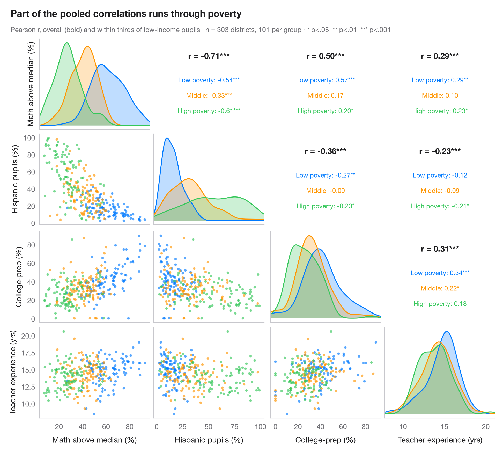

# Pairs plot with correlations

> Scatter matrix of four school-district variables, with group KDEs on the diagonal and pooled vs within-group correlations above it.



The Python counterpart of `GGally::ggpairs()`. Every pair of variables gets a
scatterplot below the diagonal, coloured by group; the diagonal shows each
variable's density per group; and the mirror cell above the diagonal prints
Pearson's *r*, overall (bold) and within each group, with significance stars.
Comparing the two is the point: pooled and within-group correlations can differ
sharply — even in sign — when groups sit in different regions of the plot.

Data are the 303 California school districts of the STAR98 test bundled with
**statsmodels** (`sm.datasets.star98`): the share of pupils above the national
median in math, the shares of Hispanic pupils and of pupils in college-prep
(UC/CSU) courses, and teachers' average years of experience. Districts are
grouped into thirds of their share of low-income pupils (`pd.qcut`, 101 each),
so the within-group coefficients hold poverty roughly constant: the link
between Hispanic share and math results, −0.71 overall, is weaker inside every
poverty group. Densities use `scipy.stats.gaussian_kde` and correlations
`scipy.stats.pearsonr`; the grid is a plain `plt.subplots(4, 4)`.

**R equivalent:** `GGally::ggpairs()`  
**Libraries:** Matplotlib, NumPy, pandas, statsmodels, SciPy

```python
import matplotlib.pyplot as plt
import numpy as np
import pandas as pd
import statsmodels.api as sm
from scipy import stats

# Data: 303 California school districts (STAR98), grouped by thirds of low-income pupils
raw = sm.datasets.star98.load_pandas().data
df = pd.DataFrame({"Math above median (%)": 100 * raw.NABOVE / (raw.NABOVE + raw.NBELOW),
                   "Hispanic pupils (%)": raw.PERHISP, "College-prep (%)": raw.PCTAF,
                   "Teacher experience (yrs)": raw.AVYRSEXP})
groups = ["Low poverty", "Middle", "High poverty"]
df["group"] = pd.qcut(raw.LOWINC, 3, labels=groups).astype(str)
cols = df.columns[:4]
palette = ["#007AFF", "#FF9500", "#34C759"]
stars = lambda p: "***" if p < .001 else "**" if p < .01 else "*" if p < .05 else ""

fig, axes = plt.subplots(4, 4, figsize=(9.5, 8.6), sharex="col")
lims = {c: (df[c].min() - 0.05 * np.ptp(df[c]), df[c].max() + 0.05 * np.ptp(df[c])) for c in cols}
fig.get_layout_engine().set(rect=(0, 0, 1, 0.92), w_pad=0.04, h_pad=0.04)
for i, yv in enumerate(cols):
    for j, xv in enumerate(cols):
        ax = axes[i, j]
        ax.grid(False)
        if i == j:                                       # diagonal: KDE per group
            grid = np.linspace(*lims[xv], 200)
            for s, c in zip(groups, palette):
                dens = stats.gaussian_kde(df.loc[df.group == s, xv])(grid)
                ax.fill_between(grid, dens, color=c, alpha=0.25, lw=0)
                ax.plot(grid, dens, color=c, lw=1.3)
            ax.set_yticks([])
        elif i > j:                                      # lower: scatter by group
            for s, c in zip(groups, palette):
                d = df[df.group == s]
                ax.scatter(d[xv], d[yv], s=12, color=c, alpha=0.65, lw=0)
            ax.set_ylim(lims[yv])
        else:                                            # upper: correlation coefficients
            r, p = stats.pearsonr(df[xv], df[yv])
            ax.text(0.5, 0.78, f"r = {r:.2f}{stars(p)}", ha="center", fontsize=11,
                    fontweight="semibold", transform=ax.transAxes)
            for k, (s, c) in enumerate(zip(groups, palette)):
                d = df[df.group == s]
                rs, ps = stats.pearsonr(d[xv], d[yv])
                ax.text(0.5, 0.52 - k * 0.17, f"{s}: {rs:.2f}{stars(ps)}", ha="center",
                        fontsize=9, color=c, transform=ax.transAxes)
            ax.tick_params(labelbottom=False, labelleft=False)
            for sp in ax.spines.values():
                sp.set_visible(False)
        if i < 3:
            ax.tick_params(labelbottom=False)
        if j > 0 or i == 0:
            ax.tick_params(labelleft=False)
        if i == 3:
            ax.set_xlabel(xv)
            ax.set_xlim(lims[xv])
        if j == 0:
            ax.set_ylabel(yv)

fig.text(0.01, 0.985, "Part of the pooled correlations runs through poverty", fontsize=13,
         fontweight="semibold", va="top")
fig.text(0.01, 0.945, f"Pearson r, overall (bold) and within thirds of low-income pupils · n = {len(df)} "
         "districts, 101 per group · * p<.05  ** p<.01  *** p<.001", fontsize=9.5, color="#6E6E73", va="top")
plt.show()
```

---

**PyStatlas** by [Thierry Warin](https://www.warin.ca) · [View on the website →](https://warint.github.io/pystatlas/correlation/pairs-plot/) · [← Correlation & association](../README.md)

**Cite:** Warin, T. (2026). Pairs plot with correlations. In PyStatlas: The Python Gallery of Statistical Graphics. https://warint.github.io/pystatlas/correlation/pairs-plot/
