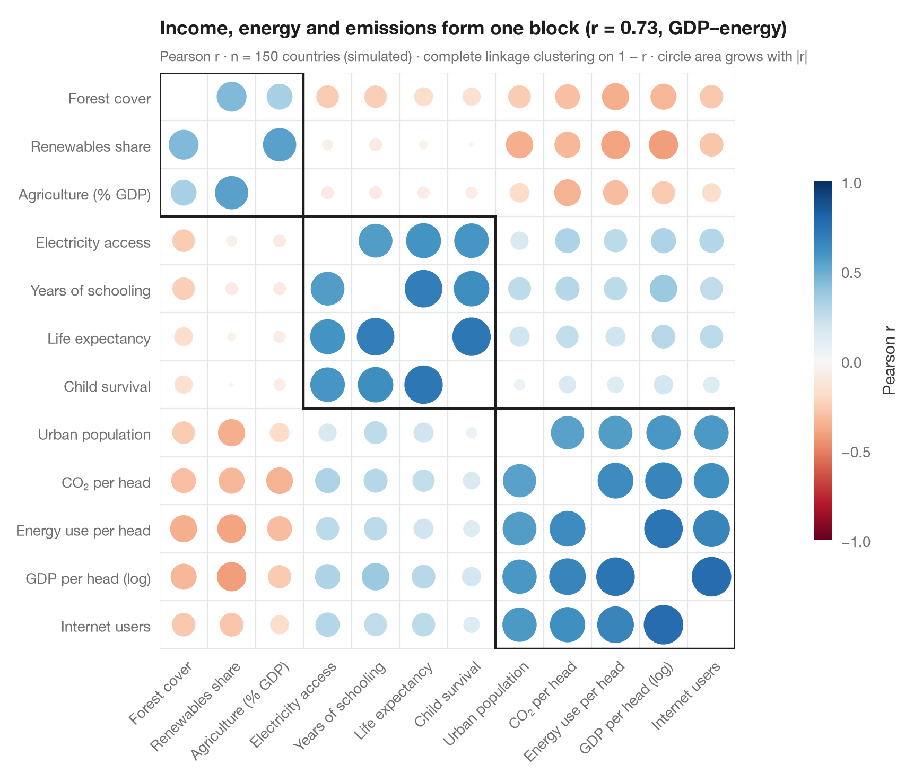

# Correlogram with clustering

> Corrplot-style circles sized and coloured by r for 13 school-district indicators, ordered by hierarchical clustering.



The Python counterpart of `corrplot(method = "circle", order = "hclust")`. Each
circle's **area** grows with |*r*| and its colour gives the sign, so strong
correlations pop out and weak ones fade. The variables are reordered by
**hierarchical clustering** (complete linkage on the distance 1 − *r*), which
pulls positively correlated variables into blocks along the diagonal; the boxes
outline the three clusters, like `addrect = 3`. Here low-income, Hispanic pupils
and minority teachers form one block, and math results correlate negatively with
all three.

Data are 13 indicators for the 303 California school districts of the STAR98
test bundled with **statsmodels** (`sm.datasets.star98`): math results (share
of pupils above the national median), pupil composition (low-income, Hispanic,
Black and Asian pupils), teachers (minority share, experience, salary), resources
(spending per pupil, pupil–teacher ratio) and school organisation (college-prep
courses, charter and year-round schools). The ordering comes from
`scipy.cluster.hierarchy.linkage` and `leaves_list`, the boxes from `fcluster`.

**R equivalent:** `corrplot::corrplot(order = "hclust", addrect = 3)`  
**Libraries:** Matplotlib, NumPy, statsmodels, SciPy

**Data:** Gill, J. (2001). Generalized Linear Models: A Unified Approach (Quantitative Applications in the Social Sciences, No. 134). Sage. https://www.statsmodels.org/stable/datasets/generated/star98.html — Original data from the California Department of Education's Standardized Testing and Reporting (STAR) program, 1998. Subset distributed with statsmodels (sm.datasets.star98) with the author's permission.


```python
import matplotlib.pyplot as plt
import numpy as np
import statsmodels.api as sm
from matplotlib.patches import Circle, Rectangle
from scipy.cluster.hierarchy import fcluster, leaves_list, linkage
from scipy.spatial.distance import squareform

# Data: 13 indicators for 303 California school districts (STAR98, bundled with statsmodels)
df = sm.datasets.star98.load_pandas().data
df["MATH"] = 100 * df.NABOVE / (df.NABOVE + df.NBELOW)
labels = {"MATH": "Math above median", "LOWINC": "Low-income pupils",
          "PERHISP": "Hispanic pupils", "PERBLACK": "Black pupils",
          "PERASIAN": "Asian pupils", "PERMINTE": "Minority teachers",
          "AVYRSEXP": "Teacher experience", "AVSALK": "Teacher salary",
          "PERSPENK": "Spending per pupil", "PTRATIO": "Pupil–teacher ratio",
          "PCTAF": "College-prep courses", "PCTCHRT": "Charter schools",
          "PCTYRRND": "Year-round schools"}
df = df[list(labels)].rename(columns=labels)
corr = df.corr()

# Hierarchical clustering on the distance 1 - r, then reorder the matrix
Z = linkage(squareform(1 - corr.to_numpy(), checks=False), method="complete")
order = leaves_list(Z)
corr = corr.iloc[order, order]
clusters = fcluster(Z, t=3, criterion="maxclust")[order]
k = len(corr)

fig, ax = plt.subplots(figsize=(8.4, 7.2))
cmap, norm = plt.get_cmap("RdBu"), plt.Normalize(-1, 1)
for i in range(k):
    for j in range(k):
        r = corr.iat[i, j]
        if i == j:
            continue
        ax.add_patch(Circle((j, i), radius=0.47 * np.sqrt(abs(r)), color=cmap(norm(r)), lw=0))

# Boxes around the clusters (consecutive runs along the diagonal)
start = 0
for idx in range(1, k + 1):
    if idx == k or clusters[idx] != clusters[start]:
        ax.add_patch(Rectangle((start - 0.5, start - 0.5), idx - start, idx - start,
                               fill=False, ec="#1D1D1F", lw=1.6))
        start = idx

ax.set_xticks(range(k), corr.columns, rotation=45, ha="right", rotation_mode="anchor")
ax.set_yticks(range(k), corr.index)
ax.set_xticks(np.arange(-0.5, k), minor=True)
ax.set_yticks(np.arange(-0.5, k), minor=True)
ax.grid(which="minor", color="#E5E5EA", lw=0.8)
ax.grid(which="major", visible=False)
ax.tick_params(which="minor", length=0)
ax.set_xlim(-0.5, k - 0.5)
ax.set_ylim(k - 0.5, -0.5)
ax.set_aspect("equal")
for s in ax.spines.values():
    s.set_visible(False)

cb = fig.colorbar(plt.cm.ScalarMappable(norm=norm, cmap=cmap), ax=ax, shrink=0.6, pad=0.02,
                  ticks=[-1, -0.5, 0, 0.5, 1])
cb.set_label("Pearson r", color="#3A3A3C")
cb.outline.set_visible(False)
r_pov = corr.loc["Math above median", "Low-income pupils"]
ax.set_title(f"Math results run against the poverty block (r = {r_pov:.2f} with low income)", pad=26)
ax.text(0, 1.02, f"Pearson r · n = {len(df)} school districts · complete-linkage clustering on 1 − r · "
        "circle area grows with |r|", transform=ax.transAxes, fontsize=9.5, color="#6E6E73")
plt.show()
```

---

**PyStatlas** by [Thierry Warin](https://www.warin.ca) · [View on the website →](https://warint.github.io/pystatlas/correlation/correlogram-bubble/) · [← Correlation & association](../README.md)

**Cite:** Warin, T. (2026). Correlogram with clustering. In PyStatlas: The Python Gallery of Statistical Graphics for the Social Sciences. https://warint.github.io/pystatlas/correlation/correlogram-bubble/
