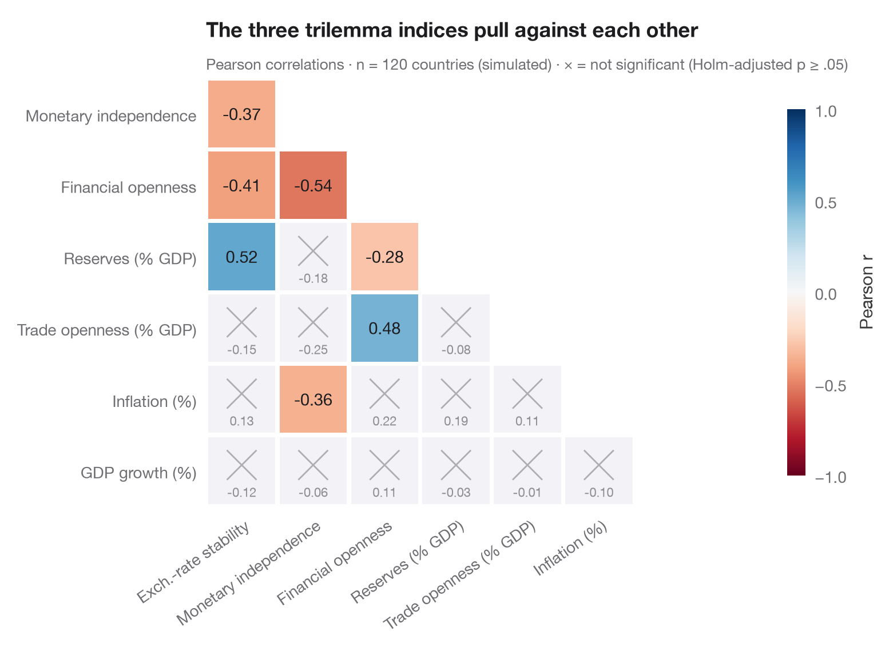
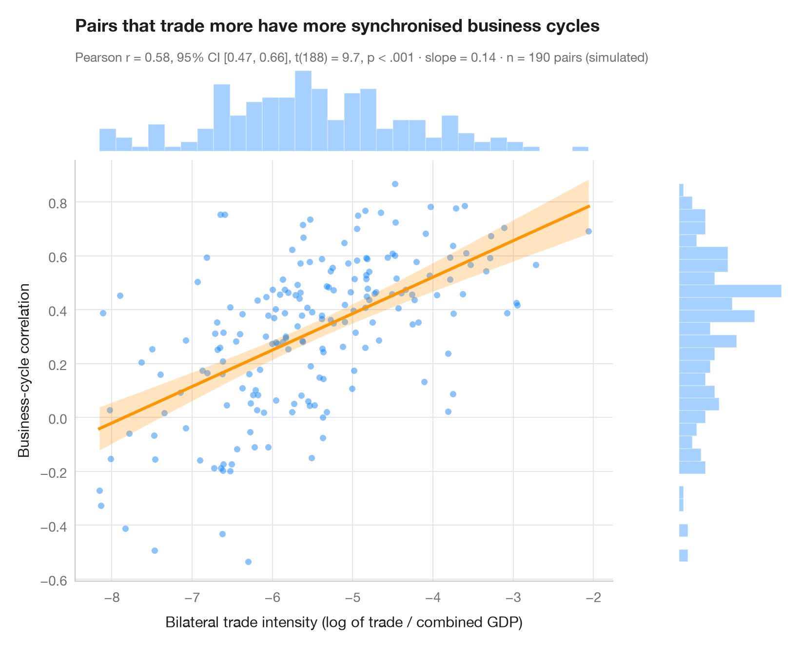
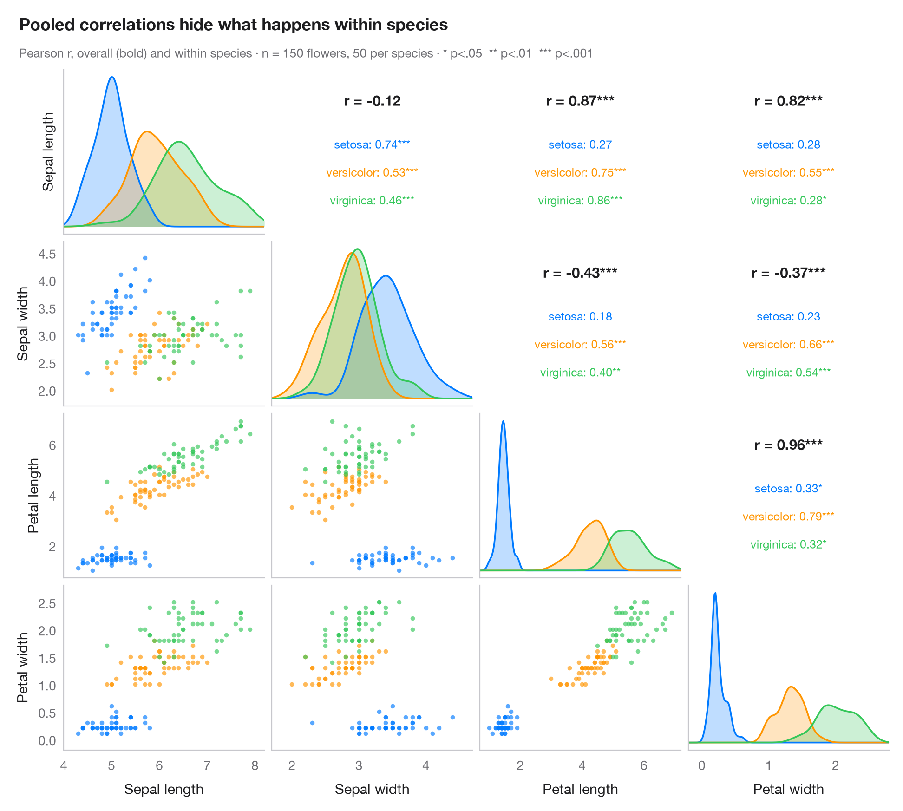
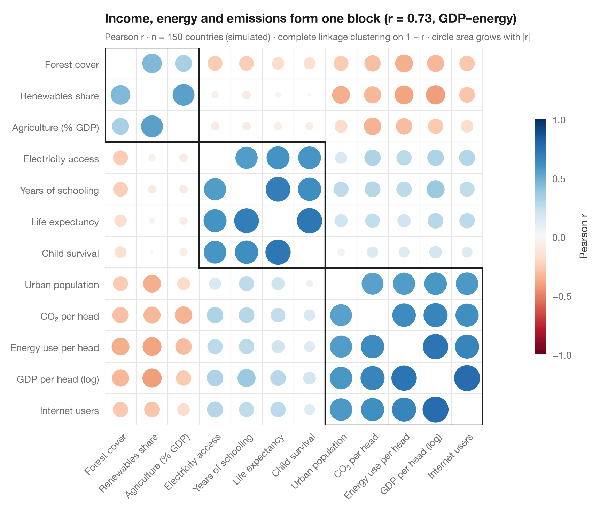

# Correlation & association

Correlation matrices, scatterplots with statistics and pairwise relationships.

| Chart | Description |
|:--|:--|
|  | **[Correlation matrix](01-correlation-matrix/)** Lower-triangle Pearson correlation heatmap; non-significant cells (Holm) are crossed out. `ggstatsplot::ggcorrmat()` |
|  | **[Scatterplot with statistics](02-scatter-with-stats/)** Scatter, OLS line with 95% band and marginal histograms, with Pearson's r in the subtitle. `ggstatsplot::ggscatterstats()` |
|  | **[Pairs plot with correlations](03-pairs-plot/)** Scatter matrix with group KDEs on the diagonal and correlation coefficients above it. `GGally::ggpairs()` |
|  | **[Correlogram with clustering](04-correlogram-bubble/)** Corrplot-style circles sized and coloured by r, ordered by hierarchical clustering. `corrplot::corrplot(order = "hclust", addrect = 3)` |

[← All families](../../README.md) · [Browse on the website](https://warint.github.io/pystatlas/correlation/)
