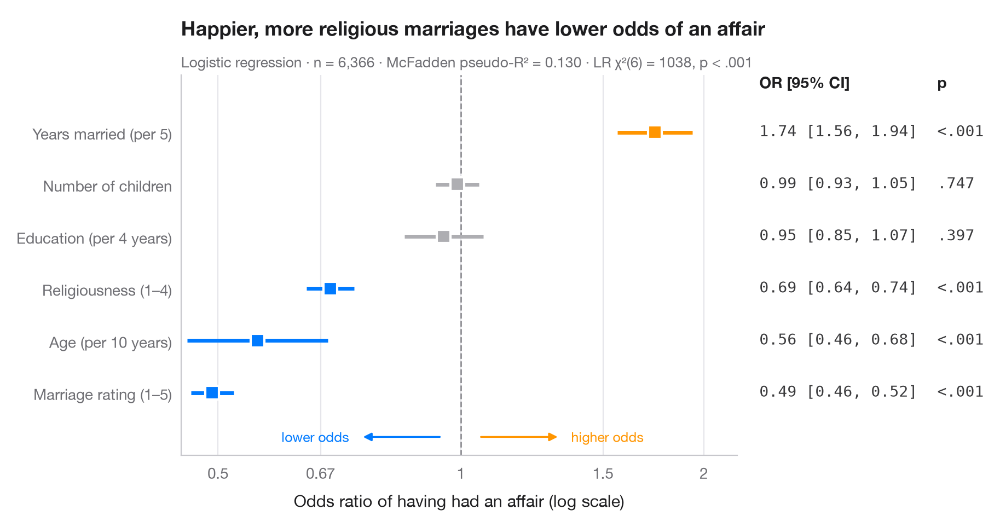

# Odds-ratio forest plot

> Logistic regression odds ratios on a log scale, with a table of OR [95% CI] alongside.



Logistic coefficients are log-odds; exponentiated, they become **odds ratios**.
Each point is the multiplicative change in the odds of the outcome for a one-unit
change in the predictor, the line is its 95% confidence interval, and the dashed
line at OR = 1 means "no effect". Because ratios are symmetric on a log scale
(0.5 is as strong as 2), the x-axis is logarithmic. The right-hand column repeats
the numbers, just like the table in a paper.

The setting is Blakely & Warin (2012, *Global Economy Journal*): choice or
mimetism in the decision to migrate in Europe. The data are **simulated** for
illustration — they are not the paper's data or results: n = 2,500 survey
respondents, and the outcome is whether they intend to move abroad. Predictors
are age, tertiary education, unemployment, having family or friends abroad and
life satisfaction. The model is fitted with `smf.logit()` and the odds ratios are
`np.exp()` of `params` and `conf_int()`.

**R equivalent:** `ggstats::ggcoef_model(exponentiate = TRUE)`  
**Libraries:** Matplotlib, NumPy, pandas, statsmodels

**Data:** Simulated data with a fixed random seed, created for this example. — No real respondents, documents or measurements: the numbers only illustrate how the chart and its statistics work.

**Data:** Blakely, A., & Warin, T. (2012). Choice or mimetism in the decision to migrate? A European illustration. Global Economy Journal, 12(2). https://doi.org/10.1515/1524-5861.1818 — The example is set in the context of this paper; unless its description says otherwise, the numbers are simulated and are not the paper's data or results.


```python
import matplotlib.pyplot as plt
import numpy as np
import pandas as pd
import statsmodels.formula.api as smf
from matplotlib.ticker import FixedLocator, NullLocator
# Simulated data, set in the context of Blakely & Warin (2012) [blakely2012]

# Data: 2,500 respondents; intention to migrate from a known logistic model
rng = np.random.default_rng(2012)
n = 2500
df = pd.DataFrame({"age10": rng.uniform(1.8, 6.5, n), "tertiary": rng.binomial(1, 0.3, n),
                   "unemployed": rng.binomial(1, 0.1, n), "network": rng.binomial(1, 0.35, n),
                   "satisfaction": rng.integers(1, 11, n)})
eta = (-0.2 - 0.45 * df.age10 + 0.35 * df.tertiary + 0.7 * df.unemployed
       + 0.95 * df.network - 0.12 * df.satisfaction)
df["migrate"] = rng.binomial(1, 1 / (1 + np.exp(-eta)))

model = smf.logit("migrate ~ age10 + tertiary + unemployed + network + satisfaction",
                  data=df).fit(disp=False)

# Odds ratios with 95% CI (intercept dropped), sorted by effect
tab = np.exp(model.conf_int().drop("Intercept")).rename(columns={0: "low", 1: "high"})
tab = tab.assign(OR=np.exp(model.params), p=model.pvalues).sort_values("OR")
labels = {"age10": "Age (per 10 years)", "tertiary": "Tertiary education",
          "unemployed": "Unemployed", "network": "Family/friends abroad",
          "satisfaction": "Life satisfaction (1–10)"}

fig, ax = plt.subplots(figsize=(8.6, 4.6))
y = np.arange(len(tab))
colors = np.where(tab["p"] < 0.05, np.where(tab["OR"] > 1, "#FF9500", "#007AFF"), "#AEAEB2")

ax.axvline(1, color="#8E8E93", lw=1, ls="--", zorder=1)
ax.hlines(y, tab["low"], tab["high"], color=colors, lw=2.5, zorder=2)
ax.scatter(tab["OR"], y, s=80, marker="s", color=colors, edgecolor="white", lw=1.5, zorder=3)

# Right-hand "table" column: OR [95% CI] and p-value
tr = ax.get_yaxis_transform()
top = len(tab) - 0.15
ax.text(1.04, top, "OR [95% CI]", transform=tr, fontsize=10, fontweight="semibold")
ax.text(1.40, top, "p", transform=tr, fontsize=10, fontweight="semibold")
for yi, (_, r) in zip(y, tab.iterrows()):
    ax.text(1.04, yi, f"{r.OR:.2f} [{r.low:.2f}, {r.high:.2f}]", transform=tr,
            va="center", fontsize=10, color="#3A3A3C", family="monospace")
    ax.text(1.40, yi, "<.001" if r.p < .001 else f"{r.p:.3f}".lstrip("0"), transform=tr,
            va="center", fontsize=10, color="#3A3A3C", family="monospace")

ax.set_xscale("log")
ticks = [0.5, 0.67, 1, 1.5, 2, 3]
ax.xaxis.set_major_locator(FixedLocator(ticks))
ax.xaxis.set_minor_locator(NullLocator())
ax.set_xticklabels([f"{t:g}" for t in ticks])
ax.set_xlim(0.45, 3.9)
ax.set_yticks(y, [labels[t] for t in tab.index])
ax.set_ylim(-1.2, len(tab) + 0.1)
ax.grid(axis="x"); ax.grid(axis="y", visible=False)
ax.set_xlabel("Odds ratio of intending to migrate (log scale)")
# Direction hints along the bottom of the panel
for x0, x1, txt, c in [(0.95, 0.75, "lower odds", "#007AFF"), (1.05, 1.33, "higher odds", "#FF9500")]:
    ax.annotate("", (x1, -0.85), (x0, -0.85), arrowprops=dict(arrowstyle="-|>", color=c, lw=1.2))
    ax.text(x1 * (0.97 if x1 < 1 else 1.03), -0.85, txt, color=c, fontsize=9, va="center",
            ha="right" if x1 < 1 else "left")
ax.set_title("Family or friends abroad more than double the odds of planning to move", pad=26)
ax.text(0, 1.02, f"Logistic regression · n = {int(model.nobs):,} respondents (simulated) · "
        f"McFadden pseudo-R² = {model.prsquared:.3f} · LR χ²({model.df_model:.0f}) = "
        f"{model.llr:.0f}, p < .001", transform=ax.transAxes, fontsize=9.5, color="#6E6E73")
plt.show()
```

---

**PyStatlas** by [Thierry Warin](https://www.warin.ca) · [View on the website →](https://warint.github.io/pystatlas/regression-models/odds-ratio-forest/) · [← Regression models](../README.md)

**Cite:** Warin, T. (2026). Odds-ratio forest plot. In PyStatlas: A Python Gallery of Statistical Graphics for the Social Sciences (Version 1.1.0) [Computer software]. https://warint.github.io/pystatlas/regression-models/odds-ratio-forest/
