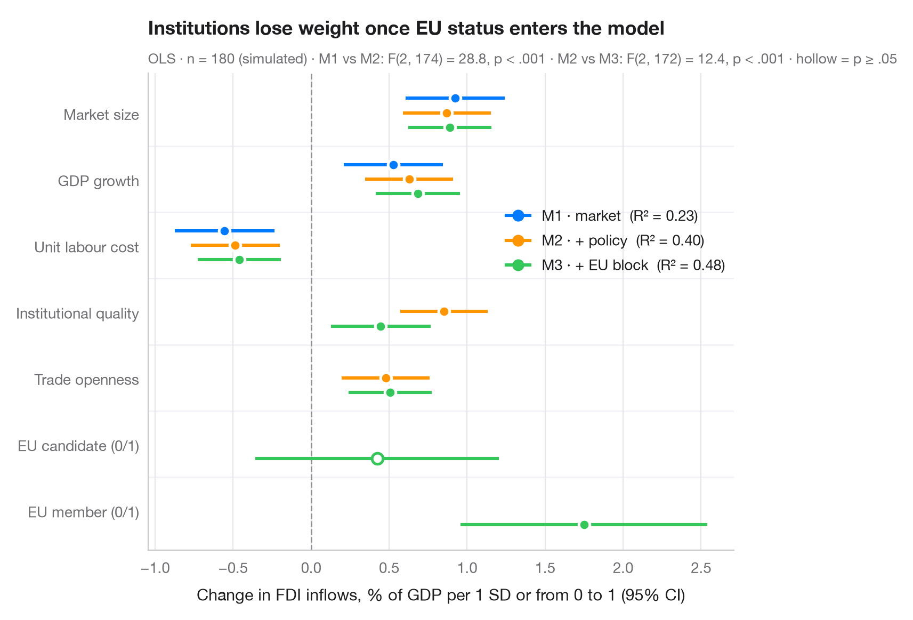

# Comparing nested models

> Coefficients of three nested FDI regressions side by side, to see how estimates shift as an EU block is added.



When covariates are added one block at a time, the interesting question is often
not *which* terms are significant but *how the estimates move*. Here each term
gets one row and each model one dodged dot-and-whisker, so you can follow a
coefficient as the model grows. Hollow markers are not significant at 5%. The
subtitle compares the models with R² and F-tests of the added blocks.

The setting is Stojkov & Warin (2018, *Journal of East-West Business*): EU
membership and foreign direct investment in transition economies. The data are
**simulated** for illustration — they are not the paper's data or results:
n = 180 country-years (10 economies × 18 years), with FDI inflows in % of GDP.
M1 holds market factors (market size, GDP growth, unit labour cost), M2 adds
policy (institutional quality, trade openness) and M3 adds the EU block
(candidate status, membership, both 0/1). Continuous predictors are
standardised. Institutions improve as countries approach the EU, so their
coefficient shrinks once the EU block enters. Models are fitted with `smf.ols()`
and compared with `anova_lm()`.

**R equivalent:** `ggstats::ggcoef_compare()`  
**Libraries:** Matplotlib, NumPy, pandas, statsmodels

**Data:** Simulated data with a fixed random seed, created for this example. — No real respondents, documents or measurements: the numbers only illustrate how the chart and its statistics work.

**Data:** Stojkov, A., & Warin, T. (2018). EU membership and FDI: Is there an endogenous credibility effect? Journal of East-West Business, 24, 144–169. https://doi.org/10.1080/10669868.2018.1431579 — The example is set in the context of this paper; unless its description says otherwise, the numbers are simulated and are not the paper's data or results.


```python
import matplotlib.pyplot as plt
import numpy as np
import pandas as pd
import statsmodels.formula.api as smf
from statsmodels.stats.anova import anova_lm
# Simulated data, set in the context of Stojkov & Warin (2018) [stojkov2018fdi]

# Data: 10 transition economies × 18 years; EU candidate status precedes membership
rng = np.random.default_rng(2018)
year = np.tile(np.arange(18), 10)
entry = np.repeat(rng.integers(8, 14, 10), 18)              # year of EU entry per country
df = pd.DataFrame({"candidate": ((year >= entry - 5) & (year < entry)).astype(int),
                   "member": (year >= entry).astype(int)})
df["size"], df["growth"], df["ulc"], df["openness"] = rng.normal(size=(4, 180))
df["institutions"] = 0.8 * df.candidate + 1.4 * df.member + rng.normal(0, 0.8, 180)
df["fdi"] = (4 + 0.8 * df["size"] + 0.6 * df.growth - 0.5 * df.ulc + 0.4 * df.openness
             + 0.3 * df.institutions + 1.0 * df.candidate + 1.8 * df.member
             + rng.normal(0, 1.8, 180))
X = ["size", "growth", "ulc", "institutions", "openness"]
df[X] = (df[X] - df[X].mean()) / df[X].std()

# Three nested models, each adding a block of predictors
formulas = {"M1 · market": "fdi ~ size + growth + ulc",
            "M2 · + policy": "fdi ~ size + growth + ulc + institutions + openness",
            "M3 · + EU block": "fdi ~ size + growth + ulc + institutions + openness + candidate + member"}
fits = {name: smf.ols(f, data=df).fit() for name, f in formulas.items()}
f_tests = anova_lm(*fits.values())

labels = {"size": "Market size", "growth": "GDP growth", "ulc": "Unit labour cost",
          "institutions": "Institutional quality", "openness": "Trade openness",
          "candidate": "EU candidate (0/1)", "member": "EU member (0/1)"}
terms = list(labels)[::-1]
palette = ["#007AFF", "#FF9500", "#34C759"]

fig, ax = plt.subplots(figsize=(8, 5.6))
ax.axvline(0, color="#8E8E93", lw=1, ls="--", zorder=1)
for k, ((name, m), c) in enumerate(zip(fits.items(), palette)):
    offset = (1 - k) * 0.22                      # dodge: first model on top
    ci = m.conf_int()
    for i, t in enumerate(terms):
        if t not in m.params:
            continue
        sig = m.pvalues[t] < 0.05
        ax.hlines(i + offset, ci.loc[t, 0], ci.loc[t, 1], color=c, lw=2.2, zorder=2)
        ax.scatter(m.params[t], i + offset, s=55, zorder=3, lw=1.8,
                   color=c if sig else "white", edgecolor=c if not sig else "white")
    ax.plot([], [], "o-", color=c, lw=2.2, ms=7,
            label=f"{name}  (R² = {m.rsquared:.2f})")

for i in range(len(terms) - 1):                  # thin separators between terms
    ax.axhline(i + 0.5, color="#F2F2F7", lw=1, zorder=0)
ax.set_yticks(range(len(terms)), [labels[t] for t in terms])
ax.set_ylim(-0.6, len(terms) - 0.4)
ax.grid(axis="x"); ax.grid(axis="y", visible=False)
ax.set_xlabel("Change in FDI inflows, % of GDP per 1 SD or from 0 to 1 (95% CI)")
ax.legend(loc="center right", bbox_to_anchor=(1, 0.65), handlelength=1.6, borderaxespad=0.2)
ax.set_title("Institutions lose weight once EU status enters the model", pad=26)
fmt_p = lambda p: "p < .001" if p < .001 else f"p = {p:.3f}".replace("0.", ".")
blocks = [f"M{j} vs M{j + 1}: F({f_tests.df_diff[j]:.0f}, {f_tests.df_resid[j]:.0f}) = "
          f"{f_tests.F[j]:.1f}, {fmt_p(f_tests['Pr(>F)'][j])}" for j in (1, 2)]
ax.text(0, 1.02, f"OLS · n = {int(fits['M1 · market'].nobs)} (simulated) · " + " · ".join(blocks)
        + " · hollow = p ≥ .05", transform=ax.transAxes, fontsize=9.5, color="#6E6E73")
plt.show()
```

---

**PyStatlas** by [Thierry Warin](https://www.warin.ca) · [View on the website →](https://warint.github.io/pystatlas/regression-models/compare-models/) · [← Regression models](../README.md)

**Cite:** Warin, T. (2026). Comparing nested models. In PyStatlas: A Python Gallery of Statistical Graphics for the Social Sciences (Version 1.1.0) [Computer software]. https://warint.github.io/pystatlas/regression-models/compare-models/
