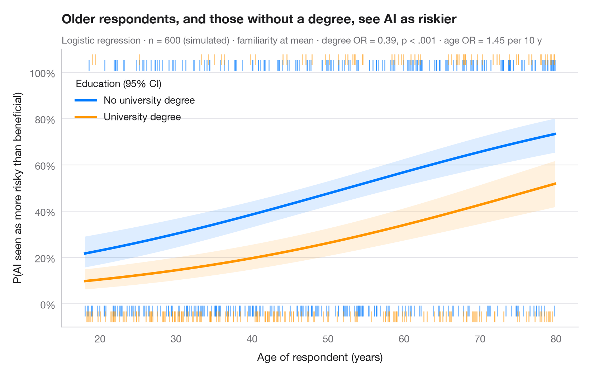

# Predicted probabilities

> Model-based probability curves with 95% CI ribbons across a predictor, by group.



Odds ratios are hard to feel; probabilities are not. This chart turns a logistic
model back into the outcome scale: each curve is the predicted probability of
the outcome across the range of a continuous predictor, for one level of a
factor, with the other covariate held at its mean. Ribbons are 95% confidence
intervals computed on the logit scale and back-transformed, so they stay inside
[0, 1]. Rugs show the observed respondents — at the top if they gave the answer,
at the bottom if they did not.

The setting is Kouloukoui, de Marcellis-Warin & Warin (2025, *AI & Society*):
public perceptions of the risks and benefits of artificial intelligence. The
data are **simulated** for illustration — they are not the paper's data or
results: n = 600 survey respondents, the outcome is whether they see AI as more
risky than beneficial, and the predictors are age, a university degree and
self-rated familiarity with AI (1–5). The model is a binomial `smf.glm()`; the
curves come from `get_prediction().summary_frame()`.

**R equivalent:** `ggeffects::ggpredict() / marginaleffects::plot_predictions()`  
**Libraries:** Matplotlib, NumPy, pandas, statsmodels

**Data:** Simulated data with a fixed random seed, created for this example. — No real respondents, documents or measurements: the numbers only illustrate how the chart and its statistics work.

**Data:** Kouloukoui, D., de Marcellis-Warin, N., & Warin, T. (2025). Balancing risks and benefits: Public perceptions of AI through traditional surveys and social media analysis. AI & Society, 40(6), 4919–4942. https://doi.org/10.1007/s00146-025-02232-x — The example is set in the context of this paper; unless its description says otherwise, the numbers are simulated and are not the paper's data or results.


```python
import matplotlib.pyplot as plt
import numpy as np
import pandas as pd
import statsmodels.api as sm
import statsmodels.formula.api as smf
# Simulated data, set in the context of Kouloukoui, de Marcellis-Warin & Warin (2025) [kouloukoui2025ai]

# Data: 600 respondents; risky = 1 if they see AI as more risky than beneficial
rng = np.random.default_rng(2025)
n = 600
df = pd.DataFrame({"age": rng.uniform(18, 80, n), "degree": rng.binomial(1, 0.4, n),
                   "familiarity": rng.integers(1, 6, n)})
eta = -1.6 + 0.045 * df.age - 0.8 * df.degree - 0.25 * df.familiarity
df["risky"] = rng.binomial(1, 1 / (1 + np.exp(-eta)))
model = smf.glm("risky ~ age + familiarity + C(degree)", data=df,
                family=sm.families.Binomial()).fit()

# Prediction grid: age across its range, familiarity at its mean, both education groups
age = np.linspace(df.age.min(), df.age.max(), 200)
groups = {0: ("No university degree", "#007AFF"), 1: ("University degree", "#FF9500")}

fig, ax = plt.subplots(figsize=(8, 5))
for level, (name, c) in groups.items():
    grid = pd.DataFrame({"age": age, "familiarity": df.familiarity.mean(), "degree": level})
    pred = model.get_prediction(grid).summary_frame(alpha=0.05)
    ax.fill_between(age, pred.mean_ci_lower, pred.mean_ci_upper, color=c, alpha=0.13, lw=0)
    ax.plot(age, pred["mean"], color=c, lw=2.5, label=name)
    # Rug of observations: answered "more risky" (top) or not (bottom), offset per group
    obs = df[df.degree == level]
    y_rug = np.where(obs.risky == 1, 1.03 + 0.025 * level, -0.03 - 0.025 * level)
    ax.scatter(obs.age, y_rug, marker="|", s=110, lw=1, color=c, alpha=0.5, clip_on=False)

ax.legend(loc="upper left", title="Education (95% CI)", alignment="left",
          bbox_to_anchor=(0.01, 0.93))
ax.set_ylim(-0.1, 1.1)
ax.set_yticks(np.linspace(0, 1, 6), [f"{v:.0%}" for v in np.linspace(0, 1, 6)])
ax.set_xlabel("Age of respondent (years)")
ax.set_ylabel("P(AI seen as more risky than beneficial)")
ax.set_title("Older respondents, and those without a degree, see AI as riskier", pad=26)
deg = "C(degree)[T.1]"
fmt_p = lambda p: "< .001" if p < .001 else f"= {p:.3f}".replace("0.", ".")
ax.text(0, 1.02, f"Logistic regression · n = {int(model.nobs)} (simulated) · familiarity at mean · "
        f"degree OR = {np.exp(model.params[deg]):.2f}, p {fmt_p(model.pvalues[deg])} · "
        f"age OR = {np.exp(10 * model.params['age']):.2f} per 10 y",
        transform=ax.transAxes, fontsize=9.5, color="#6E6E73")
plt.show()
```

---

**PyStatlas** by [Thierry Warin](https://www.warin.ca) · [View on the website →](https://warint.github.io/pystatlas/regression-models/predicted-probabilities/) · [← Regression models](../README.md)

**Cite:** Warin, T. (2026). Predicted probabilities. In PyStatlas: A Python Gallery of Statistical Graphics for the Social Sciences (Version 1.1.0) [Computer software]. https://warint.github.io/pystatlas/regression-models/predicted-probabilities/
