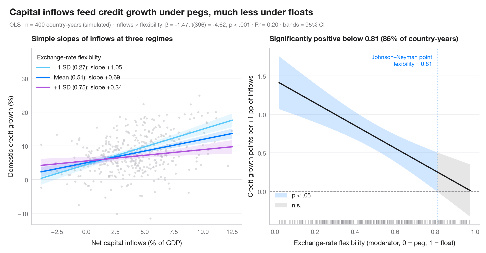

# Interaction effects

> Simple slopes at mean ± 1 SD and a Johnson–Neyman plot for college-prep courses and math results, moderated by pupil poverty.



An interaction term says that the slope of one predictor depends on another.
The **left panel** draws that slope at three values of the moderator — its mean
and ±1 standard deviation — each with a 95% confidence band. The **right panel**
is the Johnson–Neyman view: the marginal effect of the focal predictor,
β₁ + β₃·moderator, across the whole range of the moderator, with its 95% CI.
Where the band excludes zero the effect is significant; the switch-over is the
Johnson–Neyman point.

Data are the 303 California school districts of the STAR98 test bundled with
**statsmodels** (`sm.datasets.star98`). The outcome is the share of pupils above
the national median in math (%); the focal predictor is the share of pupils in
college-prep (UC/CSU) courses and the moderator the share of low-income pupils,
in `smf.ols("math ~ prep * lowinc")`. College-prep enrolment goes with better
math results in better-off districts, but the association fades as poverty
rises — and turns significantly negative only in the two poorest districts,
hence a second Johnson–Neyman point at the far right. The marginal-effect
variance is computed by hand from `cov_params()`:
Var(β₁) + 2m·Cov(β₁, β₃) + m²·Var(β₃).

**R equivalent:** `interactions::interact_plot() / interactions::johnson_neyman()`  
**Libraries:** Matplotlib, NumPy, pandas, statsmodels, SciPy

**Data:** Gill, J. (2001). Generalized Linear Models: A Unified Approach (Quantitative Applications in the Social Sciences, No. 134). Sage. https://www.statsmodels.org/stable/datasets/generated/star98.html — Original data from the California Department of Education's Standardized Testing and Reporting (STAR) program, 1998. Subset distributed with statsmodels (sm.datasets.star98) with the author's permission.


```python
import matplotlib.pyplot as plt
import numpy as np
import pandas as pd
import statsmodels.api as sm
import statsmodels.formula.api as smf
from scipy import stats

# Data: math results, college-prep enrolment and low-income pupils in 303 California districts
raw = sm.datasets.star98.load_pandas().data
df = pd.DataFrame({"math": 100 * raw.NABOVE / (raw.NABOVE + raw.NBELOW),
                   "prep": raw.PCTAF, "lowinc": raw.LOWINC})
model = smf.ols("math ~ prep * lowinc", data=df).fit()
b, V = model.params, model.cov_params()
t_crit = stats.t.ppf(0.975, model.df_resid)

fig, (ax1, ax2) = plt.subplots(1, 2, figsize=(11, 5))

# Left: simple slopes of college prep at low income = mean − 1 SD, mean, mean + 1 SD
ax1.scatter(df.prep, df.math, s=12, color="#C7C7CC", alpha=0.6, lw=0)
prep = np.linspace(df.prep.min(), df.prep.max(), 100)
m, s = df.lowinc.mean(), df.lowinc.std()
for low, lab, c in [(m - s, "−1 SD", "#5AC8FA"), (m, "Mean", "#007AFF"), (m + s, "+1 SD", "#AF52DE")]:
    pred = model.get_prediction(pd.DataFrame({"prep": prep, "lowinc": low})).summary_frame()
    ax1.fill_between(prep, pred.mean_ci_lower, pred.mean_ci_upper, color=c, alpha=0.15, lw=0)
    ax1.plot(prep, pred["mean"], color=c, lw=2.2,
             label=f"{lab} ({low:.0f}%): slope {b['prep'] + b['prep:lowinc'] * low:+.2f}")
ax1.legend(title="Low-income pupils", loc="upper left", alignment="left")
ax1.set_ylim(0, 115)
ax1.set_xlabel("Pupils in college-prep courses (%)")
ax1.set_ylabel("Pupils above national median in math (%)")
ax1.set_title("Simple slopes of college prep at three poverty levels", fontsize=12)

# Right: Johnson–Neyman — marginal effect of college prep across low income, with 95% CI
lowinc = np.linspace(df.lowinc.min(), df.lowinc.max(), 400)
eff = b["prep"] + b["prep:lowinc"] * lowinc
se = np.sqrt(V.loc["prep", "prep"] + 2 * lowinc * V.loc["prep", "prep:lowinc"]
             + lowinc**2 * V.loc["prep:lowinc", "prep:lowinc"])
lo, hi = eff - t_crit * se, eff + t_crit * se
sig = (lo > 0) | (hi < 0)
ax2.axhline(0, color="#8E8E93", lw=1, ls="--")
ax2.fill_between(lowinc, lo, hi, where=sig, color="#007AFF", alpha=0.18, lw=0, label="p < .05")
ax2.fill_between(lowinc, lo, hi, where=~sig, color="#AEAEB2", alpha=0.3, lw=0, label="n.s.")
ax2.plot(lowinc, eff, color="#1D1D1F", lw=2)
jns = lowinc[1:][np.diff(sig.astype(int)) != 0]     # where significance switches
for jn in jns:
    ax2.axvline(jn, color="#007AFF", lw=1, ls=":")
    ax2.annotate(f"Johnson–Neyman point\n{jn:.0f}% low-income", (jn, 0.97), xytext=(-8, 0),
                 xycoords=ax2.get_xaxis_transform(), textcoords="offset points",
                 fontsize=9.5, color="#007AFF", va="top", ha="right")
# Rug of the observed moderator values
ax2.plot(df.lowinc, np.full(len(df), 0.015), "|", ms=7, color="#8E8E93", alpha=0.4,
         transform=ax2.get_xaxis_transform())
share = (df.lowinc < jns[0]).mean()
ax2.legend(loc="lower left", bbox_to_anchor=(0, 0.06))
ax2.set_xlabel("Low-income pupils (moderator, %)")
ax2.set_ylabel("Math points per +1 point of college prep")
ax2.set_title(f"Significantly positive below {jns[0]:.0f}% low-income ({share:.0%} of districts)", fontsize=12)

# Figure title and statistical subtitle above both panels
p_int = model.pvalues["prep:lowinc"]
p_txt = "p < .001" if p_int < 0.001 else f"p = {p_int:.3f}"
fig.text(0.01, 1.07, "College-prep courses go with better math results, but not in poorer districts",
         fontsize=15, fontweight="semibold", va="bottom")
fig.text(0.01, 1.02, f"OLS · n = {int(model.nobs)} districts · college prep × low income: β = {b['prep:lowinc']:.4f}, "
         f"t({model.df_resid:.0f}) = {model.tvalues['prep:lowinc']:.2f}, "
         f"{p_txt} · R² = {model.rsquared:.2f} · bands = 95% CI",
         fontsize=9.5, color="#6E6E73", va="bottom")
plt.show()
```

---

**PyStatlas** by [Thierry Warin](https://www.warin.ca) · [View on the website →](https://warint.github.io/pystatlas/regression-models/interaction-effects/) · [← Regression models](../README.md)

**Cite:** Warin, T. (2026). Interaction effects. In PyStatlas: The Python Gallery of Statistical Graphics. https://warint.github.io/pystatlas/regression-models/interaction-effects/
