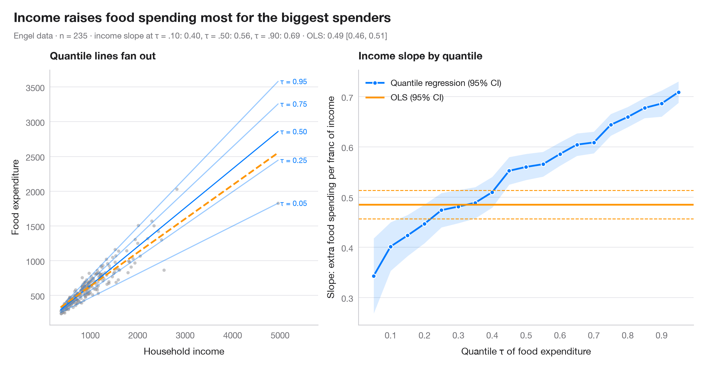

# Quantile regression process

> How a slope changes across the conditional distribution, against the single OLS estimate.



OLS estimates one slope: the effect on the conditional **mean**. Quantile
regression estimates a slope for every conditional quantile τ, so you can see
whether a predictor stretches the distribution rather than just shifting it.
The dark line is the quantile-regression coefficient for τ = 0.05 … 0.95, with
its 95% band; the orange line and dashed lines are the OLS estimate and its
95% CI, constant by construction. The left panel shows the data with a few of
the fitted quantile lines.

The setting is Troadec & Warin (2015), a chapter of *L'économie du Québec 2015*
on the place of Canadian firms in world R&D. The data are **simulated** for
illustration — they are not the chapter's data or results: n = 300 firms, with
log R&D investment against log sales (both in US$ millions), so each slope is an
elasticity. Models are fitted with `smf.quantreg().fit(q=τ)` and `smf.ols()`.

**R equivalent:** `quantreg::plot(summary(rq(tau = 1:19 / 20)))`  
**Libraries:** Matplotlib, NumPy, pandas, statsmodels

**Data:** Simulated data with a fixed random seed, created for this example. — No real respondents, documents or measurements: the numbers only illustrate how the chart and its statistics work.

**Data:** Troadec, A., & Warin, T. (2015). La place des entreprises canadiennes dans la R-D mondiale. In B. Sinclair-Desgagné, A. Van Assche & T. Warin (Eds.), L'économie du Québec 2015 : contexte et enjeux internationaux (ch. 4, pp. 109–125). Presses internationales Polytechnique. — The example is set in the context of this chapter; unless its description says otherwise, the numbers are simulated and are not the chapter's data or results.


```python
import matplotlib.pyplot as plt
import numpy as np
import pandas as pd
import statsmodels.formula.api as smf
# Simulated data, set in the context of Troadec & Warin (2015) [troadec2015]

# Data: 300 firms; the spread of R&D widens with firm size
rng = np.random.default_rng(2015)
n = 300
log_sales = rng.uniform(3, 11, n)
df = pd.DataFrame({"log_sales": log_sales,
                   "log_rd": -3 + 0.85 * log_sales + (0.2 + 0.13 * log_sales) * rng.normal(size=n)})
quantiles = np.arange(0.05, 0.96, 0.05)

# Fit one quantile regression per τ and keep slope + 95% CI
rows = []
for q in quantiles:
    fit = smf.quantreg("log_rd ~ log_sales", df).fit(q=q)
    lo, hi = fit.conf_int().loc["log_sales"]
    rows.append((q, fit.params["Intercept"], fit.params["log_sales"], lo, hi))
qr = np.array(rows)
ols = smf.ols("log_rd ~ log_sales", df).fit()
ols_lo, ols_hi = ols.conf_int().loc["log_sales"]

fig, (ax1, ax2) = plt.subplots(1, 2, figsize=(11, 5), gridspec_kw=dict(width_ratios=[1, 1.25]))

# Left: data with selected quantile lines and the OLS line
ax1.scatter(df.log_sales, df.log_rd, s=14, color="#8E8E93", alpha=0.5, lw=0)
x = np.linspace(df.log_sales.min(), df.log_sales.max(), 50)
for q, a, s_, *_ in qr[[0, 4, 9, 14, 18]]:
    ax1.plot(x, a + s_ * x, color="#007AFF", lw=1.2, alpha=0.4 + 0.6 * (q == 0.5))
    ax1.text(x[-1] + 0.1, a + s_ * x[-1], f"τ = {q:.2f}", fontsize=8.5, color="#007AFF", va="center")
ax1.plot(x, ols.params["Intercept"] + ols.params["log_sales"] * x, color="#FF9500", lw=2, ls="--")
ax1.set_xlim(right=x[-1] + 1.6)
ax1.set_xlabel("Sales (log US$ millions)")
ax1.set_ylabel("R&D investment (log US$ millions)")
ax1.set_title("Quantile lines fan out", fontsize=12)

# Right: slope estimates across τ vs the OLS slope
ax2.fill_between(qr[:, 0], qr[:, 3], qr[:, 4], color="#007AFF", alpha=0.15, lw=0)
ax2.plot(qr[:, 0], qr[:, 2], "o-", color="#007AFF", ms=5, mec="white", mew=1, label="Quantile regression (95% CI)")
ax2.axhline(ols.params["log_sales"], color="#FF9500", lw=2, label="OLS (95% CI)")
for v in (ols_lo, ols_hi):
    ax2.axhline(v, color="#FF9500", lw=1, ls="--")
ax2.set_xticks(np.arange(0.1, 1.0, 0.1))
ax2.set_xlabel("Quantile τ of log R&D investment")
ax2.set_ylabel("Slope: elasticity of R&D to sales")
ax2.legend(loc="upper left")
ax2.set_title("Sales elasticity by quantile", fontsize=12)

slope = dict(zip(np.round(qr[:, 0], 2), qr[:, 2]))
fig.text(0.01, 1.07, "Sales matter more for R&D at the top of the distribution",
         fontsize=15, fontweight="semibold", va="bottom")
fig.text(0.01, 1.02, f"n = {len(df)} firms (simulated) · elasticity at τ = .10: {slope[0.1]:.2f}, "
         f"τ = .50: {slope[0.5]:.2f}, τ = .90: {slope[0.9]:.2f} · OLS: {ols.params['log_sales']:.2f} "
         f"[{ols_lo:.2f}, {ols_hi:.2f}]", fontsize=9.5, color="#6E6E73", va="bottom")
plt.show()
```

---

**PyStatlas** by [Thierry Warin](https://www.warin.ca) · [View on the website →](https://warint.github.io/pystatlas/regression-models/quantile-regression/) · [← Regression models](../README.md)

**Cite:** Warin, T. (2026). Quantile regression process. In PyStatlas: A Python Gallery of Statistical Graphics for the Social Sciences (Version 1.1.0) [Computer software]. https://warint.github.io/pystatlas/regression-models/quantile-regression/
