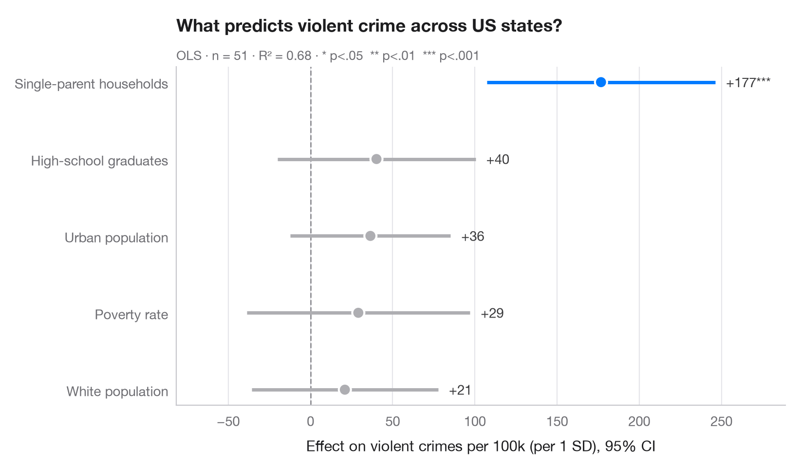
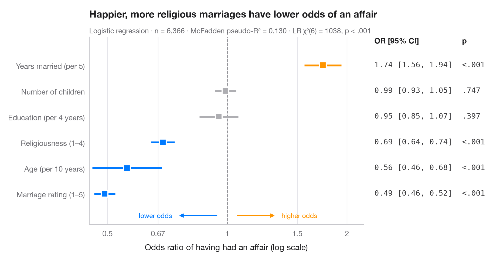
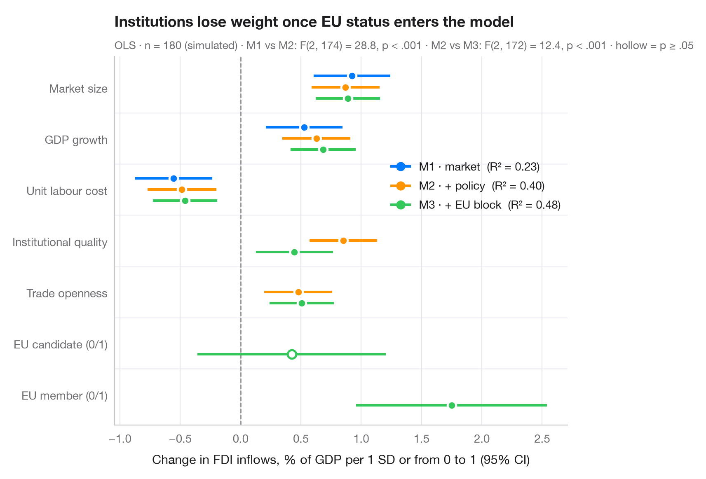
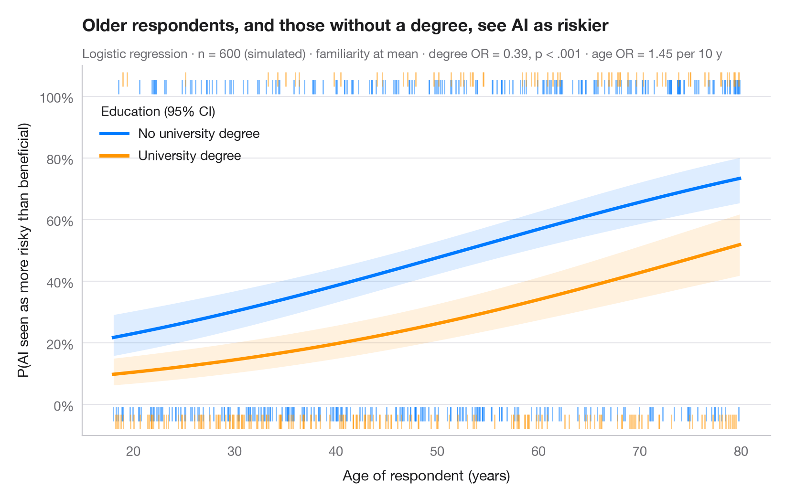
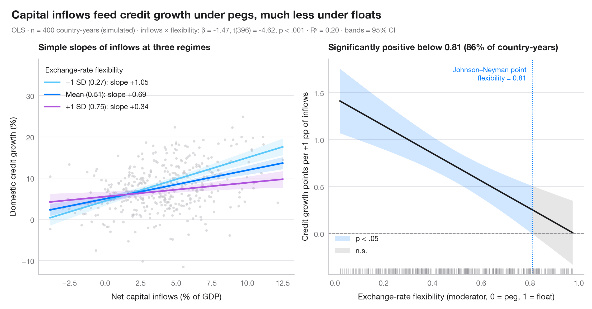
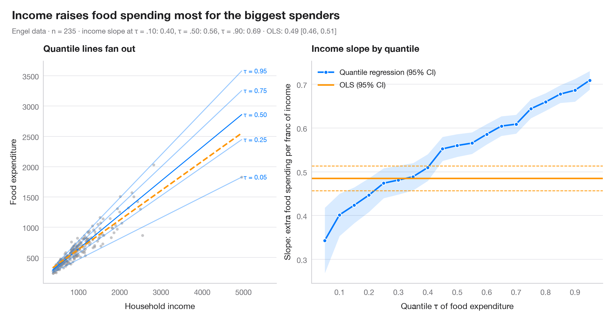

# Regression models

Coefficient plots, odds ratios, model comparison and marginal effects — ggcoef_model for Python.

| Chart | Description |
|:--|:--|
|  | **[Coefficient plot](01-coefficient-plot/)** Regression estimates with 95% confidence intervals, one row per term. `ggstats::ggcoef_model()` |
|  | **[Odds-ratio forest plot](02-odds-ratio-forest/)** Logistic regression odds ratios on a log scale, with a table of OR [95% CI] alongside. `ggstats::ggcoef_model(exponentiate = TRUE)` |
|  | **[Comparing nested models](03-compare-models/)** Coefficients of three nested regressions side by side, to see how estimates shift. `ggstats::ggcoef_compare()` |
|  | **[Predicted probabilities](04-predicted-probabilities/)** Model-based probability curves with 95% CI ribbons across a predictor, by group. `ggeffects::ggpredict() / marginaleffects::plot_predictions()` |
|  | **[Interaction effects](05-interaction-effects/)** Simple slopes at mean ± 1 SD and a Johnson–Neyman plot for two continuous predictors. `interactions::interact_plot() / interactions::johnson_neyman()` |
|  | **[Quantile regression process](06-quantile-regression/)** How a slope changes across the conditional distribution, against the single OLS estimate. `quantreg::plot(summary(rq(tau = 1:19 / 20)))` |

[← All families](../../README.md) · [Browse on the website](https://warint.github.io/pystatlas/regression-models/)
