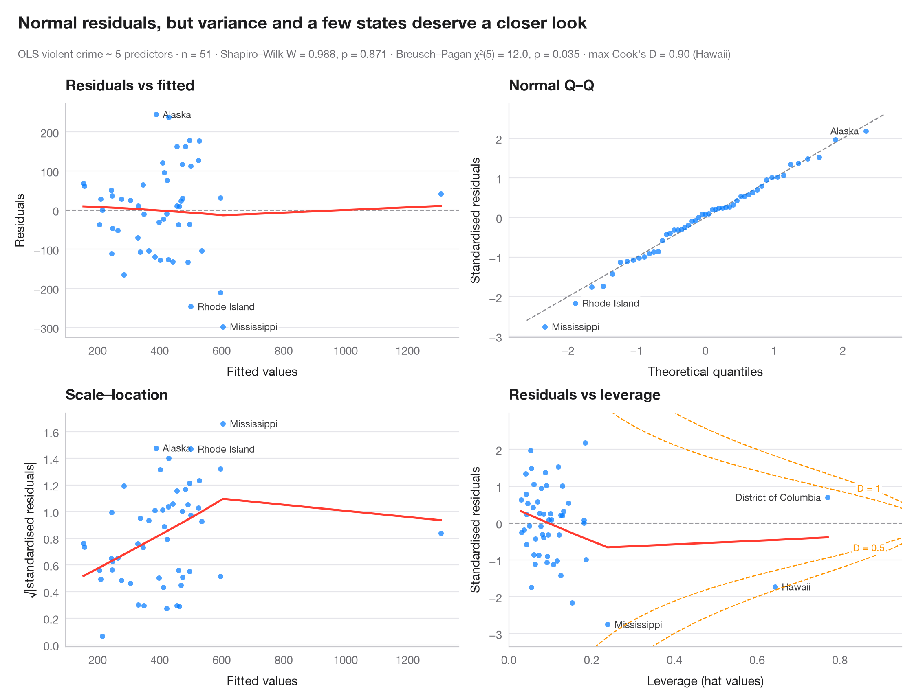

# Residual diagnostics

> The classic 2 × 2 panel for a linear model — linearity, normality, variance, leverage.



Four views of the residuals answer four questions. **Residuals vs fitted**: is
the relationship linear (flat LOWESS curve)? **Normal Q–Q**: are residuals
roughly normal (points on the line)? **Scale–location**: is the spread constant
(flat curve)? **Residuals vs leverage**: does any observation pull the fit, i.e.
sits beyond the dashed Cook's distance contours? The three most extreme
observations are labelled in each panel, and formal tests sit in the subtitle.

The model is the violent-crime regression on the 50 US states + DC from
`sm.datasets.statecrime`. Everything comes from `get_influence()` in
**statsmodels**, plus `lowess()` for the smoothers, `het_breuschpagan()` and
`scipy.stats.shapiro()`.

**R equivalent:** `plot(lm) / performance::check_model()`  
**Libraries:** Matplotlib, NumPy, statsmodels, SciPy

**Data:** U.S. Census Bureau. Statistical Abstract of the United States, state tables for 2009 (crime rates from the FBI Uniform Crime Reporting program). https://www.statsmodels.org/stable/datasets/generated/statecrime.html — Compiled for statsmodels (sm.datasets.statecrime); public domain. See the statsmodels page for each variable's table and footnotes.


```python
import matplotlib.pyplot as plt
import numpy as np
import statsmodels.api as sm
import statsmodels.formula.api as smf
from scipy import stats
from statsmodels.nonparametric.smoothers_lowess import lowess
from statsmodels.stats.diagnostic import het_breuschpagan

df = sm.datasets.statecrime.load_pandas().data
model = smf.ols("violent ~ poverty + single + urban + hs_grad + white", data=df).fit()
infl = model.get_influence()
fitted, resid = model.fittedvalues, model.resid
std_r, lev, cook = infl.resid_studentized_internal, infl.hat_matrix_diag, infl.cooks_distance[0]
p = model.df_model + 1
top = np.argsort(-np.abs(std_r))[:3]                # 3 largest standardised residuals

fig, axes = plt.subplots(2, 2, figsize=(11, 7.6))
kw = dict(s=22, color="#007AFF", alpha=0.7, lw=0, zorder=2)
smooth = dict(color="#FF3B30", lw=1.8)

def label(ax, x, y, idx):
    lo, hi = ax.get_xlim()
    for i in idx:                                   # text on the side with more room
        right = (x[i] - lo) / (hi - lo) < 0.75
        ax.annotate(df.index[i], (x[i], y[i]), xytext=(6 if right else -6, 0),
                    textcoords="offset points", ha="left" if right else "right",
                    va="center", fontsize=8.5, color="#3A3A3C", zorder=1,
                    bbox=dict(boxstyle="round,pad=0.15", fc="white", ec="none", alpha=0.85))


# 1. Residuals vs fitted
ax = axes[0, 0]
ax.axhline(0, color="#8E8E93", lw=1, ls="--")
ax.scatter(fitted, resid, **kw)
ax.plot(*lowess(resid, fitted, frac=1, it=0).T, **smooth)
label(ax, fitted.values, resid.values, top)
ax.set(title="Residuals vs fitted", xlabel="Fitted values", ylabel="Residuals")

# 2. Normal Q-Q of standardised residuals
ax = axes[0, 1]
order = np.argsort(std_r)
theo = stats.norm.ppf((np.arange(1, len(std_r) + 1) - 0.5) / len(std_r))
ax.plot([-2.6, 2.6], [-2.6, 2.6], color="#8E8E93", lw=1, ls="--")
ax.scatter(theo, std_r[order], **kw)
rank = {i: k for k, i in enumerate(order)}
label(ax, {i: theo[rank[i]] for i in top}, std_r, top)
ax.set(title="Normal Q–Q", xlabel="Theoretical quantiles", ylabel="Standardised residuals")

# 3. Scale-location
ax = axes[1, 0]
root = np.sqrt(np.abs(std_r))
ax.scatter(fitted, root, **kw)
ax.plot(*lowess(root, fitted, frac=1, it=0).T, **smooth)
label(ax, fitted.values, np.abs(root), top)
ax.set(title="Scale–location", xlabel="Fitted values", ylabel="√|standardised residuals|")

# 4. Residuals vs leverage with Cook's distance contours
ax = axes[1, 1]
ax.axhline(0, color="#8E8E93", lw=1, ls="--")
ax.scatter(lev, std_r, **kw)
ax.plot(*lowess(std_r, lev, frac=1, it=0).T, **smooth)
ylim = (std_r.min() - 0.6, std_r.max() + 0.8)
h = np.linspace(0.01, 0.95, 300)
for D in (0.5, 1):
    r = np.sqrt(D * p * (1 - h) / h)
    ax.plot(h, r, color="#FF9500", lw=1, ls="--"); ax.plot(h, -r, color="#FF9500", lw=1, ls="--")
    sign = 1 if D == 1 else -1                       # label D = 1 above, D = 0.5 below
    ax.text(0.87, sign * np.sqrt(D * p * 0.13 / 0.87), f"D = {D}", color="#FF9500", fontsize=8.5,
            ha="center", va="center", bbox=dict(boxstyle="round,pad=0.15", fc="white", ec="none"))
ax.set_ylim(*ylim); ax.set_xlim(0, 0.95)
label(ax, lev, std_r, np.argsort(-cook)[:3])
ax.set(title="Residuals vs leverage", xlabel="Leverage (hat values)", ylabel="Standardised residuals")
for a in axes.flat:
    a.title.set_fontsize(12)

bp = het_breuschpagan(resid, model.model.exog)
sw = stats.shapiro(resid)
fig.text(0.01, 1.065, "Normal residuals, but variance and a few states deserve a closer look",
         fontsize=15, fontweight="semibold", va="bottom")
fig.text(0.01, 1.02, f"OLS violent crime ~ 5 predictors · n = {int(model.nobs)} · Shapiro–Wilk "
         f"W = {sw.statistic:.3f}, p = {sw.pvalue:.3f} · Breusch–Pagan χ²({p - 1:.0f}) = "
         f"{bp[0]:.1f}, p = {bp[1]:.3f} · max Cook's D = {cook.max():.2f} ({df.index[cook.argmax()]})",
         fontsize=9.5, color="#6E6E73", va="bottom")
plt.show()
```

---

**PyStatlas** by [Thierry Warin](https://www.warin.ca) · [View on the website →](https://warint.github.io/pystatlas/model-diagnostics/residual-diagnostics/) · [← Model diagnostics](../README.md)

**Cite:** Warin, T. (2026). Residual diagnostics. In PyStatlas: A Python Gallery of Statistical Graphics for the Social Sciences. https://warint.github.io/pystatlas/model-diagnostics/residual-diagnostics/
