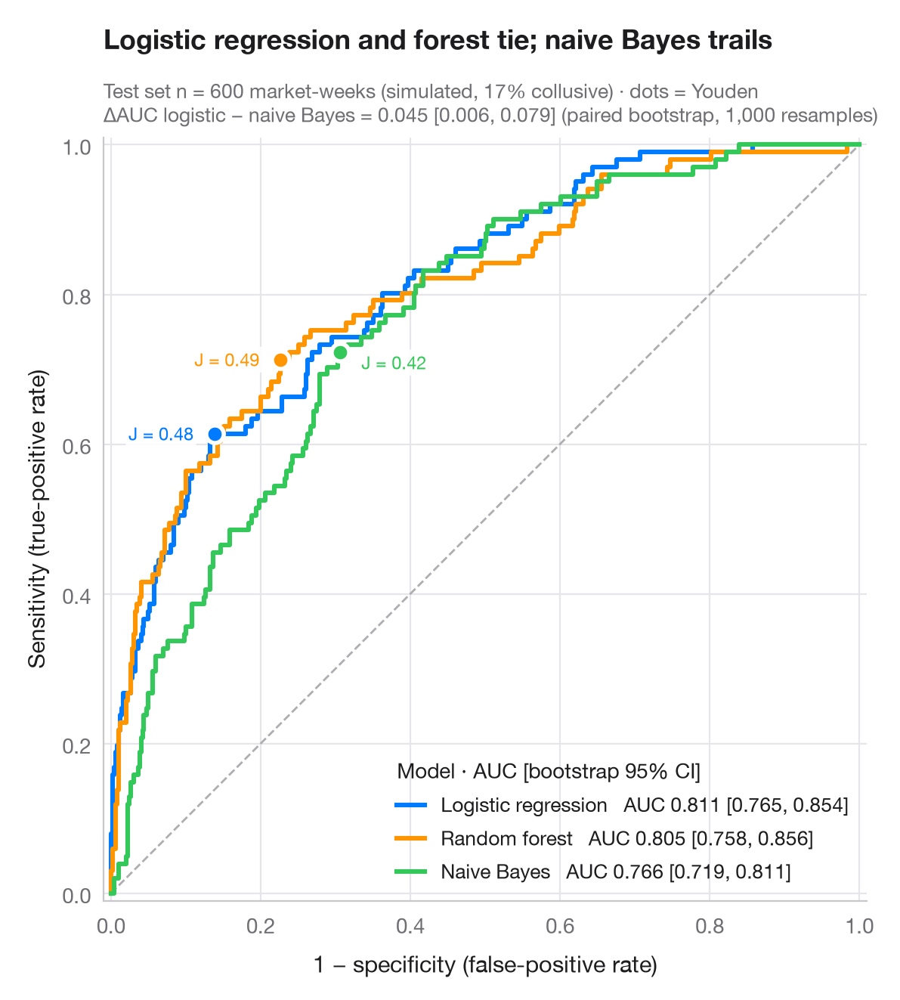

# ROC curves

> Three classifiers compared by ROC curve, AUC with bootstrap 95% CI and Youden point.



A ROC curve traces sensitivity against 1 − specificity as the decision threshold
sweeps from strict to lenient. The diagonal is a coin flip; the closer a curve
hugs the top-left corner, the better. The **AUC** is the probability that a
random positive case scores higher than a random negative one; its 95% interval
comes from 1,000 bootstrap resamples of the test set, and a paired bootstrap
compares the best and weakest model. The dot on each curve is
the threshold that maximises **Youden's J** = sensitivity + specificity − 1.

The setting is Marty & Warin (2025, *Journal of Economy and Technology*):
algorithmic collusion and what it means for antitrust enforcement. The data are
**simulated** for illustration — they are not the paper's data or results:
n = 2,000 market-weeks, about 20% of them collusive, described by five features
(price level, cost index, price volatility, share of synchronised price changes,
response lag to cost shocks), split 70/30. Collusion shows in the price–cost gap
and in synchronised *and* sticky prices, which naive Bayes, treating features as
independent, cannot combine. A
logistic regression, a random forest and a naive Bayes model from
**scikit-learn** flag collusive episodes; curves and AUCs come from
`roc_curve()` and `roc_auc_score()`.

**R equivalent:** `pROC::ggroc() / pROC::ci.auc()`  
**Libraries:** Matplotlib, NumPy, scikit-learn

**Data:** Simulated data with a fixed random seed, created for this example. — No real respondents, documents or measurements: the numbers only illustrate how the chart and its statistics work.

**Data:** Marty, F., & Warin, T. (2025). Deciphering algorithmic collusion: Insights from bandit algorithms and implications for antitrust enforcement. Journal of Economy and Technology, 3, 34–43. https://doi.org/10.1016/j.ject.2024.10.001 — The example is set in the context of this paper; unless its description says otherwise, the numbers are simulated and are not the paper's data or results.


```python
import matplotlib.pyplot as plt
import numpy as np
from sklearn.ensemble import RandomForestClassifier
from sklearn.linear_model import LogisticRegression
from sklearn.metrics import roc_auc_score, roc_curve
from sklearn.model_selection import train_test_split
from sklearn.naive_bayes import GaussianNB
# Simulated data, set in the context of Marty & Warin (2025) [marty2025collusion]

# Data: 2,000 market-weeks; collusion is likeliest when price moves are synchronised AND sticky
rng = np.random.default_rng(2025)
n = 2000
cost, sync, lag = rng.normal(size=(3, n))                     # cost index, synchrony, lag (z)
y = rng.binomial(1, np.where((sync > 0.3) & (lag > 0.3), 0.55, 0.12))
X = np.column_stack([
    1.5 * cost + 0.7 * y + rng.normal(0, 0.6, n),             # price level (tracks cost)
    1.5 * cost + rng.normal(0, 0.6, n),                       # cost index
    -0.5 * y + rng.normal(0, 1, n),                           # price volatility
    sync, lag])                                               # synchronised changes, lag to cost shocks
X_tr, X_te, y_tr, y_te = train_test_split(X, y, test_size=0.3, stratify=y, random_state=1)

models = {"Logistic regression": LogisticRegression(max_iter=1000),
          "Random forest": RandomForestClassifier(300, min_samples_leaf=20, random_state=1),
          "Naive Bayes": GaussianNB()}
palette = ["#007AFF", "#FF9500", "#34C759"]
boot = [rng.integers(0, len(y_te), len(y_te)) for _ in range(1000)]

fig, ax = plt.subplots(figsize=(7, 6.4))
ax.plot([0, 1], [0, 1], color="#AEAEB2", lw=1, ls="--")
scores = {}
for (name, clf), c, dx in zip(models.items(), palette, (-10, -10, 10)):
    score = scores[name] = clf.fit(X_tr, y_tr).predict_proba(X_te)[:, 1]
    fpr, tpr, thr = roc_curve(y_te, score)
    auc = roc_auc_score(y_te, score)
    lo, hi = np.percentile([roc_auc_score(y_te[b], score[b]) for b in boot], [2.5, 97.5])
    ax.plot(fpr, tpr, color=c, lw=2.2, label=f"{name}   AUC {auc:.3f} [{lo:.3f}, {hi:.3f}]")
    # Youden's J: threshold that maximises TPR − FPR
    j = np.argmax(tpr - fpr)
    ax.scatter(fpr[j], tpr[j], s=70, color=c, edgecolor="white", lw=2, zorder=5)
    ax.annotate(f"J = {tpr[j] - fpr[j]:.2f}", (fpr[j], tpr[j]), xytext=(dx, 0),
                textcoords="offset points", fontsize=8.5, color=c, ha="right" if dx < 0 else "left",
                va="top" if dx > 0 else "center",
                bbox=dict(boxstyle="round,pad=0.15", fc="white", ec="none", alpha=0.9))

# Paired bootstrap: is the best model really better than the weakest?
a, b = scores["Logistic regression"], scores["Naive Bayes"]
diff = [roc_auc_score(y_te[i], a[i]) - roc_auc_score(y_te[i], b[i]) for i in boot]
d_lo, d_hi = np.percentile(diff, [2.5, 97.5])

ax.set_xlim(-0.01, 1.01); ax.set_ylim(-0.01, 1.01); ax.set_aspect("equal")
ax.grid(axis="x")
ax.set_xlabel("1 − specificity (false-positive rate)")
ax.set_ylabel("Sensitivity (true-positive rate)")
ax.legend(loc="lower right", title="Model · AUC [bootstrap 95% CI]", alignment="left",
          handlelength=1.4, fontsize=9.5)
ax.set_title("Logistic regression and forest tie; naive Bayes trails", pad=42)
ax.text(0, 1.02, f"Test set n = {len(y_te):,} market-weeks (simulated, {y_te.mean():.0%} collusive) · dots = Youden\n"
        f"ΔAUC logistic − naive Bayes = {roc_auc_score(y_te, a) - roc_auc_score(y_te, b):.3f} "
        f"[{d_lo:.3f}, {d_hi:.3f}] (paired bootstrap, 1,000 resamples)",
        transform=ax.transAxes, fontsize=9.5, color="#6E6E73")
plt.show()
```

---

**PyStatlas** by [Thierry Warin](https://www.warin.ca) · [View on the website →](https://warint.github.io/pystatlas/model-diagnostics/roc-curve/) · [← Model diagnostics](../README.md)

**Cite:** Warin, T. (2026). ROC curves. In PyStatlas: A Python Gallery of Statistical Graphics for the Social Sciences. https://warint.github.io/pystatlas/model-diagnostics/roc-curve/
