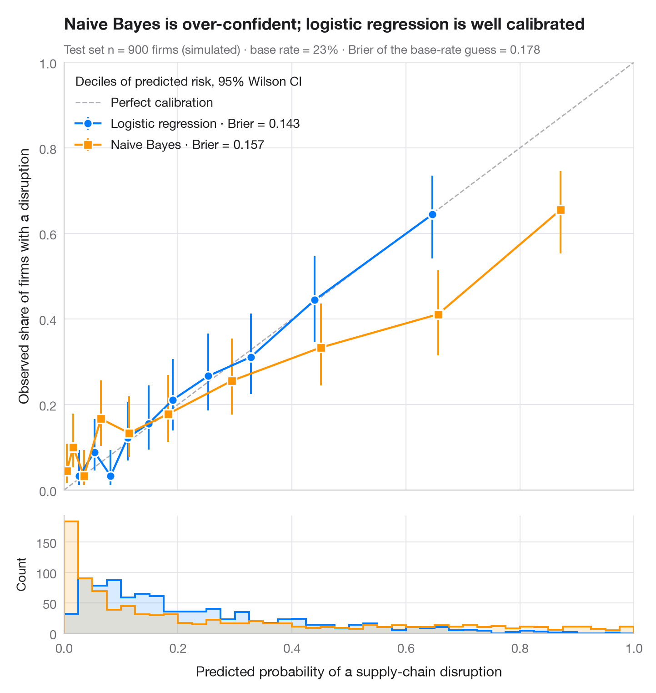

# Calibration plot

> Predicted vs observed risk per decile, with Wilson CIs, prediction histograms and Brier score.



A model can rank cases well (high AUC) and still give the wrong probabilities.
The reliability diagram checks this: test cases are grouped into deciles of
predicted risk, and the mean prediction in each bin is plotted against the
observed event rate, with a 95% Wilson interval. A calibrated model sits on the
diagonal; points below it at the high end (and above it at the low end) mean the
model is over-confident. The histograms underneath show where the predictions
actually fall.

The setting is Zarea et al. (2026, *Journal of Information Technology
Management*): risk-driven capabilities and supply-chain resilience. The data
are **simulated** for illustration — they are not the paper's data or results:
n = 3,000 firms, the outcome is whether a firm suffered a major supply-chain
disruption, and the predictors are supplier concentration, geographic risk
exposure, lead-time variability (three correlated measures of one exposure) and
a digitalisation index. Data are split 70/30. A logistic regression and a
Gaussian naive Bayes model from **scikit-learn** are compared; naive Bayes
counts the three correlated signals as independent evidence. The **Brier
score** (`brier_score_loss`, lower is better) summarises the accuracy of the
probabilities, and intervals come from `proportion_confint(method="wilson")`.

**R equivalent:** `rms::calibrate() / probably::cal_plot_breaks()`  
**Libraries:** Matplotlib, NumPy, pandas, scikit-learn, statsmodels

**Data:** Simulated data with a fixed random seed, created for this example. — No real respondents, documents or measurements: the numbers only illustrate how the chart and its statistics work.

**Data:** Zarea, H., Moghaddamzadeh, H., Moradi, M., Hassani, A., Warin, T., & Stojkov, A. (2026). Risk-driven capability development in global supply chain resilience: Implications for digitalization. Journal of Information Technology Management, 82–107. https://jitm.ut.ac.ir/article_108005.html — The example is set in the context of this paper; unless its description says otherwise, the numbers are simulated and are not the paper's data or results.


```python
import matplotlib.pyplot as plt
import numpy as np
import pandas as pd
from sklearn.linear_model import LogisticRegression
from sklearn.metrics import brier_score_loss
from sklearn.model_selection import train_test_split
from sklearn.naive_bayes import GaussianNB
from statsmodels.stats.proportion import proportion_confint
# Simulated data, set in the context of Zarea et al. (2026) [zarea2026]

# Data: 3,000 firms; three noisy measures of one latent exposure + digitalisation
rng = np.random.default_rng(2026)
n = 3000
exposure = rng.normal(size=n)
X = np.column_stack([exposure + rng.normal(0, 0.6, n),      # supplier concentration
                     exposure + rng.normal(0, 0.6, n),      # geographic risk exposure
                     exposure + rng.normal(0, 0.6, n),      # lead-time variability
                     rng.normal(size=n)])                   # digitalisation index
eta = -1.4 + 0.3 * X[:, :3].sum(axis=1) - 0.5 * X[:, 3]
y = rng.binomial(1, 1 / (1 + np.exp(-eta)))                 # 1 = major disruption
X_tr, X_te, y_tr, y_te = train_test_split(X, y, test_size=0.3, stratify=y, random_state=1)
models = {"Logistic regression": (LogisticRegression(max_iter=1000), "#007AFF", "o"),
          "Naive Bayes": (GaussianNB(), "#FF9500", "s")}

fig, (ax, axh) = plt.subplots(2, 1, figsize=(7, 7.4), sharex=True,
                              gridspec_kw=dict(height_ratios=[4, 1.1], hspace=0.05))
ax.plot([0, 1], [0, 1], color="#AEAEB2", lw=1, ls="--", label="Perfect calibration")
bins = np.linspace(0, 1, 41)
for name, (clf, c, mk) in models.items():
    p = clf.fit(X_tr, y_tr).predict_proba(X_te)[:, 1]
    # Group predictions into deciles of predicted risk
    tab = (pd.DataFrame({"p": p, "y": y_te})
             .assign(bin=lambda d: pd.qcut(d.p, 10, labels=False, duplicates="drop"))
             .groupby("bin").agg(pred=("p", "mean"), obs=("y", "mean"), k=("y", "sum"), n=("y", "size")))
    lo, hi = proportion_confint(tab.k, tab.n, method="wilson")
    ax.errorbar(tab.pred, tab.obs, yerr=[tab.obs - lo, hi - tab.obs], fmt=mk + "-", color=c,
                ms=7, mec="white", mew=1.2, lw=1.6, capsize=0, elinewidth=1.4,
                label=f"{name} · Brier = {brier_score_loss(y_te, p):.3f}")
    axh.hist(p, bins=bins, color=c, alpha=0.15, lw=0)
    axh.hist(p, bins=bins, color=c, histtype="step", lw=1.4)

ax.set_xlim(0, 1); ax.set_ylim(0, 1); ax.set_aspect("auto")
ax.grid(axis="x")
ax.set_ylabel("Observed share of firms with a disruption")
ax.legend(loc="upper left", alignment="left", title="Deciles of predicted risk, 95% Wilson CI")
axh.set_xlabel("Predicted probability of a supply-chain disruption")
axh.set_ylabel("Count", fontsize=10)
axh.grid(axis="x")
ax.set_title("Naive Bayes is over-confident; logistic regression is well calibrated", pad=26)
ax.text(0, 1.02, f"Test set n = {len(y_te):,} firms (simulated) · base rate = {y_te.mean():.0%} · "
        f"Brier of the base-rate guess = {y_te.mean() * (1 - y_te.mean()):.3f}",
        transform=ax.transAxes, fontsize=9.5, color="#6E6E73")
plt.show()
```

---

**PyStatlas** by [Thierry Warin](https://www.warin.ca) · [View on the website →](https://warint.github.io/pystatlas/model-diagnostics/calibration-plot/) · [← Model diagnostics](../README.md)

**Cite:** Warin, T. (2026). Calibration plot. In PyStatlas: A Python Gallery of Statistical Graphics for the Social Sciences. https://warint.github.io/pystatlas/model-diagnostics/calibration-plot/
