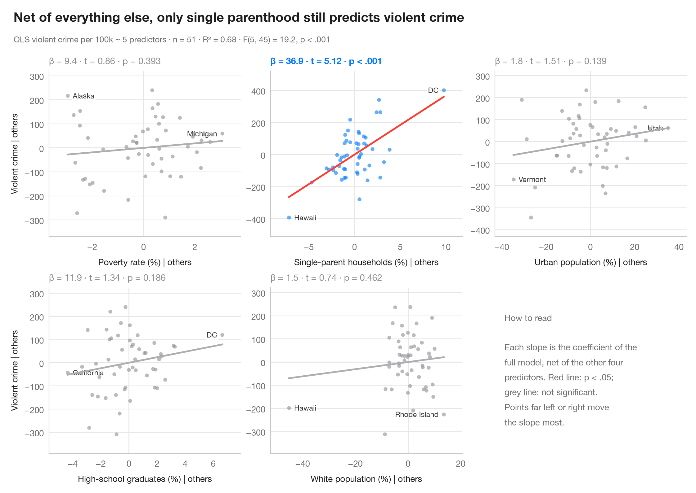

# Added-variable plots

> One partial-regression panel per predictor; each fitted slope equals its coefficient.



In a multiple regression, a raw scatter of y against one predictor mixes its
effect with everything correlated with it. An **added-variable plot** removes
that: it plots the residuals of y on all *other* predictors against the
residuals of the focal predictor on those same predictors. By the
Frisch–Waugh–Lovell theorem, the slope of the line through the cloud is exactly
the multiple-regression coefficient, and points far out on the x-axis are the
ones that drive that coefficient.

The model is the violent-crime regression on the 50 US states + DC from
`sm.datasets.statecrime`, fitted with **statsmodels** `smf.ols()`. Residuals are
computed with one auxiliary OLS fit per axis; each panel reports β, its t and p.

**R equivalent:** `car::avPlots()`  
**Libraries:** Matplotlib, NumPy, statsmodels

```python
import matplotlib.pyplot as plt
import numpy as np
import statsmodels.api as sm
import statsmodels.formula.api as smf

df = sm.datasets.statecrime.load_pandas().data
predictors = ["poverty", "single", "urban", "hs_grad", "white"]
labels = {"poverty": "Poverty rate (%)", "single": "Single-parent households (%)",
          "urban": "Urban population (%)", "hs_grad": "High-school graduates (%)",
          "white": "White population (%)"}
full = smf.ols("violent ~ " + " + ".join(predictors), data=df).fit()

fig, axes = plt.subplots(2, 3, figsize=(11, 7))
for ax, x in zip(axes.flat, predictors):
    others = " + ".join(p for p in predictors if p != x)
    ey = smf.ols(f"violent ~ {others}", data=df).fit().resid      # y | others
    ex = smf.ols(f"{x} ~ {others}", data=df).fit().resid          # x | others
    sig = full.pvalues[x] < 0.05
    c = "#007AFF" if sig else "#8E8E93"

    ax.axhline(0, color="#E5E5EA", lw=1); ax.axvline(0, color="#E5E5EA", lw=1)
    ax.scatter(ex, ey, s=20, color=c, alpha=0.6, lw=0, zorder=2)
    grid = np.linspace(ex.min(), ex.max(), 2)
    ax.plot(grid, full.params[x] * grid, color="#FF3B30" if sig else "#AEAEB2", lw=2)
    # Label the two observations with the most extreme partial x
    for i in np.argsort(-np.abs(ex.to_numpy()))[:2]:
        right = ex.iloc[i] < 0
        ax.annotate(df.index[i].replace("District of Columbia", "DC"), (ex.iloc[i], ey.iloc[i]),
                    xytext=(6 if right else -6, 0), textcoords="offset points",
                    ha="left" if right else "right", va="center", fontsize=8.5, color="#3A3A3C",
                    zorder=1, bbox=dict(boxstyle="round,pad=0.15", fc="white", ec="none", alpha=0.85))
    p = full.pvalues[x]
    ax.set_title(f"β = {full.params[x]:.1f} · t = {full.tvalues[x]:.2f} · "
                 + ("p < .001" if p < .001 else f"p = {p:.3f}"), fontsize=10.5, color=c,
                 fontweight="semibold" if sig else "normal", pad=8)
    ax.set_xlabel(f"{labels[x]} | others", fontsize=10)
    if ax.get_subplotspec().is_first_col():
        ax.set_ylabel("Violent crime | others", fontsize=10)
    ax.margins(x=0.12, y=0.15)

# Last cell: reading guide instead of an empty panel
axes.flat[-1].axis("off")
axes.flat[-1].text(0.05, 0.5, "How to read\n\nEach slope is the coefficient of the\n"
                   "full model, net of the other four\npredictors. Red line: p < .05;\n"
                   "grey line: not significant.\nPoints far left or right move\n"
                   "the slope most.", transform=axes.flat[-1].transAxes, va="center",
                   fontsize=10, color="#6E6E73", linespacing=1.5)

fig.text(0.01, 1.065, "Net of everything else, only single parenthood still predicts violent crime",
         fontsize=15, fontweight="semibold", va="bottom")
fig.text(0.01, 1.02, f"OLS violent crime per 100k ~ 5 predictors · n = {int(full.nobs)} · "
         f"R² = {full.rsquared:.2f} · F({full.df_model:.0f}, {full.df_resid:.0f}) = "
         f"{full.fvalue:.1f}, p < .001", fontsize=9.5, color="#6E6E73", va="bottom")
plt.show()
```

[View on the Statlas website →](https://warint.github.io/statlas/model-diagnostics/partial-regression/) · [← Model diagnostics](../README.md)
