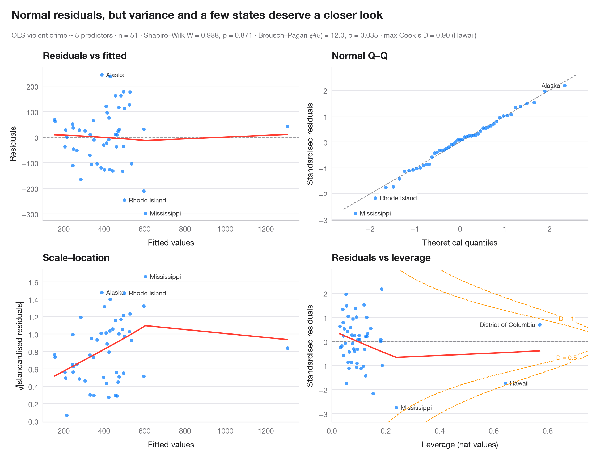
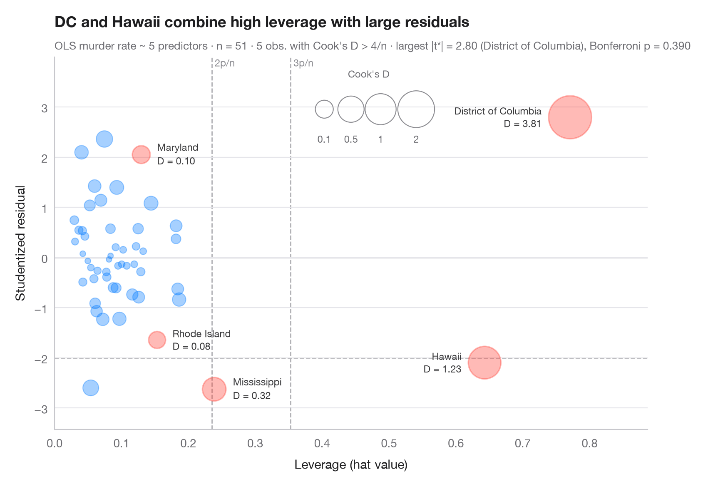
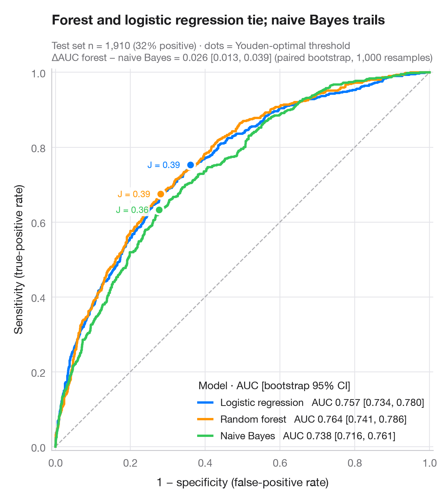
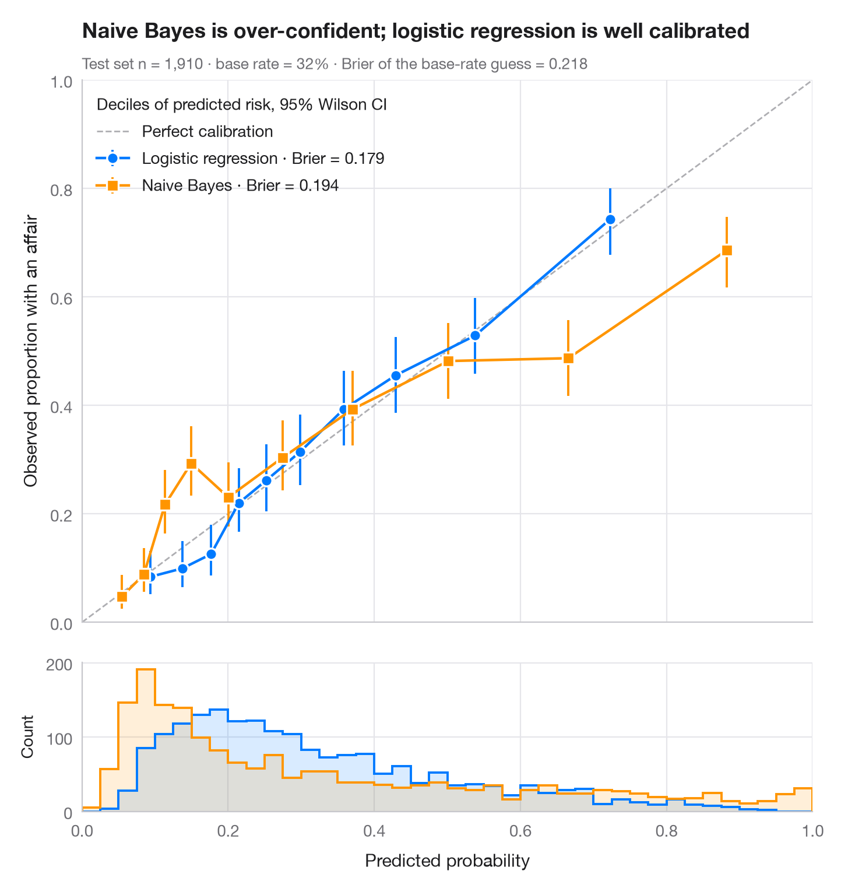
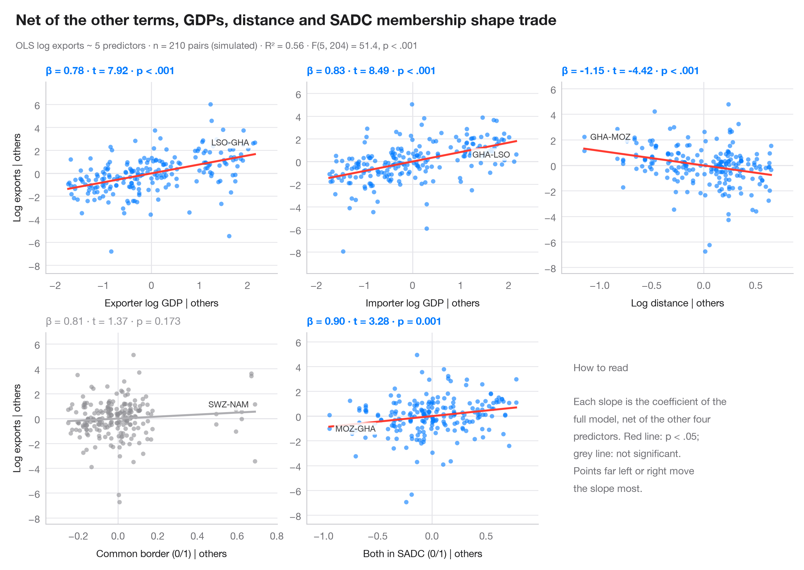

# Model diagnostics

Residuals, leverage, calibration and ROC curves: check before you trust a model.

| Chart | Description |
|:--|:--|
|  | **[Residual diagnostics](01-residual-diagnostics/)** The classic 2 × 2 panel for a linear model — linearity, normality, variance, leverage. `plot(lm) / performance::check_model()` |
|  | **[Influence plot](02-influence-plot/)** Studentized residuals vs leverage, with bubbles sized by Cook's distance. `car::influencePlot()` |
|  | **[ROC curves](03-roc-curve/)** Three classifiers compared by ROC curve, AUC with bootstrap 95% CI and Youden point. `pROC::ggroc() / pROC::ci.auc()` |
|  | **[Calibration plot](04-calibration-plot/)** Predicted vs observed risk per decile, with Wilson CIs, prediction histograms and Brier score. `rms::calibrate() / probably::cal_plot_breaks()` |
|  | **[Added-variable plots](05-partial-regression/)** One partial-regression panel per predictor; each fitted slope equals its coefficient. `car::avPlots()` |

[← All families](../../README.md) · [Browse on the website](https://warint.github.io/pystatlas/model-diagnostics/)
