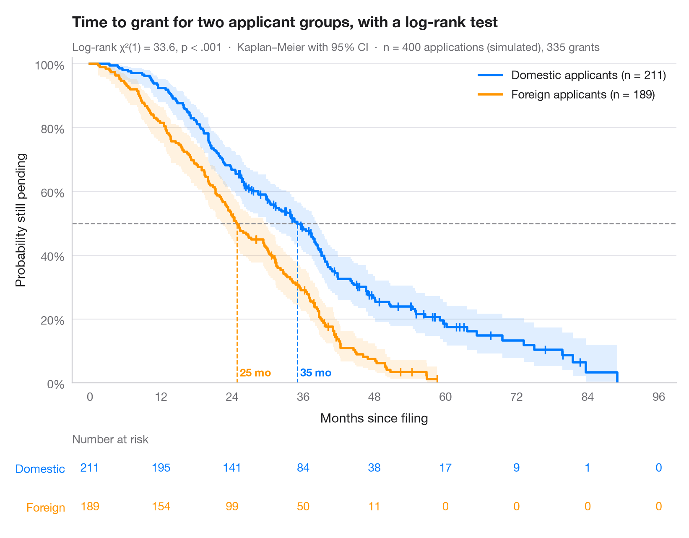

# Kaplan–Meier curves

> Time from patent filing to grant, domestic vs foreign applicants, with log-rank test and risk table.



The Kaplan–Meier estimator turns follow-up times — some ending in an event, some
censored — into a step curve of the probability of "surviving" beyond each time.
Shaded bands are pointwise 95% confidence intervals, small ticks mark censored
applications, and dashed lines drop from 50% to the **median survival** of each
group. The table underneath gives the number still at risk, which tells you how
much data supports the tail of each curve.

The setting is Vorreuther & Warin (2021, *Data in Brief*), a dataset on patent
relatedness and velocity in the Chinese pharmaceutical industry. The data here
are **simulated** for illustration and are not the paper's data or results:
400 pharmaceutical patent applications, timed in months from filing; the event
is the grant, and applications still pending when observation stops are
censored. Curves come from `KaplanMeierFitter`, the comparison from
`logrank_test`.

**R equivalent:** `survminer::ggsurvplot(risk.table = TRUE)`  
**Libraries:** Matplotlib, NumPy, pandas, lifelines

**Data:** Simulated data with a fixed random seed, created for this example. — No real respondents, documents or measurements: the numbers only illustrate how the chart and its statistics work.

**Data:** Vorreuther, C. M., & Warin, T. (2021). Patent relatedness and velocity in the Chinese pharmaceutical industry: A dataset of Jaccard similarities. Data in Brief, 35, 106814. https://doi.org/10.1016/j.dib.2021.106814 — The example is set in the context of this paper; unless its description says otherwise, the numbers are simulated and are not the paper's data or results.


```python
import matplotlib.pyplot as plt
import numpy as np
import pandas as pd
from lifelines import KaplanMeierFitter
from lifelines.statistics import logrank_test
# Simulated data, set in the context of Vorreuther & Warin (2021) [vorreuther2021]

# Data: months from filing to grant of 400 patent applications (shared generator)
rng = np.random.default_rng(2021)
n = 400
df = pd.DataFrame({"foreign": rng.integers(0, 2, n), "university": (rng.random(n) < 0.25).astype(int),
                   "claims": rng.poisson(12, n), "relatedness": rng.beta(2, 4, n).round(2)})
lp = 0.6 * df.foreign - 0.04 * (df.claims - 12) + 2.0 * (df.relatedness - 0.33) - 0.35 * df.university
grant = 40 * rng.weibull(2, n) * np.exp(-lp / 2)        # Weibull PH: higher lp, faster grant
cens = rng.uniform(24, 96, n)                           # end of observation window
df["months"], df["granted"] = np.minimum(grant, cens).round(1), (grant <= cens).astype(int)

groups = {"Domestic": df[df.foreign == 0], "Foreign": df[df.foreign == 1]}
colors = ["#007AFF", "#FF9500"]
ticks = np.arange(0, 97, 12)
fig, (ax, tab) = plt.subplots(2, 1, figsize=(8, 6.2), sharex=True,
                              gridspec_kw=dict(height_ratios=[4.2, 1]))

# Kaplan–Meier fit per group: step curve, CI band, censoring ticks, median line, risk table
for k, ((name, d), c) in enumerate(zip(groups.items(), colors)):
    km = KaplanMeierFitter().fit(d.months, d.granted, label=name)
    sf, ci = km.survival_function_[name], km.confidence_interval_
    ax.step(sf.index, sf, where="post", color=c, lw=2, label=f"{name} applicants (n = {len(d)})")
    ax.fill_between(ci.index, ci.iloc[:, 0], ci.iloc[:, 1], step="post", color=c, alpha=0.12, lw=0)
    cm = d.loc[d.granted == 0, "months"]
    ax.plot(cm, km.survival_function_at_times(cm), "|", color=c, ms=7, mew=1.2)
    med = km.median_survival_time_
    ax.plot([med, med], [0, 0.5], ls="--", lw=1, color=c)
    ax.text(med, 0.02, f" {med:.0f} mo", color=c, fontsize=9.5, fontweight="semibold", ha="left")
    for t in ticks:
        tab.text(t, 1 - k, (d.months >= t).sum(), ha="center", va="center", color=c, fontsize=10)

ax.axhline(0.5, color="#8E8E93", lw=1, ls="--", zorder=1)
ax.set(ylim=(0, 1.02), xlim=(-3, 99), ylabel="Probability still pending", xlabel="Months since filing")
ax.tick_params(labelbottom=True)
ax.yaxis.set_major_formatter(plt.matplotlib.ticker.PercentFormatter(1))
ax.legend(loc="upper right")

# Log-rank test
dom, fgn = groups["Domestic"], groups["Foreign"]
lr = logrank_test(dom.months, fgn.months, dom.granted, fgn.granted)
p_txt = "p < .001" if lr.p_value < 0.001 else f"p = {lr.p_value:.3f}"
ax.set_title("Time to grant for two applicant groups, with a log-rank test", pad=26)
ax.text(0, 1.02, f"Log-rank χ²(1) = {lr.test_statistic:.1f}, {p_txt}  ·  Kaplan–Meier with 95% CI  ·  "
        f"n = {n} applications (simulated), {df.granted.sum()} grants", transform=ax.transAxes,
        fontsize=9.5, color="#6E6E73")

# Risk table styling
tab.set(ylim=(-0.5, 1.5), xticks=ticks)
tab.tick_params(labelbottom=False)
tab.set_yticks([1, 0], list(groups))
for lbl, c in zip(tab.get_yticklabels(), colors):
    lbl.set_color(c)
tab.grid(False)
tab.spines[["left", "bottom"]].set_visible(False)
tab.set_title("Number at risk", fontsize=10, fontweight="normal", color="#6E6E73", pad=4)
plt.show()
```

---

**PyStatlas** by [Thierry Warin](https://www.warin.ca) · [View on the website →](https://warint.github.io/pystatlas/survival/kaplan-meier/) · [← Survival analysis](../README.md)

**Cite:** Warin, T. (2026). Kaplan–Meier curves. In PyStatlas: A Python Gallery of Statistical Graphics for the Social Sciences. https://warint.github.io/pystatlas/survival/kaplan-meier/
