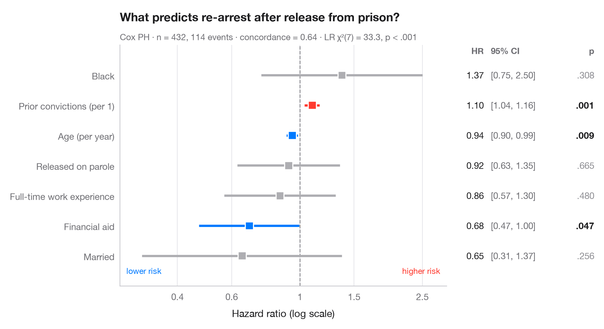

# Cox hazard ratios

> Forest plot of a Cox proportional hazards model with HR, 95% CI and p-values.



A Cox proportional hazards model estimates how each covariate multiplies the
instantaneous risk of the event. Each row shows a **hazard ratio** (HR) with its
95% confidence interval on a log scale, so that halving and doubling the risk
sit at equal distances from the reference line at HR = 1. The table on the
right repeats the numbers, as in a published forest plot.

Data are the Rossi recidivism study (`lifelines.datasets.load_rossi`): 432
released prisoners followed for one year, the event being re-arrest. The model
is fitted with `lifelines.CoxPHFitter`; the subtitle reports the concordance
index and the likelihood-ratio test of the whole model.

**R equivalent:** `survminer::ggforest()`  
**Libraries:** Matplotlib, NumPy, lifelines

```python
import matplotlib.pyplot as plt
import numpy as np
from lifelines import CoxPHFitter
from lifelines.datasets import load_rossi

# Data: weeks to re-arrest after release from prison
df = load_rossi()
cph = CoxPHFitter().fit(df, duration_col="week", event_col="arrest")
lr = cph.log_likelihood_ratio_test()

# Tidy the summary: HR, 95% CI, p-value
labels = {"fin": "Financial aid", "age": "Age (per year)", "race": "Black",
          "wexp": "Full-time work experience", "mar": "Married",
          "paro": "Released on parole", "prio": "Prior convictions (per 1)"}
res = cph.summary.rename(columns={"exp(coef)": "hr", "exp(coef) lower 95%": "low",
                                  "exp(coef) upper 95%": "high"})
res = res.sort_values("hr")
y = np.arange(len(res))
colors = np.where(res.p < 0.05, np.where(res.hr > 1, "#FF3B30", "#007AFF"), "#AEAEB2")

fig, (ax, tab) = plt.subplots(1, 2, figsize=(9, 4.8), sharey=True,
                              gridspec_kw=dict(width_ratios=[3, 1.3]))

# Forest: CI whiskers and point estimates on a log axis
ax.axvline(1, color="#8E8E93", lw=1, ls="--", zorder=1)
ax.hlines(y, res.low, res.high, color=colors, lw=2.5, zorder=2)
ax.scatter(res.hr, y, s=80, marker="s", color=colors, edgecolor="white", lw=1.2, zorder=3)
ax.set_xscale("log")
ax.set_xticks([0.4, 0.6, 1, 1.5, 2.5], ["0.4", "0.6", "1", "1.5", "2.5"])
ax.minorticks_off()
ax.set_xlim(0.26, 3)
ax.set_yticks(y, [labels[t] for t in res.index])
ax.grid(axis="x"); ax.grid(axis="y", visible=False)
ax.set_xlabel("Hazard ratio (log scale)")
ax.text(0.98, -0.6, "higher risk", ha="right", color="#FF3B30", fontsize=9,
        transform=ax.get_yaxis_transform())
ax.text(0.02, -0.6, "lower risk", ha="left", color="#007AFF", fontsize=9,
        transform=ax.get_yaxis_transform())

# Table: HR [95% CI] and p-value
for yi, (_, r) in zip(y, res.iterrows()):
    p = "< .001" if r.p < 0.001 else f"{r.p:.3f}".lstrip("0")
    tab.text(0.22, yi, f"{r.hr:.2f}", va="center", ha="right", fontsize=10, color="#1D1D1F")
    tab.text(0.27, yi, f"[{r.low:.2f}, {r.high:.2f}]", va="center", fontsize=10, color="#6E6E73")
    tab.text(1, yi, p, va="center", ha="right", fontsize=10,
             color="#1D1D1F" if r.p < 0.05 else "#8E8E93",
             fontweight="semibold" if r.p < 0.05 else "normal")
tab.text(0.22, len(res) - 0.3, "HR", ha="right", fontsize=9.5, color="#6E6E73", fontweight="semibold")
tab.text(0.27, len(res) - 0.3, "95% CI", fontsize=9.5, color="#6E6E73", fontweight="semibold")
tab.text(1, len(res) - 0.3, "p", ha="right", fontsize=9.5, color="#6E6E73", fontweight="semibold")
tab.set(xlim=(0, 1), ylim=(-1, len(res)))
tab.axis("off")

ax.set_title("What predicts re-arrest after release from prison?", pad=26)
ax.text(0, 1.02, f"Cox PH · n = {len(df)}, {df.arrest.sum()} events · concordance = "
        f"{cph.concordance_index_:.2f} · LR χ²({lr.degrees_freedom:.0f}) = {lr.test_statistic:.1f}, "
        f"p < .001", transform=ax.transAxes, fontsize=9.5, color="#6E6E73")
plt.show()
```

---

**Statlas** by [Thierry Warin](https://www.warin.ca) · [View on the website →](https://warint.github.io/statlas/survival/cox-hazard-ratios/) · [← Survival analysis](../README.md)

**Cite:** Warin, T. (2026). Cox hazard ratios. In Statlas: The Python Gallery of Statistical Graphics. https://warint.github.io/statlas/survival/cox-hazard-ratios/
