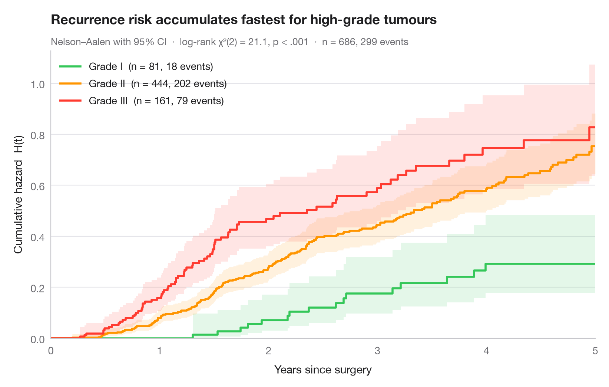

# Cumulative hazard

> Nelson–Aalen cumulative hazard curves with 95% bands for three tumour grades.



The cumulative hazard H(t) adds up the instantaneous risk of the event over
time; it is the "risk accumulated so far" and relates to survival through
S(t) = exp(−H(t)). Unlike a survival curve it is not bounded by 1, and its
**slope** is the hazard itself — a straight line means a constant risk, a
curve that bends upward means risk that grows with time.

Data are the German Breast Cancer Study Group 2 trial
(`lifelines.datasets.load_gbsg2`): recurrence-free survival of 686 women by
tumour grade. Curves come from `lifelines.NelsonAalenFitter`, and the subtitle
reports a log-rank test across the three grades (`multivariate_logrank_test`).
The x-axis stops at five years, after which too few women remain at risk.

**R equivalent:** `survminer::ggsurvplot(fun = "cumhaz")`  
**Libraries:** Matplotlib, lifelines

```python
import matplotlib.pyplot as plt
from lifelines import NelsonAalenFitter
from lifelines.datasets import load_gbsg2
from lifelines.statistics import multivariate_logrank_test

# Data: years to recurrence or death, by tumour grade
df = load_gbsg2()
df["years"] = df.time / 365.25
grades = ["I", "II", "III"]
colors = ["#34C759", "#FF9500", "#FF3B30"]

fig, ax = plt.subplots(figsize=(8, 5))

# Nelson–Aalen estimate with 95% CI, one curve per grade
for g, c in zip(grades, colors):
    d = df[df.tgrade == g]
    naf = NelsonAalenFitter().fit(d.years, d.cens, label=g)
    # Show the first 5 years only: beyond that fewer than ~10% remain at risk
    H, ci = naf.cumulative_hazard_[g].loc[:5], naf.confidence_interval_.loc[:5]
    H.loc[5], ci.loc[5] = H.iloc[-1], ci.iloc[-1]
    ax.step(H.index, H, where="post", color=c, lw=2, label=f"Grade {g}  (n = {len(d)}, {d.cens.sum()} events)")
    ax.fill_between(ci.index, ci.iloc[:, 0], ci.iloc[:, 1], step="post", color=c, alpha=0.13, lw=0)

# Log-rank test across grades
lr = multivariate_logrank_test(df.years, df.tgrade, df.cens)
ax.legend(loc="upper left")
ax.set(xlabel="Years since surgery", ylabel="Cumulative hazard  H(t)", xlim=(0, 5), xticks=range(6), ylim=(0, None))
ax.set_title("Recurrence risk accumulates fastest for high-grade tumours", pad=26)
ax.text(0, 1.02, f"Nelson–Aalen with 95% CI  ·  log-rank χ²({lr.degrees_of_freedom}) = "
        f"{lr.test_statistic:.1f}, p < .001  ·  n = {len(df)}, {df.cens.sum()} events",
        transform=ax.transAxes, fontsize=9.5, color="#6E6E73")
plt.show()
```

[View on the Statlas website →](https://warint.github.io/statlas/survival/cumulative-hazard/) · [← Survival analysis](../README.md)
