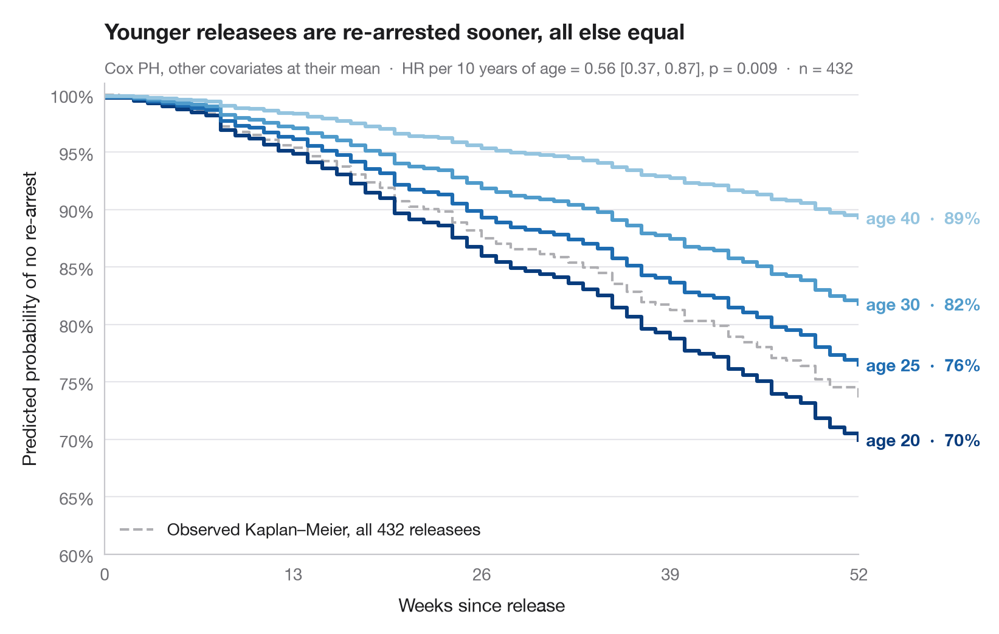

# Adjusted survival curves

> Cox model–predicted survival for several ages, other covariates held at their mean.



A hazard ratio is hard to feel; a survival curve is not. Here a fitted Cox
proportional hazards model is used to **predict** the whole survival curve for
hypothetical individuals who differ only in age, while every other covariate is
fixed at its sample mean. The vertical spread between the curves is the effect
of age translated into the probability of staying arrest-free.

Data are the Rossi recidivism study (`lifelines.datasets.load_rossi`). The model
is fitted with `lifelines.CoxPHFitter` on all seven covariates and the curves come
from `predict_survival_function()`; the observed Kaplan–Meier curve of the whole
sample is drawn in grey for reference.

**R equivalent:** `survminer::ggadjustedcurves()`  
**Libraries:** Matplotlib, NumPy, pandas, lifelines

**Data:** Rossi, P. H., Berk, R. A., & Lenihan, K. J. (1980). Money, Work, and Crime: Some Experimental Results. Academic Press. https://lifelines.readthedocs.io/en/latest/lifelines.datasets.html — Men released from Maryland state prisons in the 1970s, half randomly assigned to financial aid. Distributed with lifelines (lifelines.datasets.load_rossi).


```python
import matplotlib.pyplot as plt
import numpy as np
import pandas as pd
from lifelines import CoxPHFitter, KaplanMeierFitter
from lifelines.datasets import load_rossi

# Data: weeks to re-arrest after release from prison
df = load_rossi()
cph = CoxPHFitter().fit(df, duration_col="week", event_col="arrest")

# Hypothetical profiles: everything at the mean, age varies
ages = [20, 25, 30, 40]
profiles = pd.DataFrame([df.drop(columns=["week", "arrest"]).mean()] * len(ages))
profiles["age"] = ages
surv = cph.predict_survival_function(profiles, times=np.arange(0, 53))
colors = plt.cm.Blues(np.linspace(0.95, 0.4, len(ages)))

fig, ax = plt.subplots(figsize=(8, 5))

# Observed Kaplan–Meier curve of the whole sample, for reference
km = KaplanMeierFitter().fit(df.week, df.arrest)
ax.step(km.survival_function_.index, km.survival_function_.iloc[:, 0], where="post",
        color="#AEAEB2", lw=1.5, ls="--", label=f"Observed Kaplan–Meier, all {len(df)} releasees")
ax.legend(loc="lower left")

# Model-predicted curves, labelled at their end
for col, age, c in zip(surv.columns, ages, colors):
    s = surv[col]
    ax.step(s.index, s, where="post", color=c, lw=2.2)
    ax.text(52.5, s.iloc[-1], f"age {age}  ·  {s.iloc[-1]:.0%}", va="center",
            fontsize=10, color=c, fontweight="semibold")

hr10 = np.exp(10 * cph.params_["age"])
lo, hi = np.exp(10 * cph.confidence_intervals_.loc["age"])
p = cph.summary.loc["age", "p"]
ax.set(xlim=(0, 52), ylim=(0.6, 1.01), xticks=range(0, 53, 13),
       xlabel="Weeks since release", ylabel="Predicted probability of no re-arrest")
ax.yaxis.set_major_formatter(plt.matplotlib.ticker.PercentFormatter(1, decimals=0))
ax.set_title("Younger releasees are re-arrested sooner, all else equal", pad=26)
ax.text(0, 1.02, f"Cox PH, other covariates at their mean  ·  HR per 10 years of age = "
        f"{hr10:.2f} [{lo:.2f}, {hi:.2f}], p = {p:.3f}  ·  n = {len(df)}",
        transform=ax.transAxes, fontsize=9.5, color="#6E6E73")
plt.show()
```

---

**PyStatlas** by [Thierry Warin](https://www.warin.ca) · [View on the website →](https://warint.github.io/pystatlas/survival/adjusted-survival/) · [← Survival analysis](../README.md)

**Cite:** Warin, T. (2026). Adjusted survival curves. In PyStatlas: The Python Gallery of Statistical Graphics for the Social Sciences. https://warint.github.io/pystatlas/survival/adjusted-survival/
