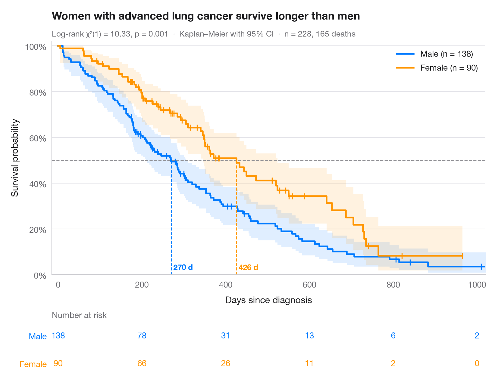
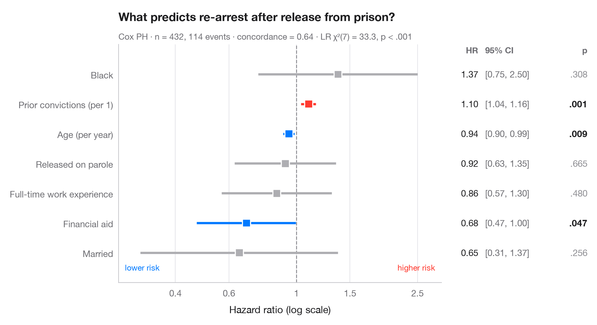
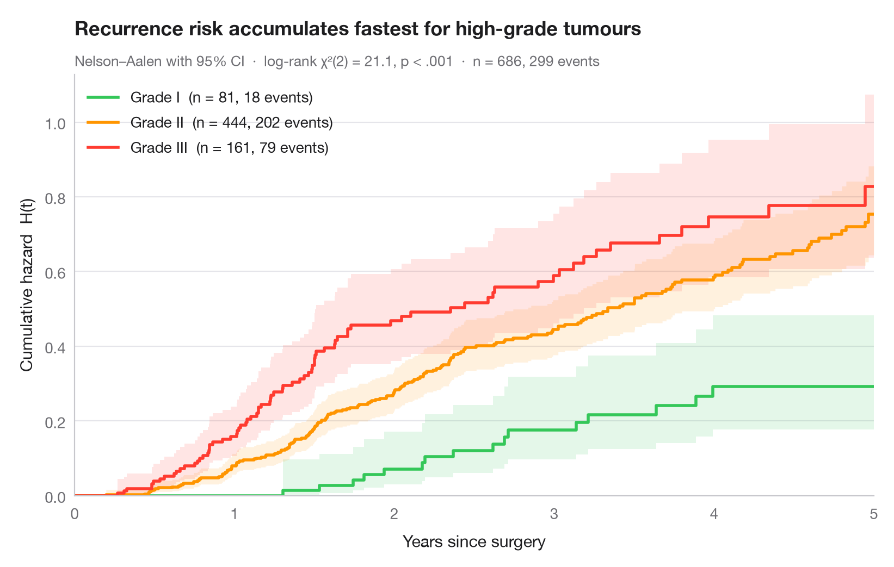
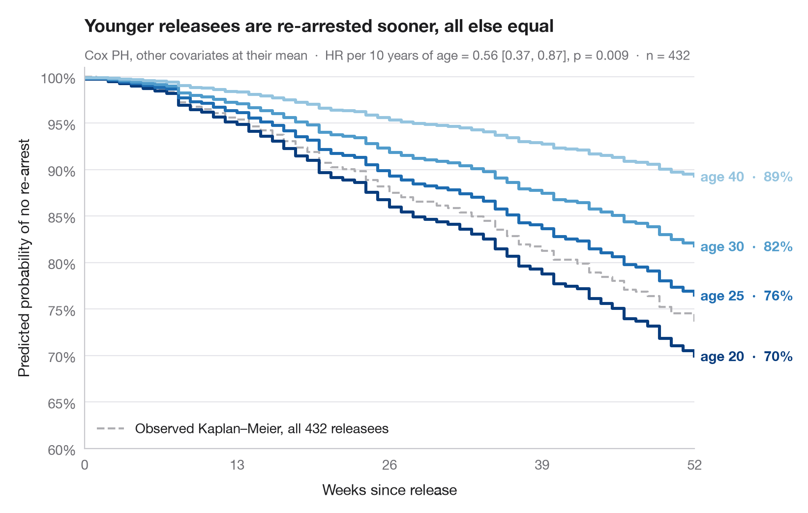

# Survival analysis

Kaplan–Meier curves with risk tables, cumulative hazards and Cox model hazard ratios.

| Chart | Description |
|:--|:--|
|  | **[Kaplan–Meier curves](01-kaplan-meier/)** Survival curves with confidence bands, censoring marks, log-rank test and risk table. `survminer::ggsurvplot(risk.table = TRUE)` |
|  | **[Cox hazard ratios](02-cox-hazard-ratios/)** Forest plot of a Cox proportional hazards model with HR, 95% CI and p-values. `survminer::ggforest()` |
|  | **[Cumulative hazard](03-cumulative-hazard/)** Nelson–Aalen cumulative hazard curves with 95% bands for three tumour grades. `survminer::ggsurvplot(fun = "cumhaz")` |
|  | **[Adjusted survival curves](04-adjusted-survival/)** Cox model–predicted survival for several ages, other covariates held at their mean. `survminer::ggadjustedcurves()` |

[← All families](../../README.md) · [Browse on the website](https://warint.github.io/statlas/survival/)
