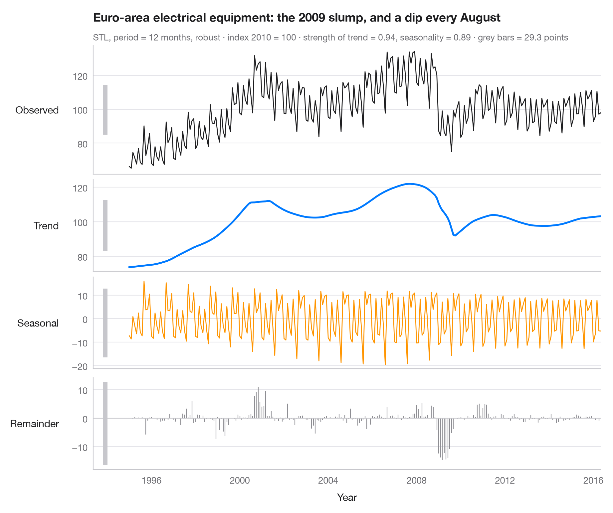

# STL decomposition

> A monthly industrial turnover series split into trend, seasonal and remainder components in stacked panels.



STL (Seasonal–Trend decomposition using Loess) writes a series as
**observed = trend + seasonal + remainder**. Each panel shares the time axis but
has its own vertical scale, so the grey bar on the left of every panel — all of
the same length in data units — shows how large each component really is:
a short bar means a component that dominates, a long one a component that is small.

Data are Eurostat's monthly turnover index for the manufacture of electrical
equipment in the euro area (2010 = 100), January 1995 to May 2016, working-day
adjusted but **not** seasonally adjusted — 257 months bundled with
**statsmodels** (`statsmodels.datasets.elec_equip`). The trend shows the
2008–09 collapse in industrial activity; the seasonal component shows the
August shutdown and the end-of-quarter peaks. The decomposition uses
`statsmodels.tsa.seasonal.STL` with a 12-month period and robust fitting; the
subtitle gives the strength of trend and seasonality as defined by Wang,
Smith & Hyndman (2006).

**R equivalent:** `feasts::STL() + autoplot()`  
**Libraries:** Matplotlib, NumPy, statsmodels

**Data:** Eurostat. Euro area (18, fixed composition) total turnover index, manufacture of electrical equipment (NACE Rev. 2), working-day adjusted, not seasonally adjusted. https://ec.europa.eu/eurostat — Distributed with statsmodels (statsmodels.datasets.elec_equip); public domain.


```python
import matplotlib.pyplot as plt
import numpy as np
from statsmodels.datasets import elec_equip
from statsmodels.tsa.seasonal import STL

# Data: euro-area turnover index, electrical equipment manufacturing (2010 = 100), monthly
turnover = elec_equip.load().data.iloc[:, 0]

res = STL(turnover, period=12, robust=True).fit()
parts = {"Observed": turnover, "Trend": res.trend, "Seasonal": res.seasonal, "Remainder": res.resid}
colors = ["#1D1D1F", "#007AFF", "#FF9500", "#8E8E93"]

# Strength of trend and seasonality (0 = none, 1 = all the variation)
f_trend = max(0, 1 - res.resid.var() / (res.trend + res.resid).var())
f_seas = max(0, 1 - res.resid.var() / (res.seasonal + res.resid).var())

fig, axes = plt.subplots(4, 1, figsize=(9, 7.5), sharex=True,
                         gridspec_kw=dict(height_ratios=[1.4, 1, 1, 1]))
bar = 2 * res.resid.abs().max()  # common scale bar, in index points
x0 = turnover.index[0] - np.timedelta64(400, "D")

for ax, (name, s), c in zip(axes, parts.items(), colors):
    if name == "Remainder":
        ax.vlines(s.index, 0, s, color=c, lw=0.8)
        ax.axhline(0, color="#C7C7CC", lw=0.8)
    else:
        ax.plot(s.index, s, color=c, lw=2 if name == "Trend" else 1)
    ax.set_ylabel(name, rotation=0, ha="right", va="center", labelpad=14)
    # Scale bar: same height in index points in every panel
    mid = (s.max() + s.min()) / 2
    ax.plot([x0, x0], [mid - bar / 2, mid + bar / 2], color="#C7C7CC", lw=5, solid_capstyle="butt",
            clip_on=False)

axes[-1].set_xlabel("Year")
fig.align_ylabels(axes)
axes[0].set_xlim(x0 - np.timedelta64(200, "D"), turnover.index[-1])
slump = res.trend.diff(12).idxmin().year                                  # steepest yearly fall
low = res.seasonal.groupby(res.seasonal.index.month_name()).mean().idxmin()  # weakest month
axes[0].set_title(f"Euro-area electrical equipment: the {slump} slump, and a dip every {low}", pad=26)
axes[0].text(0, 1.04, f"STL, period = 12 months, robust · index 2010 = 100 · strength of trend = "
             f"{f_trend:.2f}, seasonality = {f_seas:.2f} · grey bars = {bar:.1f} points",
             transform=axes[0].transAxes, fontsize=9.5, color="#6E6E73")
plt.show()
```

---

**PyStatlas** by [Thierry Warin](https://www.warin.ca) · [View on the website →](https://warint.github.io/pystatlas/time-series/stl-decomposition/) · [← Time series](../README.md)

**Cite:** Warin, T. (2026). STL decomposition. In PyStatlas: The Python Gallery of Statistical Graphics. https://warint.github.io/pystatlas/time-series/stl-decomposition/
