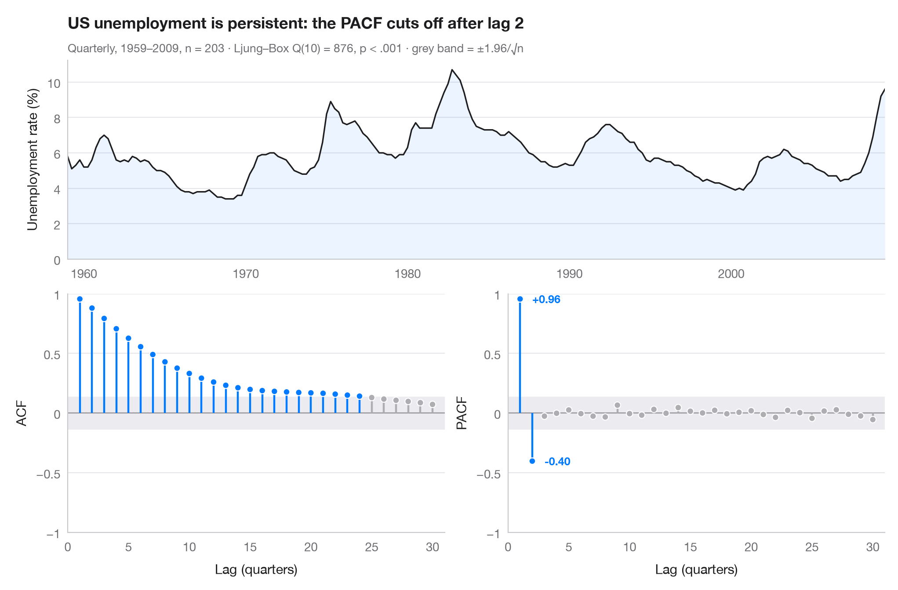

# ACF and PACF

> Autocorrelation and partial autocorrelation lollipops with 95% significance bands.



The autocorrelation function (ACF) measures how strongly a series correlates
with itself k steps earlier; the partial autocorrelation (PACF) does the same
after removing the effect of the shorter lags in between. Stems that leave the
grey band (±1.96/√n) are larger than white noise would produce. Together the two
panels suggest a model: here the ACF oscillates with the **11-year solar cycle**,
while the PACF cuts off after a few lags — the signature of an autoregressive process.

Data are the yearly Wolf sunspot numbers 1700–2008 bundled with **statsmodels**
(`sm.datasets.sunspots`). Correlations come from `statsmodels.tsa.stattools.acf`
and `pacf`, and the subtitle reports a Ljung–Box test of no autocorrelation.

**R equivalent:** `forecast::ggtsdisplay()`  
**Libraries:** Matplotlib, NumPy, statsmodels

```python
import matplotlib.pyplot as plt
import numpy as np
import statsmodels.api as sm
from statsmodels.stats.diagnostic import acorr_ljungbox
from statsmodels.tsa.stattools import acf, pacf

# Data: yearly sunspot numbers
df = sm.datasets.sunspots.load_pandas().data
y = df.set_index(df.YEAR.astype(int))["SUNACTIVITY"]
n, nlags = len(y), 30
band = 1.96 / np.sqrt(n)
lb = acorr_ljungbox(y, lags=[10]).iloc[0]

fig = plt.figure(figsize=(10, 6.5))
gs = fig.add_gridspec(2, 2, height_ratios=[1, 1.2])
ax_ts = fig.add_subplot(gs[0, :])
axes = [fig.add_subplot(gs[1, 0]), fig.add_subplot(gs[1, 1])]

# Top: the series itself
ax_ts.plot(y.index, y, color="#1D1D1F", lw=1.2)
ax_ts.fill_between(y.index, y, color="#007AFF", alpha=0.08, lw=0)
ax_ts.set(ylabel="Sunspot number", xlim=(y.index[0], y.index[-1]), ylim=(0, None))

# Bottom: ACF and PACF as lollipops with the white-noise band
values = [acf(y, nlags=nlags)[1:], pacf(y, nlags=nlags, method="ywm")[1:]]
for ax, v, name in zip(axes, values, ["ACF", "PACF"]):
    lags = np.arange(1, nlags + 1)
    sig = np.abs(v) > band
    colors = np.where(sig, "#007AFF", "#AEAEB2")
    ax.axhspan(-band, band, color="#E5E5EA", alpha=0.7, lw=0)
    ax.axhline(0, color="#8E8E93", lw=0.8)
    ax.vlines(lags, 0, v, color=colors, lw=1.6)
    ax.scatter(lags, v, s=28, color=colors, edgecolor="white", lw=0.8, zorder=3)
    ax.set(xlabel="Lag (years)", ylabel=name, ylim=(-1, 1), xlim=(0, nlags + 1))
    ax.set_xticks(range(0, nlags + 1, 5))
    ax.set_yticks([-1, -0.5, 0, 0.5, 1], ["−1", "−0.5", "0", "0.5", "1"])
for lag in (11, 22):
    axes[0].annotate(f"{lag} y", (lag, values[0][lag - 1]), xytext=(0, 8), textcoords="offset points",
                     ha="center", fontsize=9, color="#007AFF", fontweight="semibold")

ax_ts.set_title("Sunspots follow an 11-year cycle — an autoregressive signature", pad=26)
ax_ts.text(0, 1.04, f"Yearly Wolf numbers 1700–2008, n = {n} · Ljung–Box Q(10) = {lb.lb_stat:.0f}, "
           f"p < .001 · grey band = ±1.96/√n", transform=ax_ts.transAxes, fontsize=9.5, color="#6E6E73")
plt.show()
```

---

**Statlas** by [Thierry Warin](https://www.warin.ca) · [View on the website →](https://warint.github.io/pystatlas/time-series/acf-pacf/) · [← Time series](../README.md)

**Cite:** Warin, T. (2026). ACF and PACF. In Statlas: The Python Gallery of Statistical Graphics. https://warint.github.io/pystatlas/time-series/acf-pacf/
