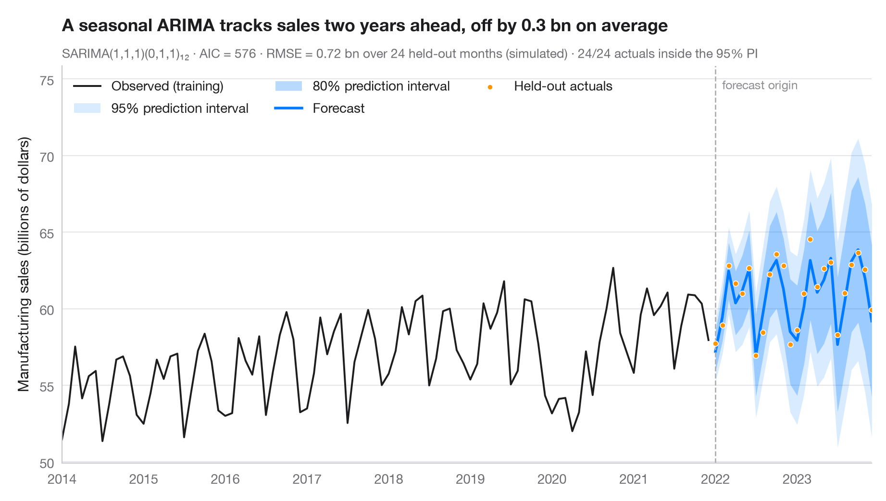

# SARIMA forecast

> Seasonal ARIMA forecast with 80% and 95% prediction intervals against held-out data.



A forecast is only honest with its uncertainty. The dark fan is the 80%
prediction interval, the light fan the 95% interval; both widen as the horizon
grows. The last four years were **held out** from the fit, so the dots show what
actually happened and the subtitle reports the out-of-sample RMSE and how many
of those months fell inside the 95% interval.

Data are the Mauna Loa CO₂ measurements bundled with **statsmodels**
(`sm.datasets.co2`), aggregated to monthly means. The model is a seasonal
ARIMA(1,1,1)(0,1,1)₁₂ — the classic "airline" structure — fitted with
`statsmodels.tsa.statespace.SARIMAX`; intervals come from `get_forecast().conf_int()`.

**R equivalent:** `forecast::autoplot(forecast())`  
**Libraries:** Matplotlib, NumPy, statsmodels

```python
import matplotlib.pyplot as plt
import numpy as np
import statsmodels.api as sm
from statsmodels.tsa.statespace.sarimax import SARIMAX

# Data: monthly CO2; hold out the last 4 years
co2 = sm.datasets.co2.load_pandas().data["co2"].resample("MS").mean().interpolate()
h = 48
train, test = co2[:-h], co2[-h:]

# Fit a seasonal ARIMA and forecast the held-out horizon
fit = SARIMAX(train, order=(1, 1, 1), seasonal_order=(0, 1, 1, 12)).fit(disp=False)
fc = fit.get_forecast(h)
mean, ci95, ci80 = fc.predicted_mean, fc.conf_int(alpha=0.05), fc.conf_int(alpha=0.20)

rmse = np.sqrt(((test - mean) ** 2).mean())
covered = ((test >= ci95.iloc[:, 0]) & (test <= ci95.iloc[:, 1])).sum()

fig, ax = plt.subplots(figsize=(9, 5))
hist = train["1991":]
ax.plot(hist.index, hist, color="#1D1D1F", lw=1.4, label="Observed (training)")
ax.fill_between(mean.index, ci95.iloc[:, 0], ci95.iloc[:, 1], color="#007AFF", alpha=0.15, lw=0,
                label="95% prediction interval")
ax.fill_between(mean.index, ci80.iloc[:, 0], ci80.iloc[:, 1], color="#007AFF", alpha=0.28, lw=0,
                label="80% prediction interval")
ax.plot(mean.index, mean, color="#007AFF", lw=2, label="Forecast")
ax.scatter(test.index, test, s=16, color="#FF9500", edgecolor="white", lw=0.6, zorder=4,
           label="Held-out actuals")

# Mark the forecast origin
ax.axvline(test.index[0], color="#AEAEB2", lw=1, ls="--")
ax.text(test.index[0], 0.97, "  forecast origin", transform=ax.get_xaxis_transform(),
        fontsize=9, color="#8E8E93", va="top")

ax.set(ylabel="CO₂ (ppm)", xlim=(hist.index[0], test.index[-1]))
ax.legend(loc="upper left", ncols=1)
ax.set_title("A seasonal ARIMA tracks CO₂ four years ahead, but runs slightly low", pad=26)
ax.text(0, 1.02, f"SARIMA(1,1,1)(0,1,1)₁₂ · AIC = {fit.aic:.0f} · out-of-sample RMSE = {rmse:.2f} ppm "
        f"over {h} months · {covered}/{h} actuals inside the 95% PI",
        transform=ax.transAxes, fontsize=9.5, color="#6E6E73")
plt.show()
```

---

**Statlas** by [Thierry Warin](https://www.warin.ca) · [View on the website →](https://warint.github.io/statlas/time-series/arima-forecast/) · [← Time series](../README.md)

**Cite:** Warin, T. (2026). SARIMA forecast. In Statlas: The Python Gallery of Statistical Graphics. https://warint.github.io/statlas/time-series/arima-forecast/
