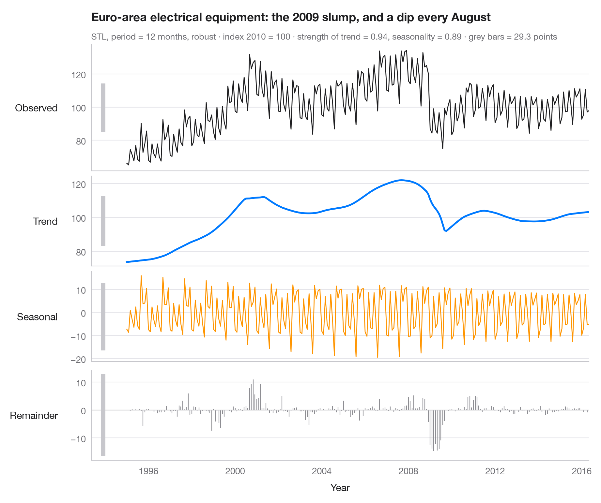
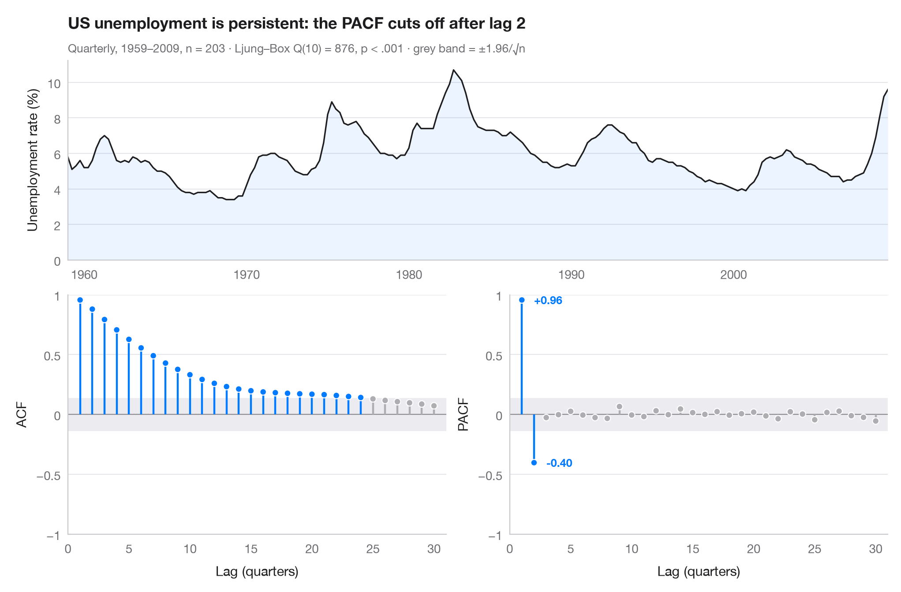
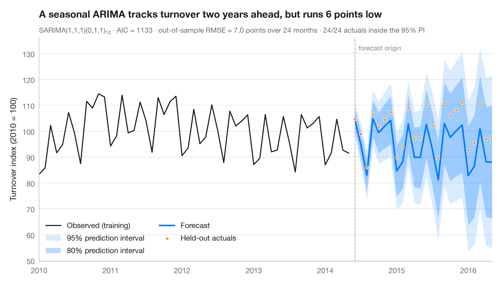
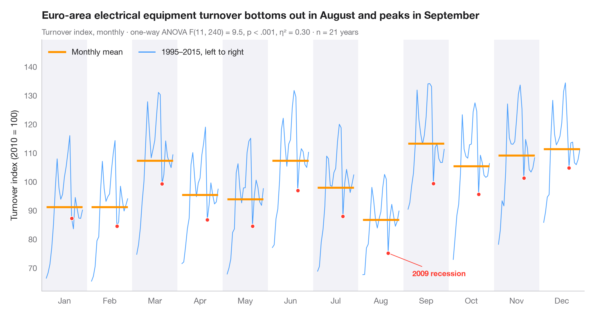

# Time series

Decomposition, autocorrelation, forecasts with prediction intervals and change over time.

| Chart | Description |
|:--|:--|
|  | **[STL decomposition](01-stl-decomposition/)** A monthly industrial turnover series split into trend, seasonal and remainder components in stacked panels. `feasts::STL() + autoplot()` |
|  | **[ACF and PACF](02-acf-pacf/)** Autocorrelation and partial autocorrelation of US quarterly unemployment, as lollipops with 95% significance bands. `forecast::ggtsdisplay()` |
|  | **[SARIMA forecast](03-arima-forecast/)** Seasonal ARIMA forecast of industrial turnover with 80% and 95% prediction intervals against held-out data. `forecast::autoplot(forecast())` |
|  | **[Seasonal subseries plot](04-seasonal-subseries/)** Each calendar month's industrial turnover across the years, with the monthly mean as a reference. `feasts::gg_subseries()` |

[← All families](../../README.md) · [Browse on the website](https://warint.github.io/pystatlas/time-series/)
