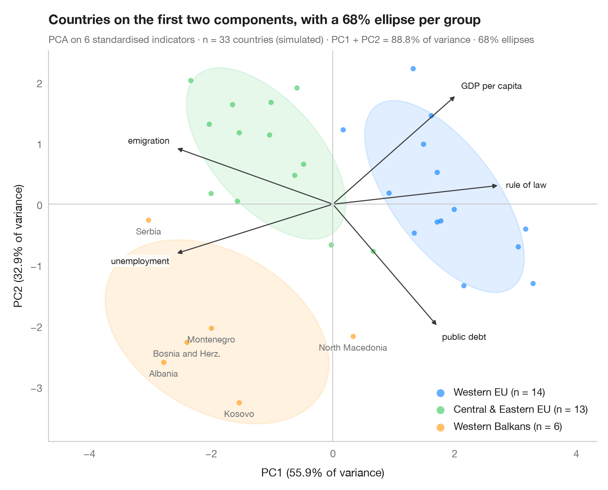

# PCA biplot

> European countries on institutional and economic indicators, Western Balkans highlighted.



A biplot overlays two things on the same principal-component plane: the
**scores** (one dot per observation, coloured by group, with a 68% normal
ellipse per group) and the **loadings** (one arrow per variable). Arrows that
point the same way are positively correlated; long arrows weigh heavily on the
two components shown; groups sit on the side of the variables they are high on.

The setting is Stojkov & Warin (2025), *Western Balkans and the Future of
Europe* (Springer): 33 European countries — 14 Western EU members, 13 newer
Central and Eastern EU members and the six Western Balkan candidates (named) —
described by six indicators: rule of law, GDP per capita, unemployment,
emigration, trade openness and public debt.
The data are **simulated** with `numpy` (seeded) from two latent factors for
illustration; they are *not* the book's data or results. Variables are
standardised, then `sklearn.decomposition.PCA` gives scores, loadings and the
share of variance printed on each axis.

**R equivalent:** `factoextra::fviz_pca_biplot()`  
**Libraries:** Matplotlib, NumPy, pandas, SciPy, scikit-learn

**Data:** Simulated data with a fixed random seed, created for this example. — No real respondents, documents or measurements: the numbers only illustrate how the chart and its statistics work.

**Data:** Stojkov, A., & Warin, T. (2025). Western Balkans and the future of Europe. Springer. https://doi.org/10.1007/978-3-031-86465-0 — The example is set in the context of this book; unless its description says otherwise, the numbers are simulated and are not the book's data or results.


```python
import matplotlib.pyplot as plt
import numpy as np
import pandas as pd
from matplotlib.patches import Ellipse
from scipy import stats
from sklearn.decomposition import PCA
from sklearn.preprocessing import StandardScaler

# Simulated data, set in the context of Stojkov & Warin (2025) [stojkov2025balkans]
rng = np.random.default_rng(25)
wb = ["Albania", "Bosnia and Herz.", "Kosovo", "Montenegro", "North Macedonia", "Serbia"]
groups = np.repeat(["Western EU", "Central & Eastern EU", "Western Balkans"], [14, 13, 6])
# Two latent factors: institutional/economic development and openness
dev = pd.Series(groups).map({"Western EU": 1.2, "Central & Eastern EU": 0.0,
                             "Western Balkans": -1.5}).to_numpy() + rng.normal(0, 0.45, 33)
opn = rng.normal(0, 1, 33) + 0.6 * (groups == "Central & Eastern EU")
names = ["rule of law", "GDP per capita", "unemployment", "emigration", "trade openness",
         "public debt"]
load = np.array([[0.85, -0.25], [0.8, 0.3], [-0.7, 0.15], [-0.55, 0.55], [0.15, 0.85],
                 [0.35, -0.65]])
X = StandardScaler().fit_transform(np.c_[dev, opn] @ load.T + rng.normal(0, 0.4, (33, 6)))
states = np.array([""] * 27 + wb, dtype=object)

pca = PCA(n_components=2).fit(X)
scores = pca.transform(X)
loadings = pca.components_.T * np.sqrt(pca.explained_variance_)  # variable–PC correlations
var = pca.explained_variance_ratio_ * 100

fig, ax = plt.subplots(figsize=(8, 6.4))
ax.axhline(0, color="#C7C7CC", lw=0.8); ax.axvline(0, color="#C7C7CC", lw=0.8)
r68 = np.sqrt(stats.chi2.ppf(0.68, df=2))
for g, c in zip(["Western EU", "Central & Eastern EU", "Western Balkans"],
                ["#007AFF", "#34C759", "#FF9500"]):
    s = scores[groups == g]
    ax.scatter(*s.T, s=26, color=c, alpha=0.6, lw=0, label=f"{g} (n = {len(s)})")
    # 68% normal-theory ellipse from the group covariance
    vals, vecs = np.linalg.eigh(np.cov(s.T))
    angle = np.degrees(np.arctan2(vecs[1, 1], vecs[0, 1]))
    ax.add_patch(Ellipse(s.mean(0), *(2 * r68 * np.sqrt(vals[::-1])), angle=angle,
                         facecolor=c, alpha=0.12, edgecolor=c, lw=1.2))

# Name the six Western Balkan countries
for i in np.flatnonzero(groups == "Western Balkans"):
    ax.annotate(states[i], scores[i], xytext=(0, -6), textcoords="offset points", fontsize=8.5,
                color="#6E6E73", ha="center", va="top")

# Loading arrows, scaled to the narrower side of the score cloud
scale = 0.85 * np.abs(scores).max(axis=0).min() / np.abs(loadings).max()
for (x, y), name in zip(loadings * scale, names):
    ax.annotate("", (x, y), (0, 0), arrowprops=dict(arrowstyle="-|>", color="#3A3A3C",
                                                    lw=1, mutation_scale=9))
    u = np.array([x, y]) / np.hypot(x, y)  # label just beyond the arrow tip
    dx, dy = 6 * u
    ax.annotate(name, (x, y), xytext=(dx, dy), textcoords="offset points", fontsize=8.5,
                color="#1D1D1F", ha="left" if u[0] > 0.3 else "right" if u[0] < -0.3 else "center",
                va="bottom" if u[1] > 0.3 else "top" if u[1] < -0.3 else "center",
                bbox=dict(boxstyle="round,pad=0.12", fc="white", ec="none", alpha=0.8))

ax.set_xlabel(f"PC1 ({var[0]:.1f}% of variance)")
ax.set_ylabel(f"PC2 ({var[1]:.1f}% of variance)")
ax.grid(False)
ax.set_aspect("equal", adjustable="datalim")
ax.legend(loc="lower right", markerscale=1.5, handletextpad=0.3)
ax.set_title("Countries on the first two components, with a 68% ellipse per group", pad=26)
ax.text(0, 1.02, f"PCA on {X.shape[1]} standardised indicators · n = {len(X)} countries (simulated) · "
        f"PC1 + PC2 = {var.sum():.1f}% of variance · 68% ellipses",
        transform=ax.transAxes, fontsize=9.5, color="#6E6E73")
plt.show()
```

---

**PyStatlas** by [Thierry Warin](https://www.warin.ca) · [View on the website →](https://warint.github.io/pystatlas/multivariate/pca-biplot/) · [← Multivariate & clustering](../README.md)

**Cite:** Warin, T. (2026). PCA biplot. In PyStatlas: A Python Gallery of Statistical Graphics for the Social Sciences. https://warint.github.io/pystatlas/multivariate/pca-biplot/
