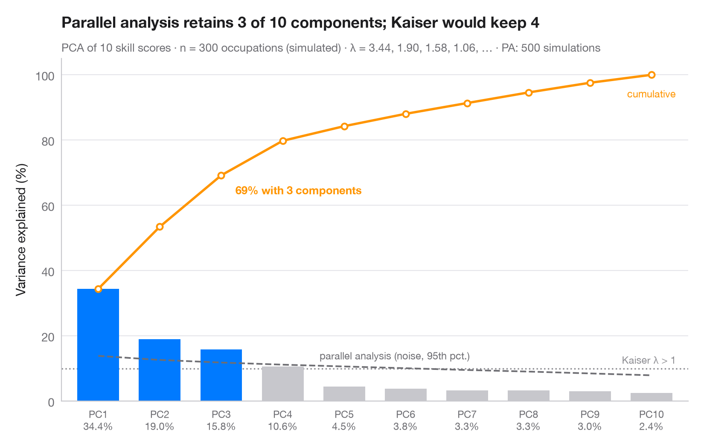

# Scree plot

> Variance explained per component, cumulative share and a parallel-analysis cut-off.



How many principal components are worth keeping? Bars show the share of
variance carried by each component, the orange line the running total. The
grey dashed line is **Horn's parallel analysis**: the 95th percentile of the
same eigenvalues computed on random, uncorrelated data of the same size. A
component is retained (blue) only if it beats that noise floor; the dotted
line marks the older Kaiser rule (eigenvalue > 1).

Data are the 13 standardised chemical measurements of the **scikit-learn**
wine dataset. Eigenvalues of the correlation matrix (the PCA variances) come from
`numpy.linalg.eigvalsh`; the parallel analysis is 500 seeded simulations.

**R equivalent:** `factoextra::fviz_eig()`  
**Libraries:** Matplotlib, NumPy, scikit-learn

```python
import matplotlib.pyplot as plt
import numpy as np
from sklearn.datasets import load_wine
from sklearn.preprocessing import StandardScaler

# PCA on the standardised wine measurements
X = StandardScaler().fit_transform(load_wine().data)
n, p = X.shape
eig = np.sort(np.linalg.eigvalsh(np.corrcoef(X.T)))[::-1]  # PCA eigenvalues
pct = 100 * eig / eig.sum()

# Horn's parallel analysis: eigenvalues of pure noise, 95th percentile
rng = np.random.default_rng(42)
sims = [np.sort(np.linalg.eigvalsh(np.corrcoef(rng.normal(size=(n, p)).T)))[::-1]
        for _ in range(500)]
pa = np.percentile(sims, 95, axis=0)
keep = eig > pa
k = np.arange(1, p + 1)

fig, ax = plt.subplots(figsize=(8, 5))
ax.bar(k, pct, width=0.68, color=np.where(keep, "#007AFF", "#C7C7CC"), zorder=2)

# Cumulative share, parallel-analysis floor and Kaiser threshold (all in % of variance)
cum = np.cumsum(pct)
ax.plot(k, cum, color="#FF9500", marker="o", ms=5, mfc="white", mew=1.5, zorder=3)
ax.annotate(f"{cum[keep.sum() - 1]:.0f}% with {keep.sum()} components",
            (keep.sum(), cum[keep.sum() - 1]), xytext=(12, -16), textcoords="offset points",
            fontsize=9.5, color="#FF9500", fontweight="semibold")
ax.text(p, cum[-1] - 4, "cumulative", fontsize=8.5, color="#FF9500", ha="center", va="top")
ax.plot(k, 100 * pa / p, color="#6E6E73", ls="--", lw=1.4, zorder=3)
ax.text(4.6, 100 * pa[4] / p + 1.5, "parallel analysis (noise, 95th pct.)", fontsize=8.5,
        color="#6E6E73", va="bottom")
ax.axhline(100 / p, color="#8E8E93", ls=":", lw=1.2, zorder=1)
ax.text(p + 0.4, 100 / p + 0.8, "Kaiser λ > 1", fontsize=8.5, color="#8E8E93", ha="right", va="bottom")

ax.set_xticks(k, [f"PC{i}\n{v:.1f}%" for i, v in zip(k, pct)], fontsize=8.5)
ax.set_xlim(0.4, p + 0.6)
ax.set_ylim(0, 105)
ax.set_ylabel("Variance explained (%)")
ax.set_title(f"Parallel analysis retains {keep.sum()} of {p} components", pad=26)
ax.text(0, 1.02, f"PCA of 13 standardised wine measurements · n = {n} · λ = "
        f"{', '.join(f'{e:.2f}' for e in eig[:4])}, … · Horn's PA: 500 simulations",
        transform=ax.transAxes, fontsize=9.5, color="#6E6E73")
plt.show()
```

---

**Statlas** by [Thierry Warin](https://www.warin.ca) · [View on the website →](https://warint.github.io/statlas/multivariate/scree-plot/) · [← Multivariate & clustering](../README.md)

**Cite:** Warin, T. (2026). Scree plot. In Statlas: The Python Gallery of Statistical Graphics. https://warint.github.io/statlas/multivariate/scree-plot/
