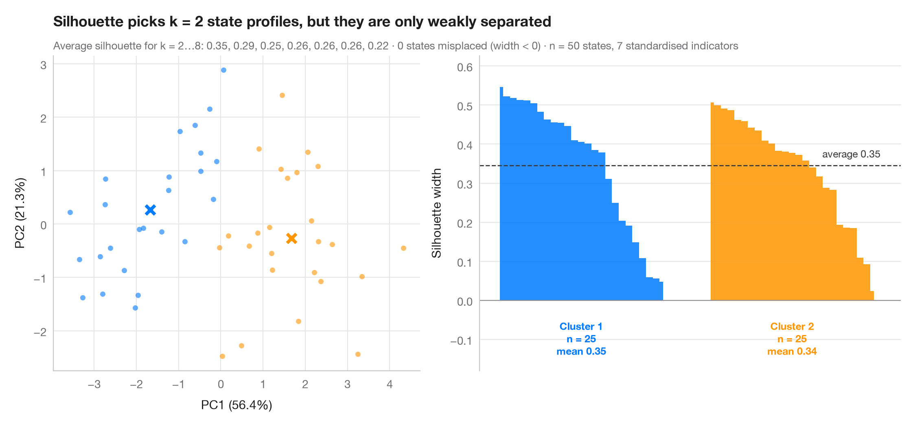

# Silhouette plot for k-means

> Do US states fall into distinct social profiles? k-means clusters next to their silhouette widths.



The silhouette width compares how close each observation is to its own cluster
with how close it is to the nearest other cluster: near 1 means well placed,
near 0 means on the border, negative means probably misassigned. The number of
clusters k is the one with the highest average silhouette (2 to 8 tried).
The left panel shows the clusters on the first two principal components; the
right panel sorts the silhouette widths within each cluster, with the dashed
line at the overall average.

Data are the 50 US states from the **statsmodels** `statecrime` dataset (2009
figures), described by 7 standardised indicators: violent-crime and murder
rates, % high-school graduates, % in poverty, % single-parent households,
% white and % urban. The District of Columbia is left out: it is so extreme
that k-means would give it a cluster of its own. The two clusters found are
roughly a lower-crime, lower-poverty profile and a higher-crime,
higher-poverty one, but an average silhouette around 0.35 is a **weak**
structure by Kaufman & Rousseeuw's rule of thumb (0.26–0.50): states form a
continuum more than separate types. `KMeans`, `silhouette_score` and
`silhouette_samples` from `sklearn` do the work; `PCA` is only used to draw
the clusters.

**R equivalent:** `factoextra::fviz_silhouette()`  
**Libraries:** Matplotlib, NumPy, statsmodels, scikit-learn

**Data:** U.S. Census Bureau. Statistical Abstract of the United States, state tables for 2009 (crime rates from the FBI Uniform Crime Reporting program). https://www.statsmodels.org/stable/datasets/generated/statecrime.html — Compiled for statsmodels (sm.datasets.statecrime); public domain. See the statsmodels page for each variable's table and footnotes.


```python
import matplotlib.pyplot as plt
import numpy as np
import statsmodels.api as sm
from sklearn.cluster import KMeans
from sklearn.decomposition import PCA
from sklearn.metrics import silhouette_samples, silhouette_score
from sklearn.preprocessing import StandardScaler

# 7 social indicators of the 50 US states (DC, an extreme outlier, is left out)
df = sm.datasets.statecrime.load_pandas().data.drop("District of Columbia")
X = StandardScaler().fit_transform(df)

# Choose k by the average silhouette width
fits = {k: KMeans(k, n_init=20, random_state=1).fit(X) for k in range(2, 9)}
avg = {k: silhouette_score(X, m.labels_) for k, m in fits.items()}
k = max(avg, key=avg.get)
labels = fits[k].labels_
sil = silhouette_samples(X, labels)
colors = ["#007AFF", "#FF9500", "#34C759", "#FF3B30", "#AF52DE", "#5AC8FA", "#8E8E93", "#A2845E"]

fig, (ax1, ax2) = plt.subplots(1, 2, figsize=(11, 5), width_ratios=[1, 1.15])

# Left: clusters projected on the first two principal components
pca = PCA(2).fit(X)
S, C = pca.transform(X), pca.transform(fits[k].cluster_centers_)
for j in range(k):
    ax1.scatter(*S[labels == j].T, s=22, color=colors[j], alpha=0.6, lw=0)
    ax1.scatter(*C[j], s=150, marker="X", color=colors[j], edgecolor="white", lw=1.5, zorder=3)
ax1.set_xlabel(f"PC1 ({100 * pca.explained_variance_ratio_[0]:.1f}%)")
ax1.set_ylabel(f"PC2 ({100 * pca.explained_variance_ratio_[1]:.1f}%)")
ax1.grid(axis="x")

# Right: silhouette widths, sorted within cluster
start = 0
for j in range(k):
    s = np.sort(sil[labels == j])[::-1]
    x = np.arange(start, start + len(s))
    ax2.fill_between(x, 0, s, color=colors[j], step="mid", lw=0, alpha=0.85)
    ax2.text(x.mean(), -0.05, f"Cluster {j + 1}\nn = {len(s)}\nmean {s.mean():.2f}",
             ha="center", va="top", fontsize=9, color=colors[j], fontweight="semibold")
    start += len(s) + 6
ax2.axhline(avg[k], color="#3A3A3C", ls="--", lw=1)
ax2.text(start - 6, avg[k] + 0.015, f"average {avg[k]:.2f}", ha="right", va="bottom",
         fontsize=9, color="#3A3A3C")
ax2.axhline(0, color="#8E8E93", lw=0.8)
ax2.set_xticks([])
ax2.set_xlim(-3, start - 3)
ax2.set_ylim(-0.18, max(sil) + 0.08)
ax2.set_ylabel("Silhouette width")
ax2.spines["bottom"].set_visible(False)

ax1.set_title(f"Silhouette picks k = {k} state profiles, but they are only weakly separated",
              pad=26)
ax1.text(0, 1.02, "Average silhouette for k = 2…8: " + ", ".join(f"{v:.2f}" for v in avg.values())
         + f" · {(sil < 0).sum()} states misplaced (width < 0) · n = {len(X)} states, "
         f"{X.shape[1]} standardised indicators", transform=ax1.transAxes, fontsize=9.5,
         color="#6E6E73", in_layout=False)
plt.show()
```

---

**PyStatlas** by [Thierry Warin](https://www.warin.ca) · [View on the website →](https://warint.github.io/pystatlas/multivariate/silhouette-clusters/) · [← Multivariate & clustering](../README.md)

**Cite:** Warin, T. (2026). Silhouette plot for k-means. In PyStatlas: The Python Gallery of Statistical Graphics for the Social Sciences. https://warint.github.io/pystatlas/multivariate/silhouette-clusters/
