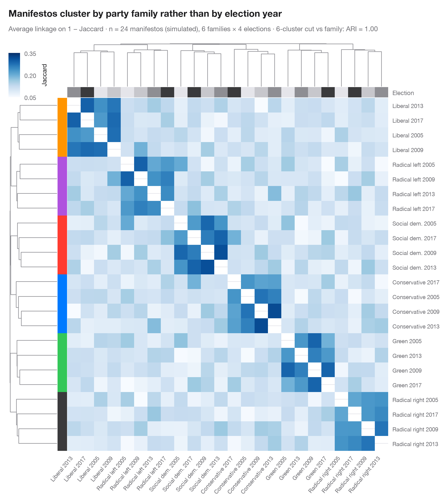

# Clustered heatmap

> Jaccard similarity between 24 party manifestos, with dendrograms and party-family colour bars.



Each row and each column is a document, and each cell the similarity between
two of them (darker = more alike). Rows and columns are reordered by
**hierarchical clustering** (average linkage on the distance 1 − similarity)
and the dendrograms show the merge history. Colour bars give the known groups
— party family on the rows, election year on the columns — so you can see at
a glance which grouping the unsupervised tree rediscovers.

The setting is Sanger & Warin (2019), a *Data in Brief* dataset of Jaccard
similarity indices between European party manifestos: here 24 manifestos —
six party families × four elections in one country. The similarities are
**simulated** with `numpy` (seeded): higher within a party, decaying with the
time between elections, plus a small shared election-year agenda. They are
*not* the dataset's values. `scipy.cluster.hierarchy.linkage` builds the tree,
`seaborn.clustermap` draws it, and `fcluster` cuts it into six clusters for
the adjusted Rand index against party family. Labels carry family and year,
so the colour bars need no legend.

**R equivalent:** `pheatmap::pheatmap() / ComplexHeatmap::Heatmap()`  
**Libraries:** Matplotlib, NumPy, pandas, seaborn, SciPy, scikit-learn

**Data:** Simulated data with a fixed random seed, created for this example. — No real respondents, documents or measurements: the numbers only illustrate how the chart and its statistics work.

**Data:** Sanger, W., & Warin, T. (2019). Dataset of Jaccard similarity indices from 1,597 European political manifestos across 27 countries (1945–2017). Data in Brief, 24, 103907. https://doi.org/10.1016/j.dib.2019.103907 — The example is set in the context of this paper; unless its description says otherwise, the numbers are simulated and are not the paper's data or results.


```python
import matplotlib.pyplot as plt
import numpy as np
import pandas as pd
import seaborn as sns
from scipy.cluster.hierarchy import fcluster, linkage
from scipy.spatial.distance import squareform
from sklearn.metrics import adjusted_rand_score

# Simulated data, set in the context of Sanger & Warin (2019) [sanger2019]
rng = np.random.default_rng(1945)
families = ["Social dem.", "Conservative", "Liberal", "Green", "Radical right", "Radical left"]
years = [2005, 2009, 2013, 2017]
fam = np.repeat(families, 4)
yr = np.tile(years, 6)
labels = [f"{f} {y}" for f, y in zip(fam, yr)]
# Jaccard similarity: base + same party (decaying with time gap) + same election + noise
gap = np.abs(yr[:, None] - yr[None, :]) / 4
J = 0.10 + (fam[:, None] == fam[None, :]) * (0.20 - 0.03 * gap) + (gap == 0) * 0.04
J = np.triu(J + rng.normal(0, 0.025, J.shape), 1)
J = J + J.T + np.eye(24)  # symmetric, 1 on the diagonal
S = pd.DataFrame(J, index=labels, columns=labels)

link = linkage(squareform(1 - J, checks=False), method="average")
ari = adjusted_rand_score(fam, fcluster(link, 6, "maxclust"))
fam_pal = dict(zip(families, ["#FF3B30", "#007AFF", "#FF9500", "#34C759", "#3A3A3C", "#AF52DE"]))
yr_pal = dict(zip(years, ["#E5E5EA", "#C7C7CC", "#8E8E93", "#3A3A3C"]))

with plt.rc_context({"figure.constrained_layout.use": False}):
    g = sns.clustermap(S, row_linkage=link, col_linkage=link, cmap="Blues", vmin=0.05, vmax=0.35,
                       mask=np.eye(24, dtype=bool),
                       row_colors=pd.Series(fam, index=labels, name="Family").map(fam_pal),
                       col_colors=pd.Series(yr, index=labels, name="Election").map(yr_pal),
                       xticklabels=True, yticklabels=True, figsize=(9, 10.1),
                       dendrogram_ratio=(0.13, 0.11), colors_ratio=0.025,
                       cbar_pos=(0.02, 0.875, 0.025, 0.09),
                       cbar_kws=dict(label="Jaccard", ticks=[0.05, 0.2, 0.35]),
                       tree_kws=dict(colors="#8E8E93", linewidths=0.8))

g.figure.subplots_adjust(top=0.93)                 # keep the top of the figure for the title and subtitle
g.ax_cbar.set_position((0.02, 0.823, 0.025, 0.085))  # colour bar back in the top-left corner
g.ax_heatmap.set(xlabel="", ylabel="")
g.ax_heatmap.tick_params(axis="both", length=0, labelsize=8)
g.ax_heatmap.set_xticklabels(g.ax_heatmap.get_xticklabels(), rotation=50, ha="right")
g.ax_row_colors.set_xticks([])
g.ax_col_colors.tick_params(axis="y", length=0, labelsize=8.5)
g.ax_cbar.tick_params(labelsize=8.5)
g.ax_cbar.yaxis.label.set_size(9)
g.figure.text(0.02, 0.978, "Manifestos cluster by party family rather than by election year",
              fontsize=13, fontweight="semibold", color="#1D1D1F")
g.figure.text(0.02, 0.95, f"Average linkage on 1 − Jaccard · n = {len(S)} manifestos (simulated), "
              f"6 families × 4 elections · 6-cluster cut vs family: ARI = {ari:.2f}",
              fontsize=9.5, color="#6E6E73")
plt.show()
```

---

**PyStatlas** by [Thierry Warin](https://www.warin.ca) · [View on the website →](https://warint.github.io/pystatlas/multivariate/clustered-heatmap/) · [← Multivariate & clustering](../README.md)

**Cite:** Warin, T. (2026). Clustered heatmap. In PyStatlas: A Python Gallery of Statistical Graphics for the Social Sciences (Version 1.1.0) [Computer software]. https://warint.github.io/pystatlas/multivariate/clustered-heatmap/
