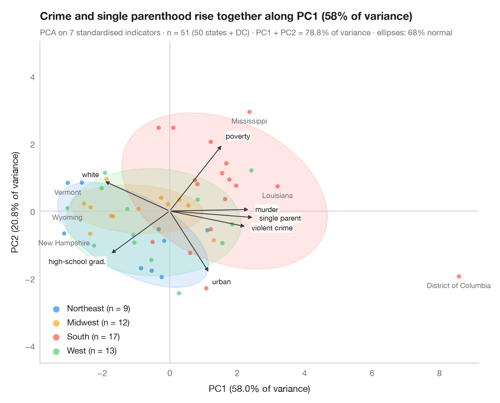
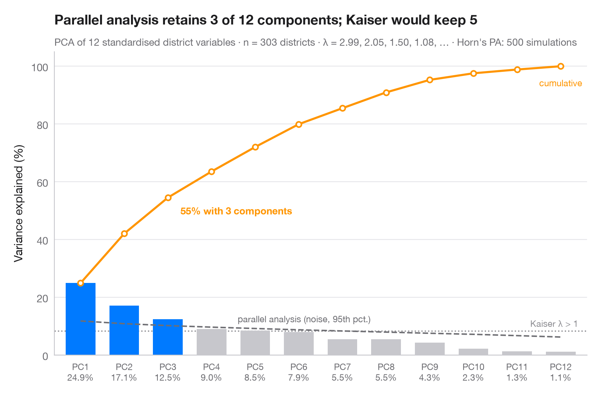
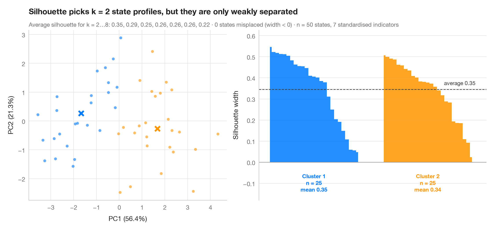
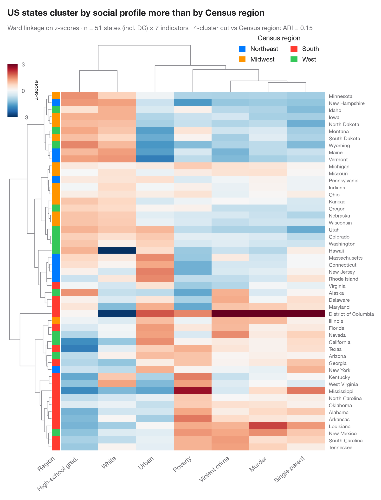

# Multivariate & clustering

PCA biplots, scree plots, clustering and heatmaps for high-dimensional data.

| Chart | Description |
|:--|:--|
|  | **[PCA biplot](01-pca-biplot/)** US states and their social indicators on the first two principal components. `factoextra::fviz_pca_biplot()` |
|  | **[Scree plot](02-scree-plot/)** How many dimensions describe 303 California school districts? Variance per component and a parallel-analysis cut-off. `factoextra::fviz_eig()` |
|  | **[Silhouette plot for k-means](03-silhouette-clusters/)** Do US states fall into distinct social profiles? k-means clusters next to their silhouette widths. `factoextra::fviz_silhouette()` |
|  | **[Clustered heatmap](04-clustered-heatmap/)** Z-scored heatmap of US states' social indicators, with row and column dendrograms and a Census-region colour bar. `pheatmap::pheatmap() / ComplexHeatmap::Heatmap()` |

[← All families](../../README.md) · [Browse on the website](https://warint.github.io/pystatlas/multivariate/)
