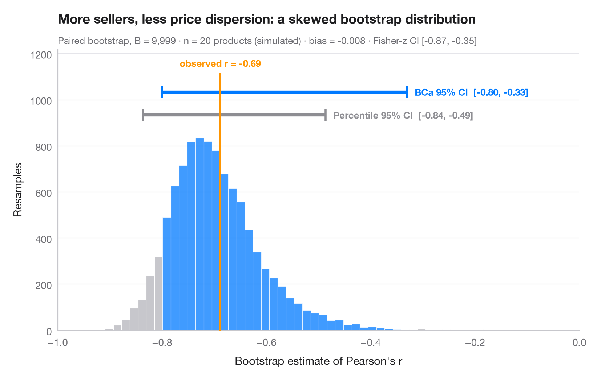

# Bootstrap distribution

> Online sellers and price dispersion across 20 products — resampled correlation with percentile and BCa 95% CIs.



The bootstrap re-estimates a statistic on thousands of samples drawn with
replacement from the data; the spread of those estimates is its sampling
uncertainty. The histogram is the bootstrap distribution of a correlation,
the orange line the value observed in the full sample. Two 95% intervals are
drawn above it: the simple **percentile** interval and the **BCa**
(bias-corrected and accelerated) interval, which shifts to account for the
bias and skew visible here — with only 20 products the distribution is far
from symmetric.

The setting is Leiter & Warin (2012), "Homogenous goods markets: An empirical
study of price dispersion on the internet" (*International Journal of
Economics and Business Research*): for each of 20 homogeneous products, the
number of online sellers and the price dispersion (coefficient of variation of
posted prices, %). The data are **simulated** with `numpy` (seeded) for
illustration; they are *not* the paper's data or results.
`scipy.stats.bootstrap` (paired, 9,999 resamples) provides both intervals.

**R equivalent:** `boot::boot() + boot::boot.ci()`  
**Libraries:** Matplotlib, NumPy, SciPy

**Data:** Simulated data with a fixed random seed, created for this example. — No real respondents, documents or measurements: the numbers only illustrate how the chart and its statistics work.

**Data:** Leiter, D., & Warin, T. (2012). Homogenous goods markets: An empirical study of price dispersion on the internet. International Journal of Economics and Business Research, 4(5), 514. https://doi.org/10.1504/ijebr.2012.048776 — The example is set in the context of this paper; unless its description says otherwise, the numbers are simulated and are not the paper's data or results.


```python
import matplotlib.pyplot as plt
import numpy as np
from scipy import stats

# Simulated data, set in the context of Leiter & Warin (2012) [leiter2012]
# 20 products: number of online sellers and price dispersion (CV of prices, %)
rng = np.random.default_rng(2012)
x = np.round(rng.lognormal(np.log(15), 0.6, 20))
y = np.clip(14 - 2.8 * np.log(x) + rng.normal(0, 1.6, 20), 1, None)
r_obs = stats.pearsonr(x, y)[0]

# Paired bootstrap of Pearson's r: percentile and BCa intervals from the same resamples
r = lambda a, b, axis=-1: stats.pearsonr(a, b, axis=axis)[0]
boot = {m: stats.bootstrap((x, y), r, paired=True, vectorized=True, n_resamples=9999,
                           method=m, random_state=np.random.default_rng(7))
        for m in ["percentile", "BCa"]}
dist = boot["BCa"].bootstrap_distribution
fisher = np.tanh(np.arctanh(r_obs) + np.array([-1, 1]) * 1.96 / np.sqrt(len(x) - 3))

fig, ax = plt.subplots(figsize=(8, 5))
lo, hi = boot["BCa"].confidence_interval
counts, edges, bars = ax.hist(dist, bins=60, color="#C7C7CC", edgecolor="white", lw=0.4)
for b, left in zip(bars, edges[:-1]):
    if lo <= left + (edges[1] - edges[0]) / 2 <= hi:
        b.set_facecolor("#007AFF"); b.set_alpha(0.75)

# Intervals stacked above the histogram
top = counts.max()
for i, (m, c, name) in enumerate([("percentile", "#8E8E93", "Percentile"),
                                  ("BCa", "#007AFF", "BCa")]):
    a, b = boot[m].confidence_interval
    yy = top * (1.12 + 0.12 * i)
    ax.plot([a, b], [yy, yy], color=c, lw=3, solid_capstyle="butt")
    ax.vlines([a, b], yy - top * 0.03, yy + top * 0.03, color=c, lw=2)
    ax.text(b + 0.015, yy, f"{name} 95% CI  [{a:.2f}, {b:.2f}]", ha="left", va="center",
            fontsize=9.5, color=c, fontweight="semibold")

ax.vlines(r_obs, 0, top * 1.34, color="#FF9500", lw=2, zorder=3)
ax.text(r_obs, top * 1.36, f"observed r = {r_obs:.2f}", ha="center", va="bottom",
        fontsize=9.5, color="#FF9500", fontweight="semibold")
ax.set_xlim(-1, 0)
ax.set_ylim(0, top * 1.46)
ax.set_xlabel("Bootstrap estimate of Pearson's r")
ax.set_ylabel("Resamples")
ax.set_title("More sellers, less price dispersion: a skewed bootstrap distribution", pad=26)
ax.text(0, 1.02, f"Paired bootstrap, B = 9,999 · n = {len(x)} products (simulated) · bias = "
        f"{dist.mean() - r_obs:+.3f} · Fisher-z CI [{fisher[0]:.2f}, {fisher[1]:.2f}]",
        transform=ax.transAxes, fontsize=9.5, color="#6E6E73")
plt.show()
```

---

**PyStatlas** by [Thierry Warin](https://www.warin.ca) · [View on the website →](https://warint.github.io/pystatlas/inference-uncertainty/bootstrap-distribution/) · [← Inference & uncertainty](../README.md)

**Cite:** Warin, T. (2026). Bootstrap distribution. In PyStatlas: A Python Gallery of Statistical Graphics for the Social Sciences. https://warint.github.io/pystatlas/inference-uncertainty/bootstrap-distribution/
